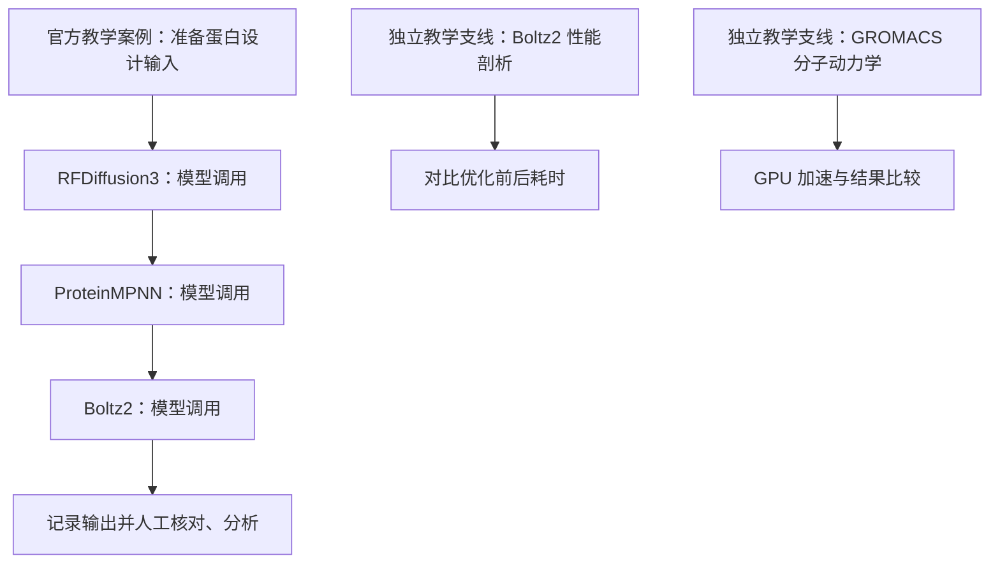

# 沐曦 AI4S：国产 GPU 加速科研线上实战营（Metax AI4S Science Camp）

## 一句话定义

**沐曦 AI4S 科研实战营**是沐曦与 AI Infra、Datawhale 等社区联合主办的线上课程活动，围绕蛋白质设计、科研 Agent Skill 与国产 GPU 计算优化开展六场教学；这里归档的是**主办方发布的课程计划**，不是已完成的实验报告。

## 英文缩写速查

| 缩写 | 英文全称 | 简要说明 |
|---|---|---|
| AI4S | AI for Science | 用 AI 工具与计算模型辅助科研 |
| GPU | Graphics Processing Unit | 支撑模型推理与分子动力学加速的计算硬件 |
| MIM | Model Inference Management | 官方页面出现的科学模型服务入口名称；具体实现以课程资料为准 |
| Skill | Agent Skill | 将科学模型调用整理为智能体可复用工具 |

## 为什么重要

科研智能体不是只回答问题，还要将科学模型的输入、计算、结果核对及后续操作串联起来。课程选取蛋白质设计作为教学案例，尝试把模型调用、任务编排、性能剖析与最终交付连成一条学习路径，可对照本站 [Google 自动化湿实验综述](google-grounding-ai-agents-wet-labs.md) 的模型、工具、验证边界。

## 核心原理

官方计划的第六课将 **RFDiffusion3 → ProteinMPNN → Boltz2** 串为蛋白设计示例流程；前三者在官方课表中分别承担按顺序执行的三个模型环节，但课程尚未发布完整输入输出协议，不能自行写死中间文件结构或声称已验证科学有效性。第三课以 Boltz2 进行推理性能分析，第五课以 GROMACS 展示分子动力学 GPU 优化；两者是单独的教学任务，并非必然自动接入蛋白设计工作流。

### 课程计划流程总览

*来源边界：* 这是根据主办方公开的**拟定课表**绘制的教学步骤图，未运行示例、未验证模型间 API；不能当成已经开源的工作流源码图。

## 工程实践

| 时间（2026） | 课程焦点 | 阅读/验收重点 |
|---|---|---|
| 11 月 14 日 | Science Agent 科研新范式 | LLM、科学模型、Skills、Harness 的协作方式 |
| 11 月 15 日 | 科学模型调用与任务编排 | MIM 服务；RFDiffusion3、ProteinMPNN、Boltz2 |
| 11 月 20 日 | AI4S 性能剖析 | Boltz2 与 mcequivalence 优化思路 |
| 11 月 27 日 | AI4S Skills | MIM/OpenScience 模型调用封装 |
| 12 月 4 日 | 分子动力学优化 | GROMACS 与沐曦 GPU 加速 |
| 12 月 11 日 | 科研智能体完整实践 | 串联蛋白设计示例、记录并分析结果 |

**源码运行时序图：不适用（截至 2026-11-13 主办方活动页没有公开统一的可运行课程源码入口）**。如后续课程公布仓库和执行脚本，应先阅读入口源码，再补相应 sequenceDiagram，不能用预期流程冒充运行时序。

## 局限与风险

- 页面所列时间为拟定安排；截至 2026-11-13 开营日期尚未到来，教材、回放与所有结果尚不能视为已公开。
- 官方未给出可复现运行环境清单、训练/推理 benchmark 或统一源码仓库；不宣称某一性能提升百分比。
- 生物设计的输出还需专业验证；本课程计划中的“模型输出”不能自动等同于经过实验确证的科学发现。

## 关联页面

- [Google Research：自动化湿实验的构件](google-grounding-ai-agents-wet-labs.md) — 模型、执行与验证的前沿研究。
- [AI Scientists' Last Exam](paper-ai-scientists-last-exam.md) — 科学智能体评价需要可核查的结果与验证器。
- [Agentic Aptamer Sandbox](paper-agentic-aptamer-sandbox.md) — 分子实验反馈闭环的对照案例。

## 参考来源

- [主办方活动原文归档](../../sources/sites/metax-ai4s-science-camp.md) — 已完整核对活动介绍与课表，尚非全部课程讲义。
- [沐曦开发者官方活动页面](https://developer.metax-tech.com/activities/40) — 报名、学习目标与六节课计划。

## 推荐继续阅读

- [主办方课程与活动通知](https://developer.metax-tech.com/activities/40) — 后续讲义、源码和时间改动以官方披露为准。
