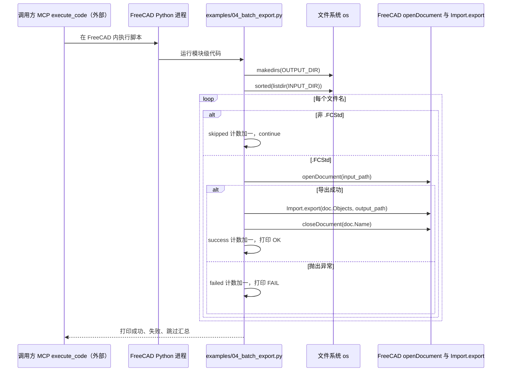

# FreeCAD Automation Skill（miaooo0000OOOO）（miaooo0000OOOO/freecad-automation-skill）

## 一句话定义

FreeCAD Automation Skill（miaooo0000OOOO）（miaooo0000OOOO/freecad-automation-skill）是与 Cai-aa 的同名仓库是不同实现：该仓库描述含 FreeCAD 宏、Hermes Agent MCP、Spreadsheet 参数驱动，以及 Part/PartDesign、装配、TechDraw、STEP/STL。

## 英文缩写速查

| 缩写 | 英文全称 | 简要说明 |
|------|----------|----------|
| CAD | Computer-Aided Design | 计算机辅助设计与几何建模 |
| MCP | Model Context Protocol | 代理调用 CAD/可视化工具的协议 |
| FEM | Finite Element Method | 结构有限元分析方法 |

## 为什么重要

对 CAE 自动化而言，代理能否稳定完成任务，取决于工程步骤是否清楚、工具边界是否明确、结果是否保留可审查证据。与 Cai-aa 的同名仓库是不同实现：该仓库描述含 FreeCAD 宏、Hermes Agent MCP、Spreadsheet 参数驱动，以及 Part/PartDesign、装配、TechDraw、STEP/STL。

## 核心原理

**项目自身范围：** FreeCAD automation skill with macros and Hermes Agent MCP integration.

**工作流：** 代理使用技能/宏构造参数化零件或装配，再通过表格参数和 MCP 工具调整设计并导出。

**仓库映射说明：** 文章未给出该项目完整的 owner/repository URL；此处按文章中的项目名/描述与公开 GitHub 仓库匹配。引用时请以本页链接的仓库 README 为准。

## 工程实践

1. 从目标问题识别所需的 Skill、MCP、CLI 或软件接口，不把指导文件当成求解器。
2. 依照仓库 README 检查安装前提、软件/许可证、输入文件和输出证据。
3. 小规模运行并逐项核对几何、网格、边界、求解状态和物理量，再决定是否扩大任务。

文章所述的项目特征：与 Cai-aa 的同名仓库是不同实现：该仓库描述含 FreeCAD 宏、Hermes Agent MCP、Spreadsheet 参数驱动，以及 Part/PartDesign、装配、TechDraw、STEP/STL。

## 局限与风险

作者说明它基于 solidworks-automation-skill 重构；应单独核查具体客户端集成和 FreeCAD 版本，不与 Cai-aa 版本合并。

源码状态核验：该 GitHub 仓库于 2026-10-07 可公开访问。仓库 API 报告许可证为 MIT。 涉及商业软件时，安装包和有效许可证需由使用者自行提供。

## 源码运行时序图

入口：在 FreeCAD 1.1+ 的 Python 环境中执行 `examples/04_batch_export.py`（examples/README 写明示例通过 MCP `execute_code` 运行；MCP 桥接 addon 不在本仓库内，下图标为外部调用方）

图依据：miaooo0000OOOO/freecad-automation-skill@e68f4ee，实际读过 README.md、examples/README.md、examples/04_batch_export.py、setup.py；未运行代码。

## 关联页面

- [CAE / CFD 代理工具项目总览](../overview/cae-cfd-agent-skills-landscape.md)
- [FreeCAD Automation Skill（Cai-aa）](./cai-aa-freecad-automation-skill.md)

## 参考来源

- [公众号文章原始资料归档](../../sources/blogs/wechat_cae_cfd_agent_skills_2026-10-07.md)
- [GitHub 仓库资料归档](../../sources/repos/miaooo0000oooo-freecad-automation-skill.md)
- [miaooo0000OOOO/freecad-automation-skill 官方仓库](<https://github.com/miaooo0000OOOO/freecad-automation-skill>)
- 源码核对（2026-11-02）：miaooo0000OOOO/freecad-automation-skill@e68f4ee，读过 README.md、examples/README.md、examples/04_batch_export.py、setup.py；时序图依据以上文件，未运行代码。

## 推荐继续阅读

- [项目 README](<https://github.com/miaooo0000OOOO/freecad-automation-skill/blob/main/README.md>)