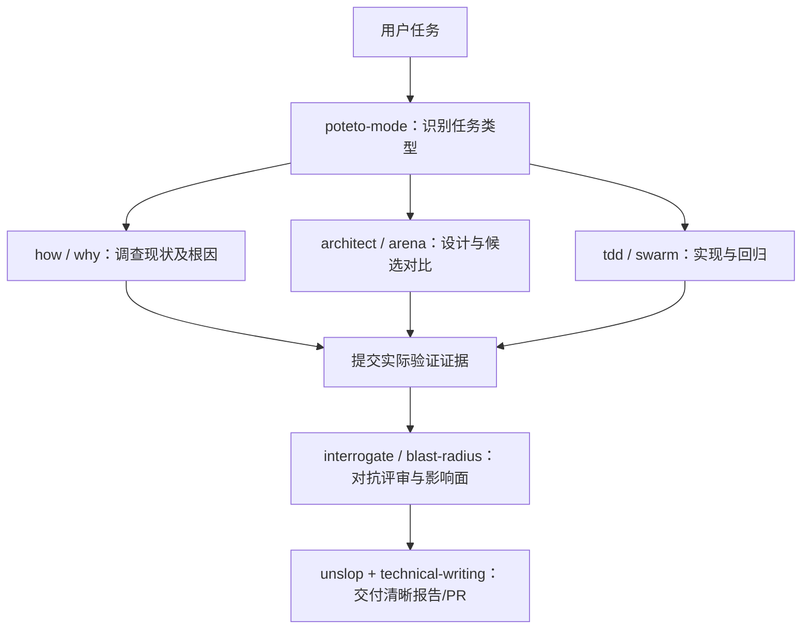
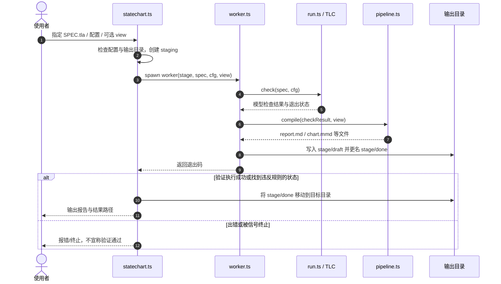

# pstack-claude（Michael Denyer）/ Cross-harness pstack

## 一句话定义

**pstack-claude** 是 Lauren Tan 原始 [pstack](https://github.com/cursor/plugins/tree/main/pstack) 的跨 Agent 宿主移植版：将架构推演、并行候选、差异审查、根因调查、形式化状态检查等流程打包为可选择的技能，由 `poteto-mode` 按任务类型路由。

## 英文缩写速查

| 缩写 | 英文全称 | 简要说明 |
|---|---|---|
| CLI | Command-Line Interface | Claude Code、Pi、Codex 等宿主的命令行操作入口 |
| PR | Pull Request | pstack 的评审、CI 修复与发版操作对象 |
| CI | Continuous Integration | `fix-ci` 等技能核实的自动化构建与测试结果 |
| TLA+ | Temporal Logic of Actions | `statechart` 用于检查状态迁移与不变量的规格语言 |
| TLC | TLA+ Model Checker | `statechart` 实际调用的状态空间检查器 |

## 为什么重要

- **让任务选择适当工作流：** 在 `poteto-mode` 中按任务性质区分 bug 根因定位、功能规划、争议方案评审及 PR 维护，不把任何一次修改都塞进同一通用 prompt。
- **以证据而非描述判断完成：** `tdd`、`blast-radius`、`statechart`、`interrogate` 分别覆盖回归测试、影响范围、状态不变量与差异审查；这些是技能指导的执行步骤，成功依赖所连接宿主的工具与实际运行证据。
- **与两类技能包形成分工：** [Addy Osmani Agent Skills](agent-skills-addyosmani.md) 覆盖 DEFINE→SHIP 的完整生命周期；[Matt Pocock Skills](mattpocock-skills.md) 侧重轻量组合和领域共享语言；pstack 更强调 **任务路由、专门 playbook、跨模型/子代理校验、跨宿主适配**。
- **面向机器人软件的启示：** 可借鉴“状态不变量→可复验工具→人审证据”的组织方式，用于 ROS2 状态机与部署流水线；上游并没有提供机器人真机安全证明。

## 核心原理

### 组件与边界

| 层 | 已核对的入口 | 作用 |
|---|---|---|
| 任务入口 | `plugins/pstack/skills/poteto-mode/SKILL.md` | 根据请求选用调查、实现、审查或运维 playbook |
| 技能包 | `plugins/pstack/skills/*/SKILL.md` | `architect`、`arena`、`interrogate`、`statechart`、`unslop` 等 |
| 接入层 | `plugins/pstack/hooks/` 与 runtime mappings | SessionStart 注入路由提示；各宿主能力与名称分别映射 |
| Pi 专用扩展 | `plugins/pstack/pi/index.ts` | 为 Pi 接入子代理、问题、唤醒与 loop |
| 实际验证工具 | `plugins/pstack/skills/statechart/scripts/` | 将 TLA+ 模型检查结果编成 Mermaid 图和报告 |

### 流程总览

以下为官方 README 与 `poteto-mode` 中的 **通用任务路由概览**；按任务只走有关分支，不要求每次调用全部技能。

## 工程实践

**安装：** Claude Code 用 `/plugin marketplace add michael-denyer/pstack-claude` 与 `/plugin install pstack@pstack-claude`；Codex 用 `codex plugin marketplace add michael-denyer/pstack-claude`、`codex plugin add pstack@pstack-claude`；Pi 用 `pi install git:github.com/michael-denyer/pstack-claude`。各宿主安装命令、版本和模型角色设置应核对 [官方 README](https://github.com/michael-denyer/pstack-claude) 与 [参考文档](https://github.com/michael-denyer/pstack-claude/blob/main/docs/reference.md)。

**可复验示例：** 使用 `statechart` 需要先由使用者写入 TLA+ 的 `SPEC.tla` 与 `SPEC.cfg`（含不变量）；技能的真实脚本入口为 `plugins/pstack/skills/statechart/scripts/statechart`，核心实现 `statechart.ts`。其输出为状态图与验证报告，不是机器人运动控制轨迹。

### 源码运行时序图（已核对 statechart.ts / worker.ts）

**判读：** 官方 `statechart.ts` 将 TLC 的“全部通过 / 发现违反 / 工具运行错误”区分退出码，并将生成文件先写入隔离目录；这比画一张未经运行的状态图有更清晰的证据边界。

## 局限与风险

- **不是模型或机器人控制框架：** 仅提供 Agent 技能、宿主连接和辅助验证脚本；部署真机仍需自身的硬件安全、仿真回归与实时性测试。
- **跨宿主能力不是完全等价：** 子代理、会话 hook、可用模型、工具名与验证能力因 Claude Code、Codex、Pi、Copilot 等而异；部分适配文档明确标注尚未实测模型执行合规性。
- **隐私：** 官方称本身没有服务端或遥测，但技能读取的信息仍可能发送到用户选用的模型服务商，决策日志若被提交到 PR 也会公开给该 PR 的可见成员；共享前须去敏。
- **验证工具有限制：** `statechart` 需要 TLA+ 规格、TLC/Java 环境；检查结果只覆盖所建模的不变量，不能取代完整系统测试。

## 关联页面

- [Agent Skills（addyosmani）](agent-skills-addyosmani.md) — 生命周期与质量门禁型技能包。
- [Skills For Real Engineers（mattpocock）](mattpocock-skills.md) — 轻量组合、grill 与领域术语协同。
- [Superpowers（obra）](superpowers-obra.md) — 强制流程、worktree 与 TDD 对照。
- [Coding Agent 信任金字塔](../concepts/agentic-coding-trust-pyramid.md) — 先结构化约束、再用运行时证据建立信任。
- [Coding Agent 验证闭环](../methods/coding-agent-verification-loops.md) — 从测试到端到端验证的工程证据。
- [Agentic Manipulation Policies](../methods/agentic-manipulation-policies.md) — 机器人上层 Agent 工具执行与逐步验证的对照；pstack 并不直接控制机器人。

## 参考来源

- [pstack-claude 原文核对归档](../../sources/repos/michael-denyer-pstack-claude.md)
- [官方 GitHub 仓库](https://github.com/michael-denyer/pstack-claude)
- [原始 Cursor pstack](https://github.com/cursor/plugins/tree/main/pstack)
- [官方 README 与参考手册](https://github.com/michael-denyer/pstack-claude/blob/main/docs/reference.md)

## 推荐继续阅读

- [poteto-mode 主工作流](https://github.com/michael-denyer/pstack-claude/blob/main/plugins/pstack/skills/poteto-mode/SKILL.md)
- [statechart 技能说明](https://github.com/michael-denyer/pstack-claude/blob/main/plugins/pstack/skills/statechart/SKILL.md)
- [statechart 可执行源码](https://github.com/michael-denyer/pstack-claude/blob/main/plugins/pstack/skills/statechart/scripts/statechart.ts)
