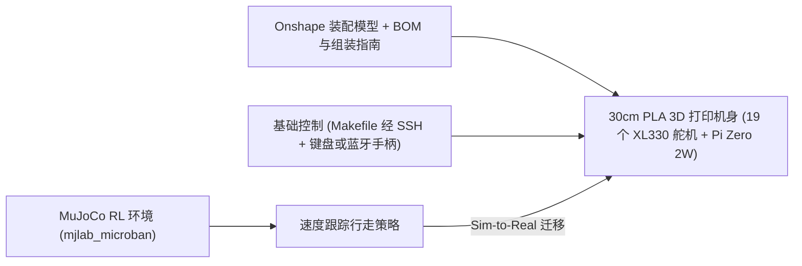
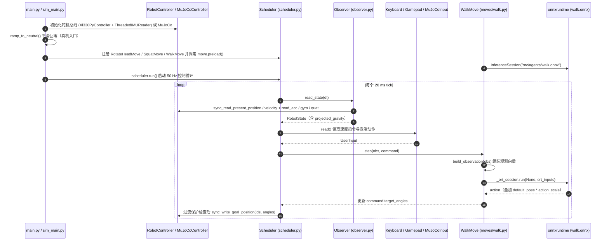

# Microban

## 一句话定义

**Microban** 是 Rhoban 团队（法国波尔多大学 LaBRI）开发的约 30 cm 高开源人形机器人，主仓库 [Rhoban/microban](https://github.com/Rhoban/microban)，RL 环境 [Rhoban/mjlab_microban](https://github.com/Rhoban/mjlab_microban)。

## 英文缩写速查

| 缩写 | 英文全称 | 简要说明 |
|------|----------|----------|
| BOM | Bill of Materials | 物料清单 |
| RL | Reinforcement Learning | 强化学习 |
| PLA | Polylactic Acid | 常见 3D 打印耗材 |
| SSH | Secure Shell | 远程登录/控制协议 |

## 为什么重要

- 低成本（<$600）+ 有真机可迁移的 RL 行走策略，是少见「从零自己做人形并做 sim-to-real」的学生/爱好者入口。
- 在微信文章《想进入机器人领域吗？学习这18个开源项目就够了》中排第 **1** 位。

## 核心要点（据文章）

- 硬件：19 个 Dynamixel XL330-M288-T 舵机 + Raspberry Pi Zero 2W，全部结构件可在桌面 3D 打印机上用 PLA 打印。
- 成本与文档：官方目标成本 550–600 美元，提供完整 BOM、购买链接、Onshape 装配模型和逐步组装指南。
- 软件：通过 Makefile 经 SSH 控制，支持键盘或蓝牙手柄；独立的 MuJoCo RL 环境 mjlab_microban 已实现可迁移到真机的速度跟踪行走策略。

## 工程实践

- 入门路径（文章建议）：先按 BOM 打印并组装，再用 Makefile + 手柄调通，最后用 mjlab_microban 训练速度跟踪策略做 sim-to-real。
- 以上规格与许可证均出自文章叙述，**未逐项核对官方仓库**；动手前请以官方 README/BOM 为准。

## 机制与架构图

## 源码运行时序图

入口：真机部署经 `Makefile`（`make run`）在树莓派执行 `src/main.py`；本地仿真经 `make sim` 执行 `src/sim/sim_main.py --hz 50`（加载 `src/model/mjcf/scene.xml` 与 `bam` 执行器模型）。两条路径共用 `Scheduler` 与 `WalkMove`（`src/agents/walk.onnx`）：

图依据：`Rhoban/microban`（`main` 分支）`Makefile`、`src/main.py`、`src/robot_controller.py`、`src/scheduler.py`、`src/observer.py`、`src/moves/walk.py`、`src/sim/sim_main.py`、`src/sim/mujoco_controller.py`。

## 局限与风险

- 本页仅基于一篇第三方公众号文章，规格数字可能随版本变化。
- 仓库迁移、分叉和许可证以官方当前状态为准。

## 关联页面

- [策略优化](../methods/policy-optimization.md) — 延伸阅读，了解策略学习的优化目标。
- [强化学习](../methods/reinforcement-learning.md) — 延伸阅读，了解基于奖励的策略训练。
- [humanoid-robot](./humanoid-robot.md)
- [open-source-humanoid-hardware](./open-source-humanoid-hardware.md)
- [mujoco](./mujoco.md)
- [机器人开源项目 18 例（微信 GitHubStore）索引](../overview/robot-open-source-wechat-githubstore-18-projects.md)

## 推荐继续阅读

- [Rhoban/microban](https://github.com/Rhoban/microban)

## 参考来源

- [wechat_githubstore_18_open_source_robot_projects.md](../../sources/blogs/wechat_githubstore_18_open_source_robot_projects.md)
