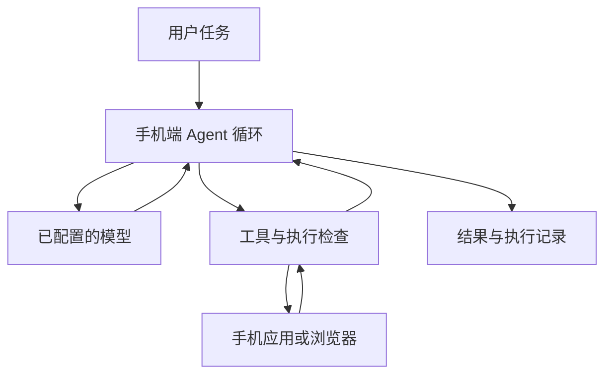
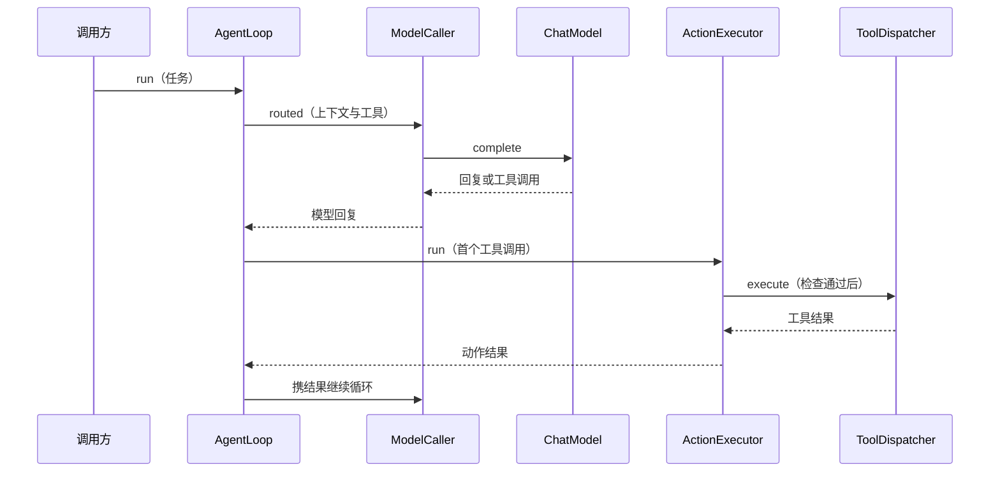

# Mika（Android 手机智能体）

## 一句话定义

Mika 是运行在 Android 手机上的开源助手，通过模型与工具循环操作手机应用、网页和文件。

## 英文缩写速查

| 缩写 | 英文全称 | 简要说明 |
|---|---|---|
| API | Application Programming Interface | 连接模型服务的接口 |
| APK | Android Package Kit | Android 安装包 |
| MCP | Model Context Protocol | 电脑侧连接手机任务服务的方式之一 |
| CLI | Command-Line Interface | 电脑侧命令行入口 |

## 流程总览

应用可在独立后台屏幕执行操作；支持应用、网页、定时任务、记忆及 arm64 Linux 沙箱。任务过程可供用户查看和中断。模型既可使用远程服务，也可连接本地网络上的模型服务；手机端运行不代表推理一定在手机本地。

## 源码运行时序图

图展示 `AgentLoop.run` 内的一次普通工具调用，依据固定版本的 `AgentLoop.kt`、`ModelCaller.kt` 和 `ActionExecutor.kt`；并非全部分支。应用入口到手机控制实现尚未完整追踪。

## 工程实践与局限

- Android 11 起可使用聊天、网页和文件；操作手机应用需要 Android 12，官方建议 Android 14 或更新版本。首次手机控制需配对无线调试或通过 USB 启动助手。
- 仓库以 Apache-2.0 发布。模型需要支持工具调用；选择外部服务时，内容和屏幕信息会发送给所选模型提供方。项目称没有 Mika 自有服务器。
- 默认 Ask 模式仅在下单或付款等花钱操作前确认；发送、提交和删除等动作会直接执行。自主模式连付款也不询问。
- 密码、付款等禁止截图的界面可能需要人工接管；自动操作第三方服务可能受其条款限制。尚未进行真机验证，完整手机侧执行链待核对。

## 关联页面

- [Agent Autoloop](./agent-autoloop.md)：事件驱动的命令行智能体调度。
- [LangGraph](./langgraph.md)：有状态智能体工作流编排。

## 参考来源

- [源码归档与核查范围](../../sources/repos/mika.md)
- [README 固定版本](https://github.com/wangzan101/Mika/blob/8d97468a75917a7966792dc486a5632971f26e7e/README.md)
- [功能说明固定版本](https://github.com/wangzan101/Mika/blob/8d97468a75917a7966792dc486a5632971f26e7e/docs/features.en.md)
- [AgentLoop](https://github.com/wangzan101/Mika/blob/8d97468a75917a7966792dc486a5632971f26e7e/core/src/main/kotlin/com/wangzan101/mika/core/agent/AgentLoop.kt)、[ModelCaller](https://github.com/wangzan101/Mika/blob/8d97468a75917a7966792dc486a5632971f26e7e/core/src/main/kotlin/com/wangzan101/mika/core/agent/ModelCaller.kt)、[ActionExecutor](https://github.com/wangzan101/Mika/blob/8d97468a75917a7966792dc486a5632971f26e7e/core/src/main/kotlin/com/wangzan101/mika/core/action/ActionExecutor.kt)

## 推荐继续阅读

- [手机控制设置指南](https://github.com/wangzan101/Mika/blob/8d97468a75917a7966792dc486a5632971f26e7e/docs/setup-guide.en.md)
