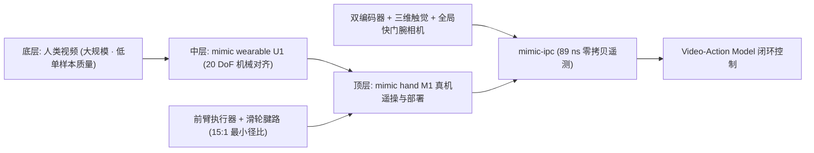

# mimic hand M1

| 字段 | 内容 |
|------|------|
| **机构** | 迷可机器人 Mimic Robotics（瑞士） |
| **类型** | 产业自研闭源腱驱动灵巧手（2026-07-16 官方博客发布） |
| **配对采集** | [mimic wearable U1](./mimic-wearable-u1.md)（umimic，运动学/传感 1:1） |
| **开放状态** | 硬件/固件/`mimic-ipc` 商业闭源；仅重定向研究基准 `mimic_retargeter_lab` 开源 |

**mimic hand M1** 是 **mimic robotics** 为 **通用人形尺度灵巧操作** 自研制造的 **高度后驱、滑轮导向腱驱动** 工业灵巧手：以 **人手固定形态** 贯通人类视频预训练、[U1 外骨骼](./mimic-wearable-u1.md) 中层采集与真机部署，利用 **前臂执行器 + 线性滑轮腱路** 同时覆盖 **50 g 级精细力感知** 与 **>25 kg 稳态抓握**。

## 一句话定义

**瑞士自研、AI-first 的 21 DoF（15 主动 + 6 耦合）滑轮腱驱动工业灵巧手，结合双编码器力估计、多维指尖触觉与全局快门腕相机，服务全栈固定人手形态的 Video-Action 学习与工业班次级部署。**

## 英文缩写速查

| 缩写 | 英文全称 | 简要说明 |
|------|----------|----------|
| DoF | Degrees of Freedom | 独立可控运动轴；M1 为 15 主动 + 6 耦合共 21 DoF |
| MCP / PIP / DIP | Metacarpophalangeal / Proximal·Distal Interphalangeal | 掌指 / 近端·远端指间关节 |
| CMC | Carpometacarpal Joint | 腕掌关节，决定拇指对掌灵活性 |
| VAM | Video-Action Model | mimic 主打的视频潜空间规划 + 动作解码策略路线 |
| IPC | Inter-Process Communication | 进程间通信；mimic 自研低抖动零拷贝 `mimic-ipc` 中间件 |
| AMR | Autonomous Mobile Robot | 自主移动机器人；mimic 工位可架设于固定台或 AMR 上 |

## 为什么重要

- **同一机构兼顾精细力敏与工业重载：** 官方博客指出掌内集成电机手在 **后驱性 vs 持续扭矩** 上难以兼得；M1 将执行器后置至前臂并采用滑轮导向腱驱动，在同一只手上实现 **<0.05 Nm** 反驱扭矩（可由电流感知 **50 g** 级载荷）与 **>25 kg** 圆柱强力抓握。
- **全链路固定人手形态消除预/后训练鸿沟：** 与 [mimic-video](../methods/mimic-video.md) 一致，mimic 主张以人手作为预训练（人类视频）到后训练（U1 外骨骼与 M1 真机）的统一形态载体，避免传统「人手视频预训练 + 二指夹爪微调」引起的策略迁移失配。
- **高可观测性与工业级耐用设计：** 电机与关节双编码器实现 **<0.1 N** 单向接触力估计与 **±0.18 mm** 闭环指尖定位（关节背隙 **<0.3°**），配合 **45° 过伸裕度**、**0.7 m³/min 主动风冷** 与可穿戴工业工作手套（work gloves），面向装配、包装分拣与复杂手工作业等高碰撞产线班次。

## 核心原理

### 机械架构与全量规格

| 维度 | 官方博客（2026-07-16）核对规格 |
|---|---|
| 制造与属性 | 瑞士自研自产，商业闭源工业硬件 |
| 驱动与路由 | **双向、滑轮导向腱驱动**（前臂电机布局，非 Bowden 管；轴承/滑轮降摩擦，最小滑轮-肌腱直径比 **15:1**） |
| 自由度（DoF） | **15 主动 + 6 耦合 = 21 DoF** |
| 关节活动范围（RoM） | 四指 **MCP 135°**、外展/内收 **up to 55°**、**PIP 135°**、**DIP 130°**；拇指 **CMC1 90°**、**CMC2 70°**、**MCP 100°**、**IP 110°**；支持 **45° 过伸** |
| 后驱性与背隙 | 反驱扭矩 **< 0.05 Nm**；关节背隙 **< 0.3°**；电流侧可感知 **50 g** 级载荷 |
| 力与定位精度 | 双编码器（电机+关节）估计单向接触力 **< 0.1 N**；指尖闭环定位 **± 0.18 mm** |
| 出力与负载 | 单指伸直稳态指尖力 **25 N**；圆柱强力抓握稳态载荷 **> 25 kg** |
| 散热与防护 | 主动风冷（**0.7 m³/min**）；支持穿戴工业工作手套（work gloves） |
| 触觉与视觉 | 法向力、切向剪切力与多点接触位置感知；全局快门、时间同步腕部相机 |

**结构取舍：** 指尖保持人形接触几何以便迁移人类操纵先验，腕部刻意加宽以容纳低摩擦线性滑轮腱路由——由于腕部处于腕相机视场后方，对视觉策略观测几乎无遮挡影响。

### 软件与控制栈（同源全栈）

- **低延迟通信（`mimic-ipc`）：** 自研零拷贝硬实时中间件，官方博客报告其跨核中位延迟 **89 ns**，在高清图像传输上较 ROS2 FastDDS shared memory 提速约 **18,000×**，在 232 B 控制话题上抖动降低约 **350×**，并统一驱动持久化异步遥测与机队预测性维护。
- **采样式重定向（Smooth Operator / SBR）：** 为解决 15 主动 DoF 灵巧手遥操作抖动与奇异位形问题，团队开源了 [Smooth Operator](https://mimicrobotics.github.io/smooth-operator/) 研究快照（代码仓库 `mimic_retargeter_lab`，`arXiv:2607.07491`）。
- **模型栈对接：** 官网时间线显示 M1/U1 与 **mimic-video**、**FLUX-mimic**（与 Black Forest Labs 合作）、**LAD**（CoRL 2025）、**mimic-one**（CoRL 2025，16-DoF 灵巧手达成 **93.3%** 成功率）等研究工作共同服务于 VAM 与 [模仿学习](../methods/imitation-learning.md) 部署。

## 源码运行时序图

**不适用** — 经核查官网首页（`https://www.mimicrobotics.com/`）与发布博客全文（2026-07-16），**mimic hand M1** 的硬件 CAD、底层固件、双编码器力估计器、`mimic-ipc` 零拷贝通信中间件及商用部署代码均属**商业闭源专有系统**，无公开可运行控制仓库。团队仅在研究侧公开了采样重定向实验室快照 [mimic_retargeter_lab](https://github.com/mimicrobotics/mimic_retargeter_lab)，无法据此验证 M1 真机驱动与控制器运行入口。

## 工程实践

- **系统开放边界：** M1 硬件/固件/`mimic-ipc` 均未开源；官方商用交付采用 **Intro call → Use-case analysis → Deploy & scale** 流程，以 1 臂或 2 臂的固定工作台或 AMR 移动工作站形式落地（平台无关，覆盖 Assembly、Packaging & Sorting 与 Complex Manual Tasks）。
- **数据与遥操链路：** 产线外场高通量示范优先使用运动学/传感 1:1 匹配的 [mimic wearable U1](./mimic-wearable-u1.md) 采集，顶层真机微调与闭环遥操作则由 M1 + `mimic-ipc` + Smooth Operator 承担。
- **维护工程化：** 摒弃摩擦随腕角和循环次数漂移的 Bowden 管，通过最小 **15:1** 滑轮-肌腱比与主动风冷维持长期标定稳定性与连续班次散热。

## 局限与风险

- **完全依赖商业闭源栈：** 无公开硬件图纸、固件或 SDK，学术与第三方团队无法自行复刻 M1 本体或独立验证 `mimic-ipc` 厂商自报性能指标。
- **腕部体积增加：** 线性滑轮腱路导致前臂与腕部尺寸加宽，在极窄腔体伸入或双臂极近距协同场景需额外碰撞包络规划。
- **与开源科研手定位差异：** 相较可低成本 3D 打印或模块化采购的 [Allegro Hand](./allegro-hand.md) 与 [RUKA-v2](./ruka-v2-hand.md)，M1 瞄准高单价工业部署闭环而非开放科研普及。

## 与其他页面的关联

- [mimic wearable U1](./mimic-wearable-u1.md) — 与 M1 1:1 机械与传感对齐的被动外骨骼采集器
- [mimic-video（VAM）](../methods/mimic-video.md) — 同公司视频-动作模型策略路线
- [Manipulation 任务](../tasks/manipulation.md) — 灵巧手多指精细与重载操作场景
- [Teleoperation](../tasks/teleoperation.md) — 顶层真机遥操作与中层 U1 示范对照
- [Imitation Learning](../methods/imitation-learning.md) — 支撑 M1 数据金字塔学习的策略范式
- [Motion Retargeting](../concepts/motion-retargeting.md) — 平滑重定向（Smooth Operator）在 15-DoF 手上的作用
- [Tactile Sensing](../concepts/tactile-sensing.md) — 法向/切向触觉与双编码器力估计算法对照
- [Kyber Labs](./kyber-labs.md) — 另一条可后驱产业灵巧手工程路线

## 参考来源

- [Solving Dexterity: A Full-Stack Approach 博客核对归档](../../sources/blogs/mimicrobotics_m1_u1_full_stack.md)
- [mimicrobotics.com 官方站点与开源边界核查](../../sources/sites/mimicrobotics.md)

## 推荐继续阅读

- 官方发布博客全文：<https://www.mimicrobotics.com/blog/solving-dexterity-a-full-stack-approach>
- Smooth Operator 重定向项目页：<https://mimicrobotics.github.io/smooth-operator/>
- mimic 官网与 VAM 研究线：<https://www.mimicrobotics.com/>
