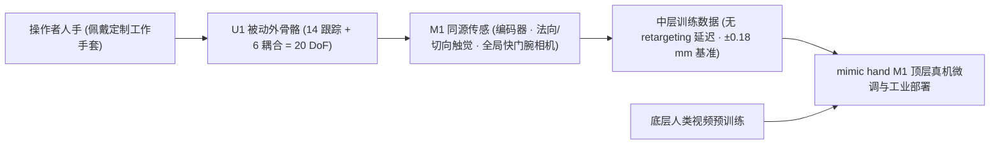

# mimic wearable U1（umimic）

| 字段 | 内容 |
|------|------|
| **机构** | 迷可机器人 Mimic Robotics（瑞士） |
| **类型** | 商业闭源被动外骨骼示范采集器（2026-07-16 与 M1 同期发布） |
| **别名** | umimic |
| **目标硬件** | [mimic hand M1](./mimic-hand-m1.md) |

**mimic wearable U1**（简称 **umimic**）是 **mimic robotics** 为突破真机遥操作规模瓶颈设计的 **固定运动学被动外骨骼**：操作者直接用人手驱动刚性连杆机构，被机械约束至与 [mimic hand M1](./mimic-hand-m1.md) 完全匹配的运动空间，并同步采集与 M1 一致的 **触觉、关节编码器与腕部相机观测**，实现脱离真机硬件的外场高保真灵巧示范采集。

## 一句话定义

**与 mimic hand M1 运动学、活动范围、触觉与腕相机 1:1 对应的 20 DoF（14 跟踪 + 6 耦合）被动外骨骼，通过机械硬约束取代软件重定向，在无真机条件下高效采集 mimic 数据金字塔中层示范。**

## 英文缩写速查

| 缩写 | 英文全称 | 简要说明 |
|------|----------|----------|
| UMI | Universal Manipulation Interface | 无机器人手持夹爪采集范式；U1 将其拓展至多指灵巧手 |
| DoF | Degrees of Freedom | 自由度；U1 跟踪 14 主动等效轴 + 6 耦合轴共 20 DoF |
| RoM | Range of Motion | 关节活动范围；U1 连杆与 M1 关节角限位保持机械一致 |
| IL | Imitation Learning | 模仿学习；观测模态一致性决定可穿戴数据微调上限 |
| Teleop | Teleoperation | 真机遥操作；U1 用于分担其高硬件占用与低吞吐痛点 |

## 为什么重要

- **将 UMI 无真机数采范式拓展至多指灵巧操作：** 传统手持式夹爪采集器无法表达复杂手内操作，而直接遥操作多指机械手受限于软件重定向误差、视觉延迟与昂贵真机占用；U1 允许操作者不连接任何机器人本体，在真实产线或野外以近人类原生速度采集 20 DoF 灵巧示范。
- **填补 mimic 数据金字塔中层空白：** 在 mimic 的全栈路线中，人类视频（底层）规模大但缺少精确关节与力觉对齐，真机遥操作（顶层）质量高但成本高昂；U1 处于中层，提供比任意第一视角视频对齐度高得多、且比部署成百上千台 M1 真机更易横向扩容的高质量示范流。
- **零重定向误差与统一观测模态：** U1 直接输出与 M1 同构的关节编码器轨迹、指尖法/切向触觉、全局快门腕相机画面与工业手套摩擦界面，消除策略迁移时常见的视角偏移与软件 retargeting 抖动。

## 核心原理

### 机械耦合与传感规格

| 维度 | 官方博客（2026-07-16）核对规格 |
|---|---|
| 驱动方式 | **被动外骨骼**（操作者人手主动施力驱动连杆） |
| 自由度（DoF） | **14 跟踪 + 6 耦合 = 20 DoF**（与 M1 可达运动空间对齐） |
| 运动学与 RoM | 刚性连杆 **机械硬约束** 1:1 映射，强制贴合人手与 M1 共同可实现运动及关节限位 |
| 拇指人体工学 | 拇指 CMC 对掌最具挑战：用户拇指位于外骨骼拇指 **上方**，其余四指位于连杆耦合 **后方** |
| 定位参考基准 | 与 M1 对齐的闭环参考基准达 **± 0.18 mm**（关节编码器测量） |
| 触觉与防护 | 指尖法向力、切向剪切力与多点接触；配备可按工业场景定制的工作手套（gloves） |
| 视觉观测 | 时间同步、全局快门 **腕部相机**（与 M1 腕相机等价几何视点） |

**显式设计取舍：** 团队主动放弃「单套装置自适应所有手寸」的复杂调节结构，选择 **固定几何并限定适配手寸范围**，以此换取刚度、零软件重定向延迟与近原生速度操作。

## 源码运行时序图

**不适用** — 经核查官方博客（2026-07-16）与 `mimicrobotics.com` 官网（2026-11-19），**mimic wearable U1（umimic）** 属于**商业闭源硬件采集产品**，其机械 CAD、关节标定固件、触觉与同步腕相机驱动以及与 `mimic-ipc` 对接的采集软件均未向公众开源，无公开仓库可追溯实际运行代码调用时序。

## 工程实践

- **工厂共址外场数采：** 行业跟踪文章指出，Mimic 与制造伙伴合作让产线技工直接佩戴外骨骼手套在真实工位执行作业，无需在采集阶段占用机器人工作站，随后将策略回流部署至同工位 [mimic hand M1](./mimic-hand-m1.md)（见第三方参考 [LeoInAI 行业梳理](../../sources/blogs/leoinai_humanoid_robot_datacollection_2026-09-06.md)）。
- **手套与环境一致性：** 通过为 U1 与 M1 装配相同的定制工业工作手套，并使腕相机与手指几何维持在腕部固定位置，尽量缩小可穿戴示范与机器人执行之间的视觉外观与摩擦界面差异。
- **采集人员筛选边界：** 由于采用固定连杆几何而非无限调节结构，工程团队在组织大规模众包或产线采集时需按适配手寸区间筛选操作者，并结合 [数据手套 vs 视觉遥操作](../comparisons/data-gloves-vs-vision-teleop.md) 评估穿戴节拍成本。

## 局限与风险

- **手寸适配区间受限：** 固定几何外骨骼仅匹配特定区间手寸的操作者，手掌过大或过小会产生人体工学干涉或限位不适，限制无门槛大众采集。
- **硬件与采集管线闭源：** 无公开 BOM、CAD 或固件/标定文档，第三方科研团队无法自主复刻或对比其采集吞吐率。
- **仍缺少真实执行器动力学反馈：** 操作者通过自身肌腱与骨骼承受物体重量和撞击，无法直接体会 M1 电机惯量、线缆柔性与热/力矩饱和边界，仍须少量顶层真机 [Teleoperation](../tasks/teleoperation.md) 与闭环微调补齐动力学分布。

## 与其他页面的关联

- [mimic hand M1](./mimic-hand-m1.md) — 1:1 同构目标工业灵巧手
- [mimic-video（VAM）](../methods/mimic-video.md) — 消费 U1 中层示范的 Video-Action 模型
- [Teleoperation](../tasks/teleoperation.md) — 顶层真机遥操作与无真机外骨骼数采对照
- [Manipulation 任务](../tasks/manipulation.md) — 装配、包装分拣等复杂工业手工作业
- [Imitation Learning](../methods/imitation-learning.md) — 示范质量与观测模态对齐的核心应用下游
- [Motion Retargeting](../concepts/motion-retargeting.md) — U1 用机械耦合取代软件 retargeting 的动机
- [灵巧操作数据采集指南](../queries/dexterous-data-collection-guide.md) — 外骨骼方案横向比较
- [数据手套 vs 视觉遥操作](../comparisons/data-gloves-vs-vision-teleop.md) — 穿戴式采集与纯视觉遥操作的系统权衡
- [TwinDEX](./twindex.md) — 同类「外骨骼–同构手 1:1」路线对照（三指构型）

## 参考来源

- [Solving Dexterity: A Full-Stack Approach 博客核对归档](../../sources/blogs/mimicrobotics_m1_u1_full_stack.md)
- [mimicrobotics.com 官方站点与开源边界核查](../../sources/sites/mimicrobotics.md)
- [人形机器人数据采集行业观察（第三方产业对照）](../../sources/blogs/leoinai_humanoid_robot_datacollection_2026-09-06.md)

## 推荐继续阅读

- 官方发布博客：<https://www.mimicrobotics.com/blog/solving-dexterity-a-full-stack-approach>
- UMI 原始手持夹爪范式：<https://umi-gripper.github.io/>
- [人形机器人数据采集产业地图](../queries/humanoid-robot-data-collection-landscape.md)
