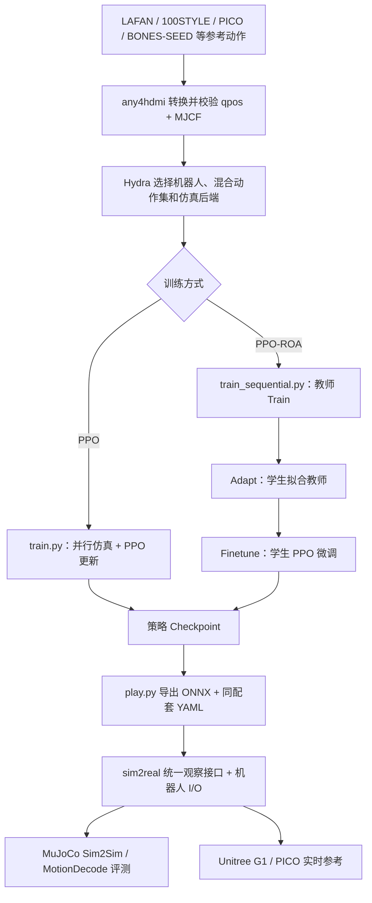
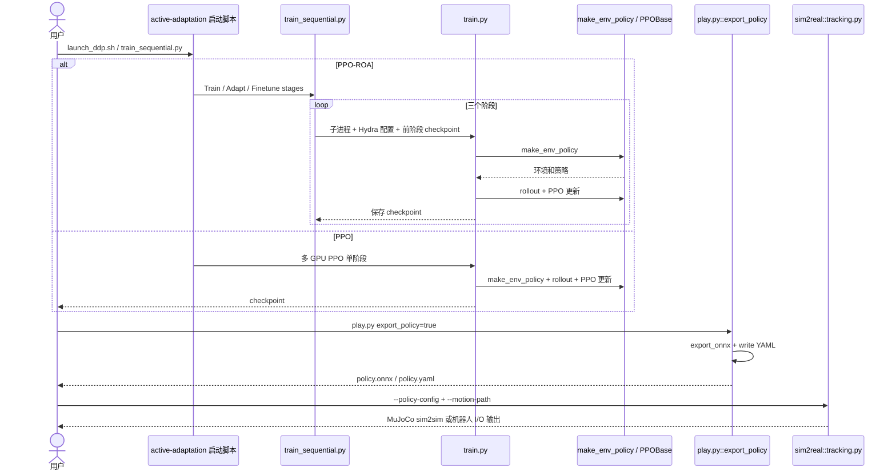

# MimicLite（监督运动跟踪基础设施）

## 一句话定义

**MimicLite** 是 [Party OS](./party-os.md) 首批开源的 **监督学习运动跟踪基础设施**，贯通数据组织、策略训练、统一评测与真机部署，使研究者能以更低算力快速迭代跟踪策略，并将来自不同训练框架的策略接入同一套 sim2real 系统。

## 英文缩写速查

| 缩写 | 英文全称 | 简要说明 |
|------|----------|----------|
| WBT | Whole-Body Tracking | 全身参考运动跟踪训练范式 |
| Sim2Real | Simulation to Real | 仿真策略迁移真机 |
| XR | Extended Reality | 扩展现实，含 Pico 等 VR 遥操入口 |
| YAML | YAML Ain't Markup Language | 用于声明 observation 顺序与参数的配置格式 |
| GPU | Graphics Processing Unit | 训练算力基础 |

## 为什么重要

- **小时级迭代：** 文称 8×RTX 4090、约 3 小时可训练具有强劲跟踪性能的通用策略（约 24 GPU-hours），降低「新数据/新任务验证依赖漫长训练周期」的摩擦。
- **统一数据到部署链路：** any4hdmi + mjhub 减少训练、评测与部署之间的系统差异，让研究者集中迭代 observation、reward、termination 与数据分布。
- **跨 codebase 部署层：** 模块化 observation interface 使 SONIC、HEFT、TeleopIT、Humanoid-GPT、BFM-Zero、TWIST2 等外部策略可沿同一路径完成 matched evaluation、sim2sim 与真机部署——**不仅服务自有训练，也做行业策略的互操作 runtime**。

## 核心原理

### 1. 小时级监督跟踪训练

- **输入：** 统一格式的参考 motion（来自多数据集或真机采集）。
- **机制：** 在并行仿真环境中优化跟踪策略；文称可随并行环境数、GPU 数与模型容量扩展，更大规模训练可提高高动态动作完成度。
- **输出：** 可部署的 tracking policy artifact。
- **文内对标：** 训练成本约为 [SONIC](../methods/sonic-motion-tracking.md) 算力的 ~1/875（自述），全局根部跟踪更好、局部身体跟踪相当——**须以公开复现与 matched evaluation 验证**。

### 2. Tracking Infra：any4hdmi + mjhub

| 组件 | 职责 |
|------|------|
| **any4hdmi** | 将 LAFAN、100STYLE、SONIC、真机数据等不同来源动作组织为 **统一 motion 格式** |
| **mjhub** | 保证机器人 asset 在 **训练、运动学计算、sim2sim 验证** 中的一致性 |

设计重点不是增加零散脚本，而是建立 **稳定、可复现的数据→训练→评测→部署** 管线。

### 3. 遥操与高动态统一 policy

- **低延迟遥操：** 同一 MimicLite policy 支持 Pico/XR 遥操——人体输入实时转为参考运动，再输出低层控制目标。
- **高动态真机：** 单策略可完成行走、转身、侧步、下蹲、跪地等交互动作，以及虎跳衔接肩滚、旋转踢、侧手翻等高动态跟踪。
- **意义：** 把「灵活遥操」与「敏捷运动能力」收敛到 **同一部署 runtime**，减少遥操栈与跟踪栈分裂维护。

### 4. 跨 codebase observation interface

接入外部 codebase 训练的策略时：

1. 实现对应的 **observation class**；
2. 用 **YAML** 定义各项 observation 的顺序与参数；
3. **无需修改** 推理、仿真或机器人接口。

已接入（文内列表）：SONIC、HEFT、[TeleopIT / Teleopit](./paper-teleopit.md)、Humanoid-GPT、BFM-Zero、TWIST2。

### 官方流程总览（RoboParty 文档，第 1–6 章）

以下流程基于 [官方完整使用指南](https://roboparty.com/documents/party-os?doc=mimiclite&lang=zh) 与 `EGalahad/mimic-lite` 实际训练/导出入口，不借用 PartyMimic 的可微世界模型算法。

### 官方源码运行时序图

读过的源码入口为 `EGalahad/mimic-lite/scripts/train.py`、`train_sequential.py`、`play.py`、`eval.py`；运行前需独立克隆 `Agent-3154/active-adaptation` 并将训练仓库放在其 `projects/mimic-lite/` 中。

## 工程实践

| 步骤 | 建议 |
|------|------|
| 数据准备 | 用 [hhtools](./human-humanoid-tools.md) 或 any4hdmi 支持的数据源导入参考动作 |
| 训练 | 8×4090 级配置起步；按需扩展并行环境与模型容量 |
| 评测 | 在 MimicLite 内做 matched evaluation 与 sim2sim，再对比外部 codebase 原始指标 |
| 部署 | 真机或 Pico/XR 遥操；RP1 人形发布后可快速部署（文内叙事） |
| 外部策略接入 | 仅实现 observation class + YAML，复用共享 deployment runtime |

**仓库：** [github.com/Roboparty/MimicLite](https://github.com/Roboparty/MimicLite)

### 仓库现状（核查于 2026-10-27，依据 `Roboparty/MimicLite` README / README_cn.md）

- **性质：** `Roboparty/MimicLite` 是**项目落地页**（最近提交 2026-10-15「Point MimicLite submodule to latest main」），含技术报告 `mimic-lite.pdf`；训练与部署代码在 `.gitmodules` 指向的外部子模块中，浅克隆里这些目录为空。许可 GPL-3.0-or-later，各组件仓库保留各自许可。
- **组件分工（README 表）：** `EGalahad/mimic-lite`（训练、评测、策略导出、任务配置）；`Agent-3154/active-adaptation`（仿真后端、分布式启动器、环境）；`EGalahad/any4hdmi`（动作转换/校验/可视化/数据集工具）；`EGalahad/sim2real`（ONNX 推理、MuJoCo sim2sim、Pico 遥操、Unitree G1 部署）。本页上文的 `mjhub` 来自公众号文章，当前 README 未出现该名称（核查关键词 `mjhub` 无命中）。
- **已发布 checkpoint：** G1（MimicLite v1.1）、H2、A3、RP1 28 DoF、RP1 24 DoF，均为 Finetune 阶段的 ROA student 策略，托管于 Google Drive；训练为 Train/Adapt/Finetune 4000/1000/2000 次更新，G1 v1.1 与 RP1 用 8×8192 环境。所以上文“RP1 发布后可快速部署”现已有 RP1 checkpoint 可查，但 RP1 真机验证状态以子仓库 docs 为准（本页未核）。
- **数据：** 训练数据集在 Hugging Face `any4hdmi` collection；BONES-SEED 因许可不转存，仅提供转换脚本。
- **评测口径：** README 的对比图仅为 **G1**；动作前瞻延迟表（50 Hz）：MimicLite-PPO/ROA 0.08 s，SONIC 0.90 s，BFM-Zero 0.12 s，TWIST2 0.00 s。

### 官方版本与复现实证（2026-11-11 复核）

| G1 官方发布模型 | Actor | 并行环境 | 官方记录 GPU-hours | Motion lookahead |
|---|---|---|---:|---:|
| MimicLite-PPO | 1024×3 | 16×16384 | 92.3 | 0.08 s |
| MimicLite-ROA | 1024×3 | 16×16384 | 173.2 | 0.08 s |
| MimicLite v1.1 ROA student | 512×3 | 8×8192 | 50.106 | 0.08 s |

- 以上数据来自 [实施仓库 README](https://github.com/EGalahad/mimic-lite) 以及 [RoboParty 官方使用指南](https://roboparty.com/documents/party-os?doc=mimiclite&lang=zh)，**不是**「8×4090 约 3 小时」的同一实验；后者是项目总述。
- v1.1 Train / Adapt / Finetune 分别是 **4000 / 1000 / 2000** 次更新。教师可看额外未来参考帧（0.32 s），但部署学生只有 0.08 s 前瞻。
- `sim2real` 统一 MotionDecode 评测包含 **Locomotion-80、Manipulation-48、Ground-60、Dance-40**；完成度与身体误差要同时看，误差只计失败前片段。部署 ONNX 和 YAML 必须来自同次导出。
- 其他机器人的 checkpoint 以 [官方明细](https://github.com/EGalahad/mimic-lite/blob/main/docs/checkpoints.md) 为准；A3 发布包的集成 ONNX / sim2real 验证**仍未完成**，不能从“有权重”推出已证实真机效果。

## 局限与风险

- **监督跟踪边界：** 强依赖参考 motion 质量与分布；与 [UFO](./roboparty-ufo.md) 无监督线互补而非替代。
- **跨 codebase 列表演进：** 接入项目以仓库 README 为准，文内列表可能滞后。
- **性能声明：** 1/875、3h 等数字为公众号自述，跨硬件与任务须独立 benchmark。
- **RP1 依赖：** 部分真机叙事绑定 RoboParty RP1 发布节奏；RP1 总览 README 将 MimicLite 列为 RP1 demo 项目之一。
- **落地页非代码库：** 复现需分别拉取上述子仓库，版本以落地页固定的子模块提交为准。
- **原文阅读边界：** 2026-11-11 已完整通读官方使用指南、英中 README 和配套发布说明，并核对训练/导出核心代码；另有 GitHub 托管的 `mimic-lite.pdf` 技术报告，**本轮未成功取得 PDF 全文**，不声称其已通读。健康度的原文项限定于 frontmatter `original` 指向的已读官方技术文档。

## 关联页面

- [Party OS](./party-os.md)
- [PartyMimic：单卡可微世界模型全身跟踪](./partymimic.md) — 相比 MimicLite 的多 codebase 训练部署基础设施定位，PartyMimic 聚焦 SuperMimic 系可微模型训练配方与单卡评测
- [human-humanoid-tools](./human-humanoid-tools.md)
- [SONIC（规模化运动跟踪）](../methods/sonic-motion-tracking.md)
- [BFM-Zero（论文实体）](./paper-bfm-zero.md)
- [TWIST2（论文实体）](./paper-twist2.md)
- [Teleopit（论文实体）](./paper-teleopit.md) — 文内跨 codebase 列表中的 TeleopIT
- [Teleoperation](../tasks/teleoperation.md)
- [Sim2Real](../concepts/sim2real.md)
- [FB / BFM-Zero / INTACT / Mimic / VLA 任务空间表征对比](../comparisons/fb-bfm-zero-intact-mimic-vla-task-space.md) — Mimic 欧氏曲线投影、termination 与 FSQ 的读法

## 公司路线日期口径

2026-08-31 官方提交公开列出 MimicLite-PPO / MimicLite-ROA；是当前公开版本表记录，不沿用旧 Huge/Base/v1.1 或首批工具链日期。 [日期证据](https://github.com/Roboparty/MimicLite/commit/3963976de8778d9292305fc8efacbcae79ed6685)。详见[本轮日期核查](../../sources/sites/company-roadmap-date-audit-2026-10-08.md)；版本事件与原始产品首发分别记录。

## 参考来源

- [公司路线日期核查](../../sources/sites/company-roadmap-date-audit-2026-10-08.md)

- [mimiclite.md](../../sources/repos/mimiclite.md)
- [RoboParty MimicLite 官方完整使用指南（2026-11-11 全文核查）](../../sources/sites/mimiclite-official-guide-2026-11-11.md)
- [Roboparty/MimicLite README（2026-10-27 核查）](https://github.com/Roboparty/MimicLite)
- [wechat_roboparty_lab_party_os_3_tools.md](../../sources/blogs/wechat_roboparty_lab_party_os_3_tools.md)
- [zhihu_jagger_task_space_fb_bfm_intact_mimic_vla.md](../../sources/blogs/zhihu_jagger_task_space_fb_bfm_intact_mimic_vla.md)

## 推荐继续阅读

- [MimicLite GitHub](https://github.com/Roboparty/MimicLite)
- [MimicLite 官方使用指南](https://roboparty.com/documents/party-os?doc=mimiclite&lang=zh)
- [机器人论文阅读笔记：SONIC](https://imchong.github.io/Robot_Learning_Paper_Notebooks/papers/04_Loco-Manipulation_and_WBC/Sonic__Supersizing_Motion_Tracking_for_Natural_Humanoid_Whole-Body_Control/Sonic__Supersizing_Motion_Tracking_for_Natural_Humanoid_Whole-Body_Control.html)
- [RoboParty Lab / Party OS 技术地图](../overview/roboparty-lab-party-os-technology-map.md)
