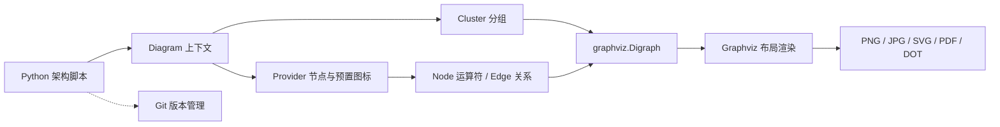
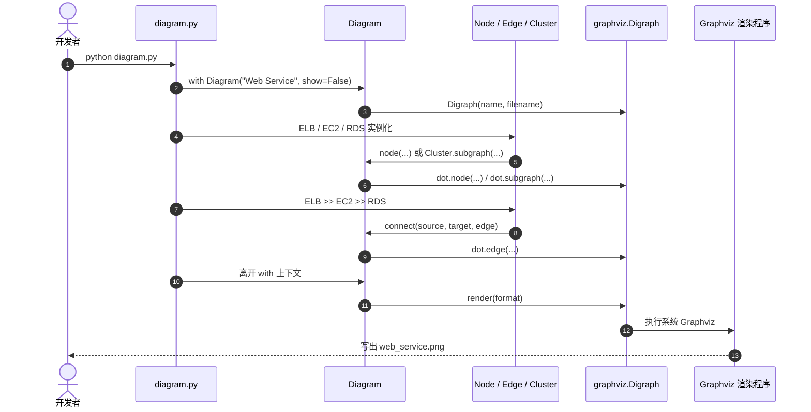

# Diagrams: Diagram as Code｜用 Python 绘制云系统架构图

**Diagrams**（[GitHub](https://github.com/mingrammer/diagrams) · [官方文档](https://diagrams.mingrammer.com/)）用 Python 描述系统拓扑，将节点、分组和连接交给 Graphviz 布局。官方 MIT 开源，2026-11-12 GitHub 显示约 42.8k stars（动态快照）。

## 一句话定义

**以 Python 代码定义架构节点和依赖方向，由 Graphviz 生成架构图，源文件可与系统代码一起版本管理。**

## 英文缩写速查

| 缩写 | 英文全称 | 简要说明 |
|---|---|---|
| AWS | Amazon Web Services | 官方预置图标和节点类别之一 |
| GCP | Google Cloud Platform | 官方预置云平台节点类别之一 |
| K8s | Kubernetes | 容器编排平台及其节点资源类别 |
| DOT | DOT Graph Description Language | Graphviz 图结构描述及可选输出格式 |
| CLI | Command-Line Interface | `diagrams` 命令行入口运行 Python 绘图脚本 |
| IaC | Infrastructure as Code | Terraform/CloudFormation 等部署配置；Diagrams 不负责生成它们 |

## 为什么重要

- **架构与代码同步审核。** `.py` 文件可以像普通源代码一样进入 Git、PR 和 CI；Git diff 展示描述文件的增删，图片可自动再生。
- **不用逐个拖拽云服务图标。** 预置 AWS、Azure、GCP、Kubernetes、Alibaba Cloud、OCI、OpenStack 等节点，也覆盖 OnPrem、Programming、SaaS、Generic、C4 等非云类别；“17 家云”不是正确的 Provider 口径。
- **明确边界。** 官方 README 强调只负责画图，既不连接/修改实际云资源，也不生成 CloudFormation/Terraform 代码。
- **适合机器人系统集成。** 可画出仿真训练、ROS 2、推理服务、数据存储、机载设备的*设计示意图*，方便团队讨论和审查，不代表图能验证实际时序或部署。

## 核心原理

项目使用 Python 的 `Diagram` 上下文管理器作为当前图；各 Provider 节点类（如 `ELB`、`EC2`、`RDS`）在创建时写入 `graphviz.Digraph`；`>>`、`<<`、`-` 运算符创建边；`Cluster` 分组对应 Graphviz 子图；退出上下文时调用 Graphviz 输出文件。

### 流程总览



这里的 Provider 指模块分类而非云厂商计数：官方文档同时列出 IBM、Firebase、Elastic、GIS、Programming、SaaS 等。图示仅描述库自身的数据流，**不会主动获取真实云资源**。

### 源码运行时序图

以下顺序依据官方 `pyproject.toml` 的 CLI 入口、`diagrams/cli.py` 及 `diagrams/__init__.py` 中的 `Diagram` / `Node` / `Edge` / `Cluster` 实现；`python diagram.py` 直接执行脚本，`diagrams diagram.py` 还会经过 CLI 读取并执行文件。



`Diagram.__exit__()` 在调用 `render()` 后清理渲染时的中间 Graphviz 描述文件；如需 DOT 输出，应显式指定相应 `outformat`。官方源码索引见 [仓库归档](../../sources/repos/mingrammer-diagrams.md)。

## 工程实践

**安装：** 先安装 Graphviz，并保证系统可以执行 `dot`；随后执行 `pip install diagrams`。当前官方 `pyproject.toml` 要求 **Python 3.9+**（官网安装页尚残留 3.7+ 旧文字）。macOS 可使用 `brew install graphviz`，Windows 安装页提供 Chocolatey/Winget 指令；Linux 使用发行版 Graphviz 包。

最简运行示例（来自官方 Quick Start）：

```python
from diagrams import Diagram
from diagrams.aws.compute import EC2
from diagrams.aws.database import RDS
from diagrams.aws.network import ELB

with Diagram("Web Service", show=False):
    ELB("lb") >> EC2("web") >> RDS("userdb")
```

保存成 `diagram.py` 后执行 `python diagram.py`，默认生成 `web_service.png`。也可用 `diagrams diagram.py`。官方支持 `png`、`jpg`、`svg`、`pdf`、`dot` 输出。

| 需求 | 用法 / 注意事项 |
|---|---|
| 机器人物理 AI 系统架构 | 用 OnPrem / Kubernetes / Generic 节点分组表示数据采集、GPU 训练、推理服务、ROS 2 节点及设备边界；具体节点类须查官方节点目录 |
| 跨团队 PR 审阅 | 同仓保存 `.py` 描述 + 生成图；审查 Python 拓扑变化，不要把 PNG 差异当作语义 diff |
| 区分训练、部署环境 | 使用嵌套 `Cluster`，但边界仍由作者设定，不能自动验证网络隔离 |
| 绘图可读性 | 调整 `direction`、`graph_attr` 和 `Edge`；节点过多可分拆多张图 |
| 不装本地环境尝试 | 官方 [Playground](https://diagrams.mingrammer.com/playground/) 通过 Pyodide 与 WebAssembly Graphviz 在浏览器运行 |

## 局限与风险

- **不是基础设施编排。** 不修改云资源，不输出 Terraform/CloudFormation，不能代替部署管理。
- **不会自动发现真实拓扑。** 显式编写的代码描述的是“作者认为”的架构；它不能证明某台机器人或云实例当前怎样连接。
- **Graphviz 仍是运行依赖。** 光安装 Python 包不足以保证本地出图；需系统 `dot` 可用。
- **审阅范围：** Git 可比较 Python 代码变化，但不会自动判断架构是否安全、正确或与现场一致。
- **脚本安全：** `diagrams` CLI 使用 `exec` 执行指定 Python 文件；陌生来源脚本必须按可执行代码审查。
- **版本差异：** 已核对的主仓版本为 0.25.1；出图参数和 Provider 类别可能随发布变化。

## 关联页面

- [Mermaid.js](./mermaid-js.md) — 文本式流程图与时序图，适合 wiki 内嵌；Diagrams 更偏云服务图标拓扑
- [Archify](./archify.md) — Agent 写 JSON IR，经确定性检查与渲染生成独立 HTML/SVG 架构工件
- [GitDiagram](./gitdiagram.md) — 用模型辅助分析现有 GitHub 仓库并生成 Mermaid 架构解释；不同于手写 Diagrams 拓扑
- [Diagram Design](./diagram-design.md) — 架构与演示视觉交付相关 Skill

## 参考来源

- [Diagrams 官方仓库与源码归档](../../sources/repos/mingrammer-diagrams.md)
- [Diagrams 官方文档归档](../../sources/sites/diagrams-mingrammer-com.md)
- [mingrammer/diagrams README](https://github.com/mingrammer/diagrams)
- [Diagram / Cluster / Edge 源码](https://github.com/mingrammer/diagrams/blob/master/diagrams/__init__.py)
- [pyproject.toml](https://github.com/mingrammer/diagrams/blob/master/pyproject.toml)

## 推荐继续阅读

- [官方 Getting Started](https://diagrams.mingrammer.com/docs/getting-started/installation)
- [Diagram 配置与导出格式](https://diagrams.mingrammer.com/docs/guides/diagram)
- [Cluster 嵌套分组](https://diagrams.mingrammer.com/docs/guides/cluster)
- [Edge 连线属性](https://diagrams.mingrammer.com/docs/guides/edge)
- [在线 Playground](https://diagrams.mingrammer.com/playground/)
