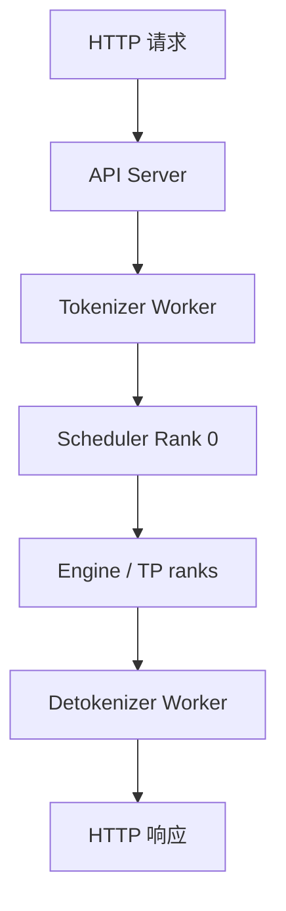
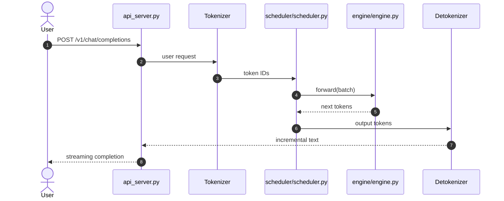

# Mini-SGLang｜精简但完整的在线 LLM Serving 系统

## 一句话定义

Mini-SGLang 以作者标注约 5000 行 Python 展示在线 serving 的多进程组件，包含 API Server、Tokenizer/Detokenizer、每 GPU Scheduler、Engine、KV cache、Radix Cache、overlap scheduling；与侧重离线简化的 Nano-vLLM 对照。

## 英文缩写速查

| 缩写 | 英文全称 | 简要说明 |
|---|---|---|
| LLM | Large Language Model | 本页服务的自回归语言模型类型 |
| KV | Key-Value Cache | 用于增量推理的历史注意力键值缓存 |
| GPU | Graphics Processing Unit | 计算和 kernel 执行的硬件 |
| CI | Continuous Integration | 贡献审核时运行的自动验证 |
| PR | Pull Request | 提交测试、代码变更、性能证据的上游审查单 |

## 为什么重要

Mini-SGLang 以作者标注约 5000 行 Python 展示在线 serving 的多进程组件，包含 API Server、Tokenizer/Detokenizer、每 GPU Scheduler、Engine、KV cache、Radix Cache、overlap scheduling；与侧重离线简化的 Nano-vLLM 对照。

## 核心原理

官方 `docs/structures.md` 描述用户请求由 API Server 交给 Tokenizer，Rank 0 Scheduler 接收 token IDs 并转发给各 TP rank 的 Scheduler，各自 Engine 推理后将输出交给 Detokenizer，再回 API。控制消息走 ZeroMQ，多 GPU 张量通信走 NCCL。

### 流程总览

## 源码运行时序图

**已核对执行入口：** `python -m minisgl --model 'Qwen/Qwen3-0.6B'` 进入 `python/minisgl/__main__.py` 的 `launch_server()`；源码 `server/api_server.py`、`scheduler/scheduler.py`、`engine/engine.py` 对应 API、批调度与模型执行。 此图仅覆盖所列实际入口的主干路径，不代表全部异步/多卡细节。

## 工程实践

- **可执行入口：** `python -m minisgl --model 'Qwen/Qwen3-0.6B'` 进入 `python/minisgl/__main__.py` 的 `launch_server()`；源码 `server/api_server.py`、`scheduler/scheduler.py`、`engine/engine.py` 对应 API、批调度与模型执行。
- **贡献切口：** 将 `--cache naive` 与 radix cache、`MINISGL_DISABLE_OVERLAP_SCHEDULING=1` 开关做单变量消融；校验文本/输出长度一致，再比较 TTFT、吞吐与延迟。
- **回归要求：** 说明 GPU/驱动/依赖、模型版本、输入与输出 token 长度分布、预热次数与 batch/并发；保留正确性对拍，再报告 tokens/s、TTFT 或 TPOT（按服务模式选择）。
- **开源状态：** 官方 [GitHub 仓库](https://github.com/sgl-project/mini-sglang) 与 README/源码可访问；对特殊 GPU kernel、训练与数据等子组件是否完全开放，不能从主页自动推断。

## 局限与风险

当前主要面向 Linux 和支持 CUDA 的平台；官方离线 benchmark 示例使用 H200、线上示例使用 4×H200；不应把这些图表数值直接推广到个人显卡。

- **视频事实界限：** “学生 / 1–2 年 / 资深”是用户提供的视频观点，不是上游官方招聘标准；未验证作者或 Discord 时间。别把开源贡献与 PR 合并结果视为确定承诺。

## 关联页面

- [LLM 推理显存估算](../concepts/llm-inference-vram-estimation.md)
- [Nano-vLLM｜面向学习的极简 LLM 推理引擎](./nano-vllm.md)
- [SGLang｜大规模语言与多模态模型推理服务框架](./sglang.md)
- [FlashInfer｜跨框架 GPU 推理 Kernel 库](./flashinfer.md)

## 参考来源

- [Mini-SGLang｜精简但完整的在线 LLM Serving 系统：一手文档和代码核验归档](../../sources/repos/mini-sglang-official.md)
- [六项目对照与原视频证据边界](../../sources/repos/llm-inference-open-source-contribution-primary-docs-2026-11.md)
- [官方 README](https://github.com/sgl-project/mini-sglang/blob/main/README.md)

## 推荐继续阅读

- [官方仓库与最新文档](https://github.com/sgl-project/mini-sglang)
