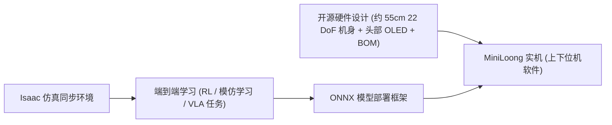
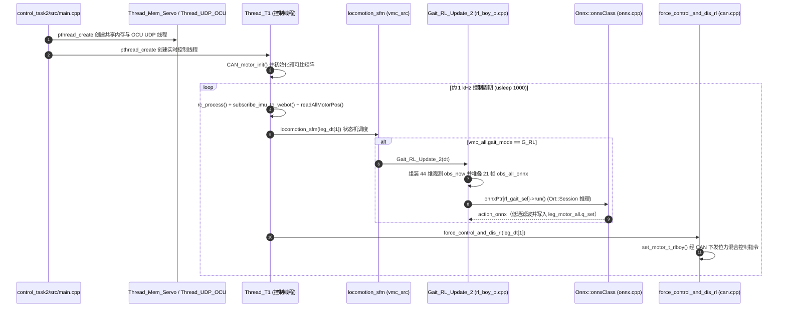

# MiniLoong（强化小子 / RL-Boy）

## 一句话定义

**MiniLoong（强化小子 / RL-Boy）** 是 [OpenLoong](./openloong.md) 生态中的小型开源人形机器人，仓库 [loongOpen/MiniLoong](https://github.com/loongOpen/MiniLoong)。

## 英文缩写速查

| 缩写 | 英文全称 | 简要说明 |
|------|----------|----------|
| ONNX | Open Neural Network Exchange | 跨框架模型部署格式 |
| VLA | Vision-Language-Action | 视觉-语言-动作模型 |
| DoF | Degrees of Freedom | 自由度 |
| OLED | Organic Light-Emitting Diode | 有机发光屏 |

## 为什么重要

- 把 OpenLoong 的全尺寸开源叙事缩小到桌面尺寸，降低端到端 RL / 模仿学习 / VLA 实验的硬件门槛。
- 在微信文章《想进入机器人领域吗？学习这18个开源项目就够了》中排第 **2** 位。

## 核心要点（据文章）

- 规格：身高约 55 cm，共 22 自由度（含腰、双手和头部）；头部 1 自由度并配 OLED 屏幕，可做表情和简单交互。
- 开源范围：机械设计、BOM、上下位机软件、ONNX 模型部署框架均公开，并与 Isaac 仿真同步。
- 定位：面向端到端强化学习和模仿学习，也支持 VLA 相关操作任务；许可证 Apache-2.0。

## 工程实践

- 文章信息：先用 Isaac 仿真训练，再通过 ONNX 部署框架上真机；具体命令以仓库 README 为准。
- 以上规格与许可证均出自文章叙述，**未逐项核对官方仓库**；动手前请以官方 README/BOM 为准。

## 机制与架构图

## 源码运行时序图

入口：离线训练在 `训练代码/OmniBotCtrl/train.py`（注册任务并执行 `ppo_runner.learn()`），经 `训练代码/OmniBotCtrl/pt2onnx.py` 导出 ONNX（可用 `训练代码/OmniBotCtrl/sim2sim_tinker.py` 做 MuJoCo 验证）；实机部署运行 `下位机代码/Linux/control_task2/src/main.cpp`（CMake 目标 `control_task_tinker_tvm`）：

图依据：`loongOpen/MiniLoong`（`main` 分支）`README.md`、`训练代码/OmniBotCtrl/train.py`、`训练代码/OmniBotCtrl/pt2onnx.py`、`训练代码/OmniBotCtrl/sim2sim_tinker.py`、`下位机代码/Linux/control_task2/CMakeLists.txt`、`下位机代码/Linux/control_task2/src/main.cpp`、`下位机代码/Linux/control_task2/vmc_src/locomotion_sfm.cpp`、`下位机代码/Linux/control_task2/gait_src/rl_boy_o.cpp`、`下位机代码/Linux/control_task2/vmc_src/force_imp_controller.cpp`、`下位机代码/Linux/control_task2/loong_ctrl/src/rl/onnx.cpp`。

## 局限与风险

- 本页仅基于一篇第三方公众号文章，规格数字可能随版本变化。
- 仓库迁移、分叉和许可证以官方当前状态为准。

## 关联页面

- [openloong](./openloong.md)
- [humanoid-robot](./humanoid-robot.md)
- [open-source-humanoid-hardware](./open-source-humanoid-hardware.md)
- [imitation-learning](../methods/imitation-learning.md)
- [vla](../methods/vla.md)
- [机器人开源项目 18 例（微信 GitHubStore）索引](../overview/robot-open-source-wechat-githubstore-18-projects.md)

## 推荐继续阅读

- [loongOpen/MiniLoong](https://github.com/loongOpen/MiniLoong)

## 参考来源

- [wechat_githubstore_18_open_source_robot_projects.md](../../sources/blogs/wechat_githubstore_18_open_source_robot_projects.md)
