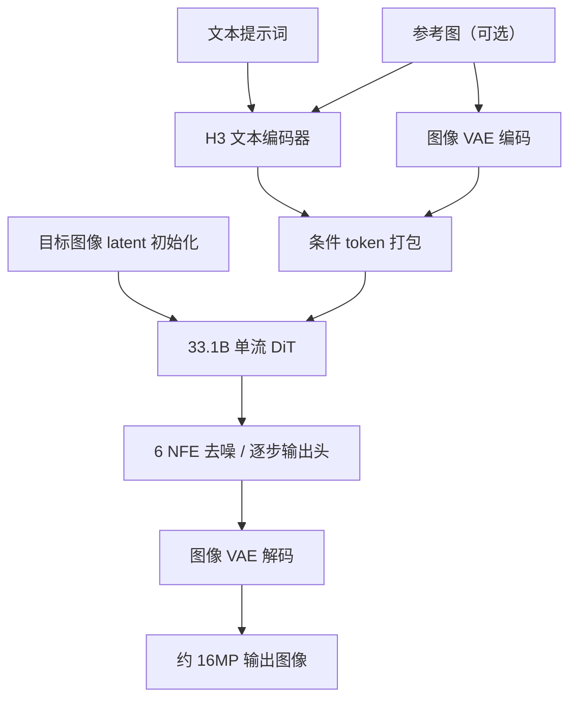
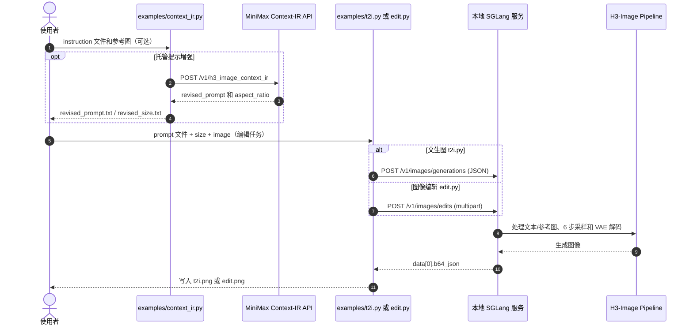

# MiniMax H3-Image：基于 H3 的 16MP 开权重图像生成与编辑模型 / 16MP Open-Weight Image Generation and Editing

## 一句话定义

**MiniMax H3-Image** 是 MiniMax 于 **2026-11-11** 正式介绍的图像生成与编辑模型：复用 [H3](./minimax-h3.md) 的多模态文本编码器和 DiT 设计、移除音频分支，在**同一检查点**上完成文生图与多参考图编辑，官方提供约 **16MP 原生输出、6 次模型评估（NFE）、最多 16 张参考图**。这是图像生成工具，不是视频世界模型或机器人动作策略。

## 英文缩写速查

| 缩写 | 英文全称 | 简要说明 |
|---|---|---|
| T2I | Text-to-Image | 文字条件的静态图像生成 |
| I2I | Image-to-Image | 图片条件的图像编辑/转换 |
| DiT | Diffusion Transformer | 扩散式图像潜变量生成主干 |
| VAE | Variational Autoencoder | 图像与低维潜变量的编解码器 |
| NFE | Number of Function Evaluations | 采样时的模型评估次数；官方设为 6 |
| CFG | Classifier-Free Guidance | 官方 6 步蒸馏版本不使用的引导机制 |
| PE | Prompt Expansion | 扩展短提示词以适应模型输入的可选模块 |

## 为什么重要

- **高分辨率静态图像原生生成：** 官方模型卡给出 4096×4096、6272×2688 等约 16MP 输出，避免把独立超分当作其标准路径。
- **同权重支持编辑：** 文本与 1–16 张参考图一起输入，适合多视图视觉素材、机器人外观概念图或合成数据候选的可控编辑。
- **和 H3 的分工清楚：** [MiniMax H3](./minimax-h3.md) 面向视频和音频联合生成；H3-Image 面向**单帧图像**，两者共享部分编码器和架构设计，并非同一输出接口。
- **机器人应用需要验证：** 可用于生成/编辑视觉候选数据，但模型官方材料没有证明其输出严格遵守几何标定、物理接触或机器人控制约束。

## 核心原理

| 层级 | 原始模型卡规格 |
|---|---|
| 条件编码器 | 复用 H3 的 Qwen3-VL 文本编码器，DiT 读取第 50 层隐藏状态 |
| 图像 VAE | CNN 编码器 + 24 层 2D ViT 解码器，16 倍空间下采样、24 个 latent 通道 |
| 扩散主干 | **33.1B** 参数、**50 层** dense single-stream DiT，hidden=5376、56 attention heads |
| 时空位置编码 | H3 系列的多模态 3D RoPE；图像 latent 以 2×2 patch 输入 |
| 推理 | 6 NFE、无需 CFG，配套逐步输出头及采样调度配置 |
| 条件/输出 | 文本（可含最多 16 张参考图）→ 目标图像 latent → VAE 解码得到图像 |

### 流程总览（依据官方模型卡）

这里的扩散模型预测是**静态目标图像**的 latent；不是 H3 音视频联合去噪，也不输出动作、深度、相机标定或动力学状态。

## 工程实践

| 路径 | 可核实入口 | 边界 |
|---|---|---|
| 托管文生图 | `POST /v1/images/generations`，`MiniMax-H3-Image` | API 默认自动提示增强；可选 Highspeed |
| 托管多图编辑 | `POST /v1/images/edits`，1–16 参考图 | 不支持蒙版局部编辑、透明背景 |
| 本地 SGLang | `sglang serve --model-path MiniMaxAI/MiniMax-H3-Image --port 30000 --warmup-mode off` | 需大显存或 offload；不是单卡 8GB 默认直接可跑 |
| 本地其他框架 | vLLM-Omni / Diffusers / ComfyUI | 使用各自版本与官方适配说明 |
| 可选提示增强 | 托管 Context-IR API 或 [PE 模型](https://huggingface.co/MiniMaxAI/MiniMax-H3-Image-PE) | PE 为单独模块，不能误作主 DiT |

**显存/体积注意：** 官方原始 DiT 约 66.28GB、VAE 约 2.34GB，H3 文本编码器另约 66.7GB。官方给出的原始检查点及编码器合计约 135GB；外部推理框架支持多卡和卸载。**开放权重不等于已在普通消费级显卡上验证可运行。**

### 源码运行时序图（依据官方 `examples/` 三个实际脚本）

此图由官方脚本的 `request_body`、`main`、本地 HTTP 请求与 `b64_json` 解码路径整理。**Context-IR 是可选的前置托管 API**，不是 SGLang 本地服务内部调用；本次只做源码静态阅读，没有运行模型或 API。

## 官方结果与对比口径

| 指标 | 官方描述 | 本次核验 |
|---|---|---|
| 4K 速度 | 4096×4096 单张低于 **10 秒**、相对主流模型更快 | 厂商数据，未独立复测、未确定统一硬件与批量设定 |
| 尺寸 | 原生约 **16MP**，模型建议 4–20MP 有效范围 | 来自官方权重模型卡 |
| 指令遵循/真实感 | 厂商称达到开权重模型领先水平 | 缺乏本次独立、同条件基准，不写成客观排名 |
| 输出接口 | 单次最多 **10** 张、最多 **16** 张参考图 | 来自官方 API 文档；不同本地服务器需分别核对 |

与 [Qwen-Image-2.1](./qwen-image-2-1.md) 的比较仅限于本页的**任务与接口**：两者都可生成和编辑图像，但 Qwen-Image-2.1 强调原生 RGBA 与局部编辑，H3-Image 官方 API 当前不提供透明背景或蒙版编辑；未经相同数据集和硬件实测，不判断谁的生成质量更好。

## 局限与风险

1. **许可不等于标准开放源代码：** [Community License 原文](https://github.com/MiniMax-AI/MiniMax-H3-Image/blob/main/LICENSE) 定义的授权地域排除 **美国、欧盟、英国、韩国**；年化收入超过 **100 万美元**或向第三方提供托管服务需申请书面授权，输出、派生模型及训练其他 AI 模型也受条款限制。产品部署前必须逐条审查。
2. **提示增强路径差异：** 托管 API 可使用 H3-Image-Context-IR，开权重本地推理需要自备详细提示词、可选 PE 或额外请求 API，不能默认视为完全离线复现云端结果。
3. **算力成本较高：** 33.1B 主干和另行加载的 H3 文本编码器使全精度本地部署门槛很高。
4. **物理一致性未获保证：** 生成的机械结构图、多视角视觉素材可能存在几何、遮挡、接触和尺寸错误；用于机器人训练前须验证标签、相机模型和仿真一致性。
5. **验证边界：** 本次未运行推理、未下载权重、未独立验证速度和定量画质。官方公告没有可复现实验完整训练配方。

## 结论

**H3-Image 在 6 步原生高分辨率生成与参考图编辑上提供一套可核查的开权重入口，但许可证、显存与视觉真实性验证是机器人数据工作流实际接入的先决条件。**

- 若只需要调用图像编辑 API，先核对 **16 参考图** 上限和遮罩/透明图限制。
- 若需私有化部署，先确认硬件和 **地域/商业授权**，再评估 SGLang/vLLM-Omni 的卸载配置。
- 若为机器人训练生成素材，采用 [生成式数据增广](../methods/generative-data-augmentation.md) 的物理和数据质量过滤，不将视觉质量等同于可用监督数据。

## 关联页面

- [MiniMax H3](./minimax-h3.md) — 上游视频/音频模型与共享的文本编码器
- [Qwen-Image-2.1](./qwen-image-2-1.md) — 图像生成、编辑和透明图接口对比
- [ComfyUI](./comfyui.md) — 可视化图像生成工作流
- [扩散模型](../concepts/diffusion-model.md) — 采样、去噪与引导机制背景
- [生成式数据增广](../methods/generative-data-augmentation.md) — 机器人合成数据筛选与物理一致性

## 参考来源

- [MiniMax H3-Image 官方公告与 API 指南（来源归档）](../../sources/sites/minimax-h3-image-official.md)
- [MiniMax H3-Image GitHub / 模型卡 / 源码 / LICENSE（来源归档）](../../sources/repos/minimax-h3-image.md)

## 推荐继续阅读

- [MiniMax 官方发布：4K Image Generation into the 10-Second Era](https://www.minimax.io/blog/minimax-h3-image)
- [MiniMax-H3-Image GitHub README / examples / LICENSE](https://github.com/MiniMax-AI/MiniMax-H3-Image)
- [MiniMax-H3-Image Hugging Face 模型卡](https://huggingface.co/MiniMaxAI/MiniMax-H3-Image)
- [MiniMax API 图像生成指南](https://platform.minimax.io/docs/guides/image-generation)
