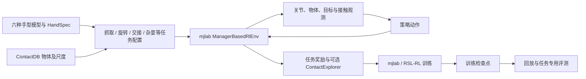
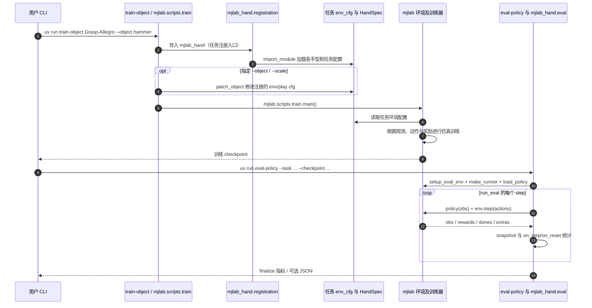

# mjlab_hand：mjlab 灵巧操作任务库 / Dexterous Hand Tasks in mjlab

## 一句话定义

**[mjlab_hand](https://github.com/ruoyiqiao/mjlab_hand)** 是 Ruoyi Qiao 开源的 **[mjlab](./mjlab.md) 灵巧手强化学习任务集合**：为 Allegro、LEAP、Shadow、Sharpa、Wuji、XHand 提供多种任务注册、训练、回放与评测工具，不是独立物理引擎或统一真机部署框架。

## 英文缩写速查

| 缩写 | 英文全称 | 简要说明 |
|---|---|---|
| RL | Reinforcement Learning | 以环境交互与奖励优化灵巧操作策略 |
| MDP | Markov Decision Process | 任务通过观测、动作、奖励、终止等定义学习问题 |
| EMA | Exponential Moving Average | 手内旋转任务采用的关节目标平滑动作配置 |
| PPO | Proximal Policy Optimization | mjlab / RSL-RL 生态常见的在线策略优化算法 |
| CLI | Command-Line Interface | `train`、`train-object`、`eval-policy` 等入口 |

## 为什么重要

**维护主体：** 项目位于 [ruoyiqiao 的个人 GitHub 仓库](https://github.com/ruoyiqiao/mjlab_hand)，官方 README 署名 Ruoyi Qiao；机构归属未见项目声明。本页使用知识库既有 `independent-maintainer` 维护主体分类，**不代表对作者任职机构的判断**。

- **跨手型研究同一技能：** `HandSpec` 统一手掌刚体、指尖 keypoints、可动/固定手模型的身份配置，便于对照手型而非重写一套训练底座。
- **从静态到动态：** 范围不仅有抓握和物体重定向，还包括双手交接、手指转盘、保定球及不同模式的三球杂耍；可逐步增加失接触、重抓、飞行轨迹难度。
- **研究接触探索：** 引入 [ContactExplorer](https://arxiv.org/abs/2603.10971) 的接触前引导和接触后覆盖奖励，作为部分抓握、手内旋转任务的探索信号。

## 核心原理

### 任务和手型

| 任务族 | README 中可核对的示例 | 可观察的技能 |
|---|---|---|
| Grasp / In-hand rotation | `Grasp-Shadow`、`InHand-Rotation-Allegro` | 物体抬升、朝向跟踪 |
| Throw / Reorientation / Regrasp | `Grasp-Throw-XHand`、`Object-Reorientation-Wuji`、`Regrasp-LEAP` | 释放飞行、目标位姿、松手重抓 |
| 双手交接 | `DualHand-Reorientation-Allegro-TrackSlew` | 双手协调交接 |
| 掌面动态技能 | `PlateSpin-Shadow`、`Baoding-Sharpa-TiltThumb` | 指尖支撑转盘、双球循环 |
| 杂耍 | `Juggle1-OneHand-Allegro`、`Juggle3-LEAP-Cascade-Residual`、`Juggle3-Allegro-Shower` | 接球、抛球、三球节奏与轨迹 |

任务 ID 根据项目 README 列举，**不代表所有任务对六种手型构成完整笛卡尔积**；完整注册表以 `uv run list-envs` 为准。

### 观测、奖励与接触

- `grasp/grasp_env_cfg.py`：关节位置/速度、手根位姿与速度、物体状态、目标位置、指尖位置和上一动作组成策略观测；奖励包含接近/目标进度、平滑和可选的接触探索。
- `in_hand_rotation/rotation_env_cfg.py`：物体相对手掌位姿、目标朝向与相对旋转误差进入观测；关节位置动作经 EMA 平滑，奖励含朝向对齐、达标奖励、动作变化惩罚。
- ContactExplorer 用两条互补路径鼓励探索：**接触前引导指尖前往探索不足的物面区域**；**接触后奖励新的指尖—物面接触覆盖**。README 提供将 `Grasp-*` / `InHand-Rotation-*` 的 `contact_explorer_reward.weight` 设为 0 的消融开关。
- `pyproject.toml` 的 `mjlab.tasks` 入口插件 + `registration.py` 的模块导入完成任务注册，复用 mjlab 的 manager-based 环境与训练脚本。

## 项目流程图



图中训练闭环为逻辑模块关系；抓取/旋转配置与训练、评测入口均来自上述仓库源码，**不将未核实的真机闭环画入**。

## 源码运行时序图

核对 `pyproject.toml`、`registration.py`、`cli/train_object.py`、`cli/eval.py`、`eval/base.py` 等入口（对应 [版本归档](../../sources/repos/mjlab_hand_ruoyiqiao.md)）；上游训练主循环由 mjlab 实现，本项目不复制其代码。



源码核对注意：`eval/base.py` 会在 **每一步执行前**保留快照，以避免环境 auto-reset 污染成功判据。正常 `uv run train` 直接走上游 mjlab CLI；`train-object` 才执行自定义物体 patch。

## 工程实践

```bash
git clone https://github.com/ruoyiqiao/mjlab_hand.git
cd mjlab_hand
uv sync --locked                       # Python 3.13
uv run list-envs                       # 查看本地实际 task id
uv run train Grasp-Allegro --env.scene.num-envs 2048
uv run train Juggle3-LEAP-Cascade-Residual --env.scene.num-envs 2048
uv run train-object Grasp-Allegro --object hammer --env.scene.num-envs 2048
uv run play-object Grasp-Shadow --checkpoint-file /path/to/model.pt
uv run eval-policy --task Grasp-Allegro --checkpoint /path/to/model.pt --output eval_metrics.json
```

**评测口径必须按任务分开：** `eval-policy` 支持抓取、手内旋转、投掷、重定向、重抓和双手交接；杂耍走 `tools/allegro4/eval_juggle.py` / `eval_three_ball.py`，转盘与宝鼎球走 `palm_eval.py`。同一数字不可横向当作所有任务的统一成功率。

## 局限与风险

- **开源状态：** 训练任务、回放、评测源码已开放；本次未核实统一预训练权重、真机部署或所有任务的公开成功率横比，不能据视频演示宣称全部成功收敛。
- **自定义物体：** README 明确不是所有 ContactDB 资产都已测试；部分对象需进一步调奖励与训练超参。
- **依赖版本：** 项目锁定 Python 3.13、mjlab 1.6.0、RSL-RL 5.4.2。与已有 Python 3.10/3.11 训练环境混用时要隔离。
- **许可边界：** 原创代码 Apache-2.0，但手模型和 ContactDB 网格另有许可证与使用条款。
- **尚未验证：** 本页只阅读官方资料与源码，未在 GPU 上实际运行训练、指标或 Sim2Real 实验。

## 关联页面

- [mjlab](./mjlab.md) — manager-based 任务训练底座
- [MuJoCo](./mujoco.md) — 物理仿真引擎
- [Manipulation](../tasks/manipulation.md) — 操作任务家族
- [Bimanual Manipulation](../tasks/bimanual-manipulation.md) — 双手交接任务
- [Contact-Rich Manipulation](../concepts/contact-rich-manipulation.md) — 接触建模与强化学习中的奖励难点
- [In-Hand Reorientation](../methods/in-hand-reorientation.md) — 手内旋转方法

## 参考来源

- [mjlab_hand 官方 README、任务配置与运行入口源码核对](../../sources/repos/mjlab_hand_ruoyiqiao.md)（main@9161811，2026-11-22）

## 推荐继续阅读

- [mjlab_hand GitHub](https://github.com/ruoyiqiao/mjlab_hand)
- [ContactExplorer 论文](https://arxiv.org/abs/2603.10971)
- [mjlab GPU 机器人学习框架](https://github.com/mujocolab/mjlab)
