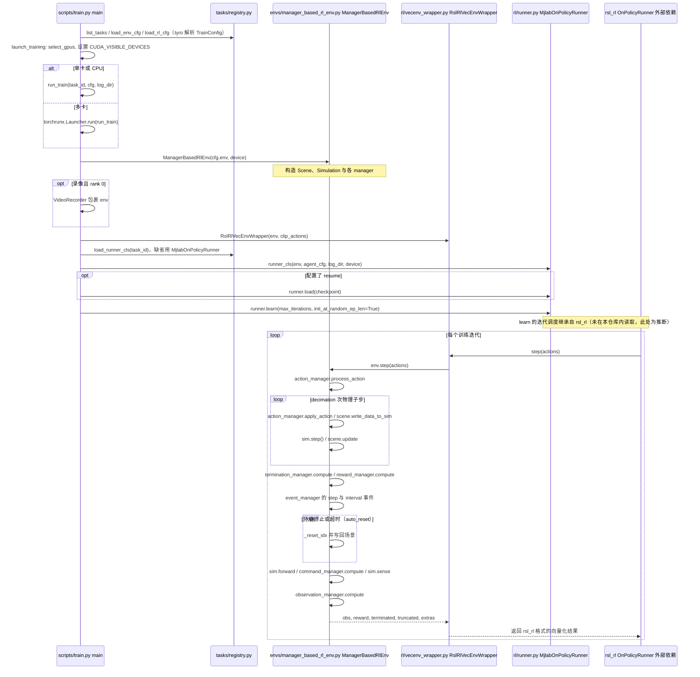

---

type: entity
tags: [repo, framework, mujoco, mujoco-warp, isaac-lab-api, reinforcement-learning, gpu-simulation, nvidia, unitree]
status: complete
updated: 2026-09-21
related:
  - ./mujoco.md
  - ./mujoco-warp.md
  - ./mjviser.md
  - ./nvidia-warp.md
  - ./mujoco-playground.md
  - ../overview/robot-training-stack-layers-technology-map.md
  - ./newton-physics.md
  - ./isaac-gym-isaac-lab.md
  - ./isaac-lab.md
  - ./isaac-sim.md
  - ./legged-gym.md
  - ./mjlab-playground.md
  - ./amp-mjlab.md
  - ./open-beni.md
  - ./smp-g1-mjlab.md
  - ./unitree-rl-mjlab.md
  - ./booster-mjlab.md
  - ./telekinesis-rlbotics.md
  - ./pollen-microduck-rl.md
  - ./paper-pac-man-perceptive-cbf-rl.md
  - ./paper-yahmp.md
  - ./paper-smpc2rl-loco-manipulation.md
  - ./asimov-v1.md
  - ./weights-and-biases.md
  - ./tensorboard.md
  - ../comparisons/wandb-vs-tensorboard.md
  - ../methods/reinforcement-learning.md
sources:
  - ../../sources/repos/mjlab.md
  - ../../sources/repos/mjviser.md
  - ../../sources/blogs/wechat_embodied_ai_lab_robot_training_stack_layers_2026.md
summary: "mjlab 将 Isaac Lab 的 manager-based 环境 API 与 MuJoCo Warp（GPU 加速物理）融合，是一个不依赖 Isaac Sim 的轻量 RL 框架，也是 AMP_mjlab 和 unitree_rl_mjlab 的底层依赖。"
---

# mjlab (轻量 GPU 加速 RL 框架)

**mjlab** 是由 mujocolab 开发的轻量机器人学习框架，核心设计是将 **Isaac Lab 的 manager-based API**（结构化环境设计）与 [**MuJoCo Warp**](./mujoco-warp.md)（GPU 并行物理）结合，在不依赖 NVIDIA Isaac Sim 的前提下提供与 Isaac Lab 相似的开发体验。

有对应研究论文：Zakka et al. (2026) arXiv:2601.22074。

## 英文缩写速查

| 缩写 | 英文全称 | 简要说明 |
|------|----------|----------|
| Isaac Lab | NVIDIA Isaac Lab | 基于 Omniverse 的机器人学习训练框架 |
| API | Application Programming Interface | 应用程序编程接口 |
| MuJoCo | Multi-Joint dynamics with Contact | 接触丰富的刚体物理仿真引擎 |
| GPU | Graphics Processing Unit | 图形处理器，大规模并行仿真训练的算力基础 |
| RL | Reinforcement Learning | 通过与环境交互最大化长期回报来学习策略的范式 |
| AMP | Adversarial Motion Prior | 用对抗判别约束状态转移接近专家运动分布的先验 |
| legged_gym | Legged Gym | 足式机器人 RL 训练的常用开源框架 |
| Isaac Gym | NVIDIA Isaac Gym | GPU 并行刚体仿真训练环境 |
| SMP | Score-Matching Motion Prior | 可复用的 score-matching 运动先验模块 |
| G1 | Unitree G1 Humanoid | 宇树入门级教育科研人形平台 |

## 为什么重要？

Isaac Lab API 是当前 RL 机器人训练的优秀抽象，但它绑定了 Isaac Sim——部署重、商业授权复杂。mjlab 将这套 API 移植到 MuJoCo Warp 之上：

- 保留熟悉的任务管理器 / 奖励管理器 / 观测管理器接口
- 替换底层为开源、轻量的 MuJoCo Warp
- 安装极简（PyPI 包 + `uv sync`）
- 对 macOS 提供有限评估支持（无 GPU 训练）

策展解读（[训练栈分层地图](../overview/robot-training-stack-layers-technology-map.md)）强调：mjlab 的价值不止于 GPU 吞吐，更在于 **manager-based 模块化**——observation、reward、event、command、curriculum 可组合复用，使多任务、多本体长期迭代时 **环境定义本身成为基础设施**，而非一次性巨型脚本。

## 架构

```
mjlab 架构
├── API 层（Isaac Lab manager-based 设计）
│   ├── SceneManager       # 场景/资产管理
│   ├── ActionManager      # 动作空间
│   ├── ObservationManager # 观测空间
│   └── RewardManager      # 奖励函数组合
└── 物理层
    └── MuJoCo Warp        # GPU 并行刚体仿真
```

## 核心能力

| 能力 | 说明 |
|------|------|
| 速度跟踪 | humanoid / 四足速度指令跟踪，flat / rough terrain |
| 动作模仿 | 参考运动数据驱动的 motion imitation |
| 多 GPU 训练 | 分布式 multi-GPU scaling |
| 实验追踪 | 集成 [Weights & Biases](./weights-and-biases.md)（训练期标量本地对照可用 [TensorBoard](./tensorboard.md)） |
| Dummy agent | 零动作 / 随机动作快速 sanity check |

## 与其他仿真框架的定位

| 维度 | mjlab | Isaac Lab | legged_gym | Genesis |
|------|-------|-----------|------------|---------|
| 物理后端 | MuJoCo Warp | Isaac Sim (PhysX) | Isaac Gym | 自研多物理 |
| API 风格 | Isaac Lab（移植） | 原生 Isaac Lab | 简单脚本 | Pythonic |
| 依赖重量 | 轻（pip 安装） | 重（Isaac Sim） | 重（IsaacGym） | 中 |
| 开源授权 | Apache 2.0 | BSD-3 | BSD-3 | Apache 2.0 |
| 上层框架 | AMP_mjlab、[SMP on G1](./smp-g1-mjlab.md)、unitree_rl_mjlab、[booster_mjlab](./booster-mjlab.md)、[asimov-mjlab](https://github.com/asimovinc/asimov-mjlab)（Asimov 官方 fork）、[Microduck RL](./pollen-microduck-rl.md) | robot_lab | legged_gym 生态 | — |
| 引擎层对照 | [Newton Physics](./newton-physics.md) 为通用 Warp 物理引擎；mjlab 专注 **RL 环境 API**，二者可并存选型 | — | — | — |

## 关联页面

- [Open-BENI](./open-beni.md) — BENI 策略训练与浏览器端 MuJoCo + ONNX 演示
- [MuJoCo](./mujoco.md) — 物理内核（mjlab 使用 [MuJoCo Warp](./mujoco-warp.md)）
- [MuJoCo Warp](./mujoco-warp.md) — 实际 GPU 刚体后端；PGS/PLUGIN 缺口与 AD 未通见该页
- [mjviser](./mjviser.md) — 基于 Viser 的 MuJoCo 浏览器查看器；负责可视化与交互，不是训练框架
- [NVIDIA Warp](./nvidia-warp.md) — MJWarp 的 JIT 计算层
- [Newton Physics](./newton-physics.md) — 同生态的底层多求解器引擎（非 RL 框架封装）
- [Isaac Lab](./isaac-lab.md) — API 设计来源；底层依赖 [Isaac Sim](./isaac-sim.md)
- [Isaac Gym / Isaac Sim / Isaac Lab](./isaac-gym-isaac-lab.md) — 三代产品总览
- [legged_gym](./legged-gym.md) — 同类框架，绑定 IsaacGym
- [AMP_mjlab](./amp-mjlab.md) — 以 mjlab 为底层的 AMP 统一策略实现
- [senlanke/mimic（mjlab）](./smp-g1-mjlab.md) — G1 上 SMP / CMoE / AME 移植枢纽
- [unitree-rl-mjlab](./unitree-rl-mjlab.md) — Unitree 官方以 mjlab 为底层的训练框架
- [booster_mjlab](./booster-mjlab.md) — whIRLwind 的 Booster K1 AMP / motion tracking 集成
- [Telekinesis RLbotics](./telekinesis-rlbotics.md) — 跨 Gymnasium/mjlab/Isaac Lab 的 YAML 驱动 PPO + ONNX 部署层
- [Microduck RL](./pollen-microduck-rl.md) — Pollen 桌面双足：BAM XL330 + 共享 61D 观测 + ONNX 热切换
- [YAHMP](./paper-yahmp.md) — G1 全身 GMT 消融与 ONNX 部署（基于 mjlab）
- [SMPC-to-RL](./paper-smpc2rl-loco-manipulation.md) — mjlab + MuJoCo Warp 上 tiled SMPC 采数与稀疏 FastTD3（代码未开源）
- [PAC-MAN](./paper-pac-man-perceptive-cbf-rl.md) — mjlab 上感知感知 CBF-RL 躲避球（全栈开源）
- [Asimov v1](./asimov-v1.md) — 硬件与 MuJoCo 主仓；行走 RL 见 asimov-mjlab（mjlab）与 [isaac_asimov](./isaac-asimov.md)（Isaac Lab）
- [MuJoCo Playground](./mujoco-playground.md) — 上游任务参照；[mjlab_playground](./mjlab-playground.md) 端口
- [训练栈分层地图](../overview/robot-training-stack-layers-technology-map.md) — 任务与训练入口层
- [强化学习](../methods/reinforcement-learning.md) — 框架支持的学习范式

## 源码运行时序图

入口：`uv run train <TaskId>`（`pyproject.toml` 的 `[project.scripts]` 把 `train` 映射到 `mjlab.scripts.train:main`）



图依据：mujocolab/mjlab@dcdf6ce，读过 `pyproject.toml`、`README.md`、`src/mjlab/scripts/train.py`、`src/mjlab/scripts/play.py`、`src/mjlab/envs/manager_based_rl_env.py`（`step`）、`src/mjlab/rl/vecenv_wrapper.py`（`step`）、`src/mjlab/rl/runner.py`（类与方法签名）、`src/mjlab/tasks/registry.py`（函数签名）；未运行代码。

## 参考来源

- [sources/repos/mjlab.md](../../sources/repos/mjlab.md)
- [具身智能研究室：训练栈分层解读](../../sources/blogs/wechat_embodied_ai_lab_robot_training_stack_layers_2026.md)
- [mujocolab/mjlab GitHub Repo](https://github.com/mujocolab/mjlab)
- [mjviser 来源归档](../../sources/repos/mjviser.md)
- Zakka et al. (2026), arXiv:2601.22074
- 源码核对（2026-11-02）：mujocolab/mjlab@dcdf6ce，读过 `pyproject.toml`、`README.md`、`src/mjlab/scripts/train.py`、`src/mjlab/scripts/play.py`、`src/mjlab/envs/manager_based_rl_env.py`、`src/mjlab/rl/vecenv_wrapper.py`、`src/mjlab/rl/runner.py`、`src/mjlab/tasks/registry.py`；时序图依据以上文件，未运行代码。
