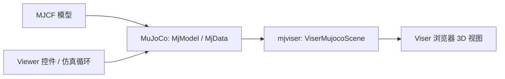

# mjviser：MuJoCo 的浏览器 3D 查看器

**mjviser** 是 mujocolab 开源的 MuJoCo 查看器，基于 [Viser](https://github.com/viser-project/viser) 提供浏览器端 3D 场景。它把 MuJoCo 的 `MjModel` 与 `MjData` 接入网页可视化，并提供仿真控制、关节/执行器检查、相机跟踪、关键帧与接触/力显示。

快速区分：

- **MuJoCo**：加载 MJCF、维护仿真状态并计算物理。
- **mjviser / Viser**：将 MuJoCo 模型和状态显示在浏览器中，支持观察和交互。
- **mjlab**：组织机器人 RL 环境和训练；它可以基于 mjviser 增加训练期查看与调试能力。

所以，mjviser 可称为 mjlab 使用的查看器/可视化层；它本身不是 mjlab，也不是 MuJoCo 的物理引擎。

## 数据流



MuJoCo 持有场景和仿真状态；`ViserMujocoScene` 将模型几何映射到 Viser 场景并按状态更新；浏览器负责呈现 3D 视图。主动式 `Viewer` 封装步进循环与控件。需要自定义控制逻辑时，可通过 `step_fn`、`render_fn` 和 `reset_fn` 接入；更精细的应用也可直接操作场景层。

## 能力

| 能力 | 用途 |
|---|---|
| 网页查看器 | 在浏览器查看 MuJoCo 模型，无需使用原生窗口 |
| 仿真播放控制 | 播放、暂停、单步、重置和调速 |
| 关节与执行器控件 | 通过滑块检查模型和执行器响应 |
| 场景诊断 | 查看接触、力、关键帧、物理标记与相机跟踪 |
| Python 扩展 | 传入仿真回调，或直接操作 `ViserMujocoScene` |
| 多环境/运动回放 | 仓库示例包含 mujoco-warp 多环境和时间轴运动回放 |

## 快速启动

```bash
uvx mjviser path/to/model.xml
```

也可安装后运行 `mjviser path/to/model.xml`。默认网页端口为 8080；`--port` 可指定其他端口。Python API 的最小形式：

```python
import mujoco
from mjviser import Viewer

model = mujoco.MjModel.from_xml_path("robot.xml")
data = mujoco.MjData(model)
Viewer(model, data).run()
```

## 和 mjlab、Draft 的关系

| 项目 | 所在层 | 主要职责 |
|---|---|---|
| MuJoCo | 物理仿真引擎 | 加载 MJCF、仿真状态与动力学计算 |
| mjviser | 可视化/查看器 | 将 MuJoCo 模型状态呈现在浏览器，提供查看和控制界面 |
| mjlab | RL 训练框架 | 管理环境、任务和策略训练；可扩展 mjviser 做调试 |
| Draft | 参数化机器人模型生成 | 从参数与运动学树生成仿真就绪的 MuJoCo MJCF |

Draft 官方仓库的依赖分组也能看出分工：`editor` 使用 Viser，`figures` 依赖中包含 mjviser，`rl` 才包含 mjlab。因此，Draft 展示的机器人白底 3D 视图应理解为 Viser/mjviser 这类查看器生成的可视化，而不是“mjlab 渲染器”。

## 许可与边界

mjviser 仓库声明 **Apache-2.0** 许可证。它主要是 beta 阶段的 MuJoCo 查看器，目标是可视化和交互调试；不是 CAD 工具、通用渲染器、策略训练框架或物理引擎。鼠标直接点击/拖动刚体和键盘回调等能力受 Viser 上游支持情况影响。

## 参考来源

- [mjviser 官方仓库](https://github.com/mujocolab/mjviser)
- [README 与示例](https://github.com/mujocolab/mjviser#readme)
- [依赖、版本和许可证](https://github.com/mujocolab/mjviser/blob/main/pyproject.toml)
- [开发架构说明](https://github.com/mujocolab/mjviser/blob/main/CLAUDE.md)
- [Viser](https://github.com/viser-project/viser)
- [MuJoCo](https://github.com/google-deepmind/mujoco)
- [mjlab](./mjlab.md)
- [Draft: 参数化机器人设计探索](https://github.com/davidhnguyen2000/draft)
- [来源归档](../../sources/repos/mjviser.md)
