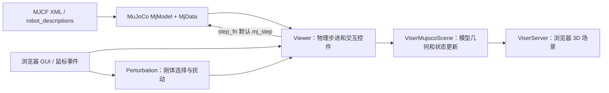
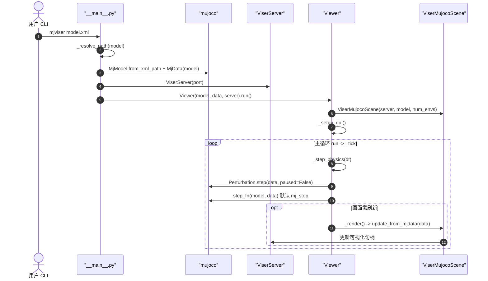

# mjviser: Web-based MuJoCo Viewer｜基于 Viser 的 MuJoCo 网页查看器

## 一句话定义

**mjviser** 是 [mujocolab 官方开源项目](https://github.com/mujocolab/mjviser)，将 MuJoCo 模型与仿真状态映射到 Viser 浏览器 3D 场景，可通过 CLI 或 Python API 使用；它是查看器和交互调试工具，不是独立物理引擎或强化学习训练框架。

## 英文缩写速查

| 缩写 | 英文全称 | 简要说明 |
|---|---|---|
| MJCF | MuJoCo XML Format | MuJoCo 机器人与场景模型描述格式 |
| CLI | Command-Line Interface | `mjviser` 命令行入口 |
| API | Application Programming Interface | `Viewer` 与 `ViserMujocoScene` 的 Python 扩展接口 |
| GUI | Graphical User Interface | Viser 网页内的播放、可视化和关节控制面板 |
| RL | Reinforcement Learning | mjlab 可负责的策略训练，非 mjviser 自身职责 |

## 为什么重要

在调试 MJCF 模型、控制器或仿真轨迹时，工程师需要检查几何体、关节与执行器状态、接触力以及扰动响应。mjviser 将查看器放在浏览器端，提供实时交互并允许用户把已有 MuJoCo `MjModel/MjData` 接入自己的仿真代码；不用将调试工具误当作训练基础设施。

## 核心原理与流程总览



- **MuJoCo**：持有模型和物理状态、计算仿真；`mjviser` 不重写动力学求解器。
- **`ViserMujocoScene`**：从 `MjModel` 创建并批量管理几何/站点；将 `MjData` 或数组中的变换刷新到 Viser 句柄，支持相机、接触与物理标记等可视化。
- **`Viewer`**：在场景层之上管理仿真循环、时间预算、暂停/单步/重置、GUI 与可替换的 `step_fn/render_fn/reset_fn`；运行中按时序推进 MuJoCo 并推送画面。
- **`Perturbation`**：`interaction.py` 使用 Viser 鼠标事件与 MuJoCo 的 `mjv_*` 交互函数。运行时对选中刚体施加扰动力，暂停时直接调整允许移动的位姿。

## 源码运行时序图

依据官方 `pyproject.toml`、`src/mjviser/__main__.py`、`viewer.py`、`scene.py` 和 `interaction.py` 的实际入口：



注意：上图是 CLI 默认运行路径；自定义 `render_fn`、`step_fn`、`reset_fn` 或直接驱动 `ViserMujocoScene` 时调用链会改变。暂停时由 `_tick` 直接调用 `Perturbation.step(data, paused=True)`，不进入上述运行态物理步进。

## 工程实践

### 安装与运行

```bash
uvx mjviser path/to/model.xml
# 或 pip install mjviser，再运行
mjviser path/to/model.xml --port 7070
# 需另外安装 robot_descriptions，才可按模型名加载：
uvx --with robot_descriptions mjviser go1
```

官方 README 还提供按工作目录名称模糊匹配，例如 `mjviser humanoid`。默认端口 8080。`pyproject.toml` 当前在官方 `main` 标注版本 **0.0.17**、Python **>=3.11,<3.15**，依赖 `mujoco-core>=4.0.1`、`viser>=1.1.1`、`trimesh>=4.8.3`（这是源码配置，不保证所有包索引同步更新）。

### Python API

```python
import mujoco
from mjviser import Viewer

model = mujoco.MjModel.from_xml_path("robot.xml")
data = mujoco.MjData(model)
Viewer(model, data).run()
```

| 能力 | 工程用途 |
|---|---|
| 播放、暂停、步进、重置和调速 | 复现/定位物理更新异常 |
| 关节和执行器滑块、关键帧 | 快速检查活动范围与驱动响应 |
| 接触点、接触力、惯性、坐标系等显示 | 辅助诊断模型与运动状态 |
| 选中刚体、Cmd/Ctrl + 拖动 | 测试受力后的动态响应，暂停时直接调整位姿 |
| `step_fn/render_fn/reset_fn` | 接入自定义控制器、渲染或重置逻辑 |
| `ViserMujocoScene` | 手动循环、场景扩展和多环境可视化 |

官方示例包括 `active_viewer.py`、`active_viewer_with_controller.py`、`passive_viewer.py`、`multi_env.py`、`ghost_overlay.py` 和 `motion_playback.py`。这些是项目示例，不等于本文已实际运行验证。

## 与 MuJoCo、mjlab 和 Draft 的关系

| 项目 | 层级与作用 |
|---|---|
| [MuJoCo](./mujoco.md) | MJCF 加载、状态推进、物理计算 |
| mjviser / Viser | 浏览器场景、仿真交互与调试 |
| [mjlab](./mjlab.md) | 机器人训练环境与 RL 工作流；其 `MjlabViserScene` 扩展 `ViserMujocoScene`，额外实现 debug 可视化及 Warp 适配 |
| [Draft](https://github.com/davidhnguyen2000/draft) | 参数化机器人模型生成；其依赖分组分别关联 Viser 参数编辑、mjviser 图形展示和 mjlab 训练 |

不能把 mjviser、mjlab、MuJoCo 混为一个训练/渲染引擎。mjviser 可为 mjlab 可视化，但不执行策略更新。

## 局限与风险

- **开源范围**：GitHub 提供 Apache-2.0 Python 实现、CLI、示例和测试；不是 CAD、DCC 软件、RL 训练框架或物理引擎。
- **交互状态需按当前源码判断**：`interaction.py` 已实现点击选择与刚体拖拽，不能继续照搬旧版「不支持鼠标拖动」描述；部分键盘快捷键受 Viser 上游限制。
- **版本与复现**：README 建议 `uvx`；若 `uvx` 误选不兼容的 Python，可按 README 指定 `-p 3.13`。本次核查的是源代码与文档，没有在本环境实测启动、跨浏览器表现、网络延迟或性能指标。

## 关联页面

- [MuJoCo](./mujoco.md) — 动力学与 MJCF 模型
- [mjlab](./mjlab.md) — 训练框架与查看器分工
- [MuJoCo Warp](./mujoco-warp.md) — 并行仿真相关技术

## 参考来源

- [官方 README](https://github.com/mujocolab/mjviser/blob/main/README.md)
- [官方源码与核读记录](../../sources/repos/mjviser.md)
- [CLI 实际入口](https://github.com/mujocolab/mjviser/blob/main/src/mjviser/__main__.py)
- [Viewer 运行循环](https://github.com/mujocolab/mjviser/blob/main/src/mjviser/viewer.py)
- [Scene 场景实现](https://github.com/mujocolab/mjviser/blob/main/src/mjviser/scene.py)
- [刚体交互](https://github.com/mujocolab/mjviser/blob/main/src/mjviser/interaction.py)
- [版本与依赖](https://github.com/mujocolab/mjviser/blob/main/pyproject.toml)

## 推荐继续阅读

- [mjviser 官方 examples 目录](https://github.com/mujocolab/mjviser/tree/main/examples) — 各类主动/被动查看器、控制器及轨迹回放案例
- [mjlab 官方仓库](https://github.com/mujocolab/mjlab) — 区分 RL 训练与观察界面
