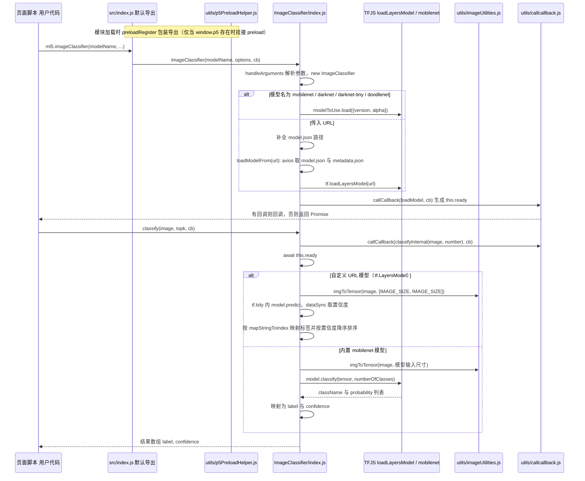

# ml5.js

**ml5.js** 是让创意编码者在浏览器中体验机器学习的 JavaScript 库，以易上手的 API、模型示例和教学资源，将部分预训练模型及神经网络能力带入网页草图。

## 英文缩写速查

| 缩写 | 英文全称 | 简要说明 |
|------|----------|----------|
| ML | Machine Learning | ml5.js 在网页中封装的机器学习算法与模型 |
| TF.js | TensorFlow.js | ml5.js 官方说明的底层 JavaScript 机器学习框架 |
| CV | Computer Vision | BodyPose、HandPose 与 FaceMesh 等网页视觉演示所属领域 |

## 为什么重要

- **端侧交互门槛低：** 可在网页中从摄像头或媒体资源得到模型结果，适合课堂演示和快速概念验证。
- **视觉输出易检查：** [p5.js](./p5js.md) 可把姿态关键点、手部骨架和置信度绘制到画布，便于观察模型行为。
- **教学链路现成：** [The Coding Train](./the-coding-train.md) 提供 ml5.js 入门 Track；官方文档从创建 p5.js 草图、导入库、加载 HandPose 模型到绘制关键点逐步说明。
- **适合构造交互样机：** 可将姿态/手势信号映射到非安全关键的网页控件或仿真交互，快速检验用户体验与输入定义。

## 核心原理

ml5.js 将常见机器学习任务包装成浏览器可调用的 JavaScript API，官方首页列出 BodyPose、HandPose、FaceMesh、ImageClassifier、SoundClassifier 和 NeuralNetwork 等入口。视觉 demo 的典型流程是取得浏览器视频流、加载模型、异步获取推理结果，再把关键点或类别传给绘图与交互逻辑；训练和推理能力依具体模型/API 而异。

## 工程实践

1. 先从官方 Getting Started 文档和当前支持的模型选择一个小任务；对比手部关键点、全身姿态和面部 landmark 是否满足目标。
2. 固定 ml5 包版本，并使用同一版本的官方文档；当前项目站明确提示新版本存在 breaking changes，旧视频或仓库 README 的代码可能不适配。
3. 原型阶段记录摄像头权限、分辨率、推理频率和端到端延迟；不要只看关键点动画是否平滑。
4. 若用于机器人交互，需另做相机标定、坐标系转换、时间同步、置信度阈值、网络传输与安全状态机；让控制器验证数据后再消费。

## 局限与风险

- 浏览器设备、模型加载、网络资源和 GPU 加速状况会影响延迟和复现性；这些能力不能直接视为确定性实时系统。
- 预训练网页模型的训练数据、适用人群、遮挡与环境边界必须单独检查；模型输出不是机器人动作授权。
- 当前官网提示 API 有 breaking changes；官方代码仓 README 仍出现 0.12.2 的旧版脚本用法，选取教程时要核对版本和许可。

## 关联页面

- [The Coding Train](./the-coding-train.md) — ml5.js 官方课程与示例来源之一。
- [p5.js](./p5js.md) — 常用的网页画布与交互宿主。
- [视觉伺服](../methods/visual-servoing.md) — 浏览器关键点交互与机器人视觉闭环控制的技术边界。

## 源码运行时序图

入口：浏览器中调用 `ml5.imageClassifier("MobileNet", 回调)`（`src/index.js` 经 webpack 打包为 `dist/ml5.min.js`，即 `package.json` 的 `main`）

图依据：ml5js/ml5-library@f80f95a，读过 `src/index.js`、`src/ImageClassifier/index.js`（构造、`loadModel`、`loadModelFrom`、`classify`、`classifyInternal`、`imageClassifier` 工厂函数）、`src/utils/callcallback.js`、`src/utils/p5PreloadHelper.js`（前 40 行）、`src/utils/modelLoader.js`（仅函数列表）、`webpack.common.babel.js`（entry/output）、`package.json`（main）；未运行代码。

## 参考来源

- [ml5.js 官方项目站归档](../../sources/sites/ml5js.md)
- [ml5js/ml5-library 官方仓库归档](../../sources/repos/ml5js-library.md)
- [ml5.js 官方文档](https://docs.ml5js.org/)
- [ml5.js 官方项目站](https://ml5js.org/)
- 源码核对（2026-11-02）：ml5js/ml5-library@f80f95a，读过 `src/index.js`、`src/ImageClassifier/index.js`、`src/utils/callcallback.js`、`src/utils/p5PreloadHelper.js`、`src/utils/modelLoader.js`、`webpack.common.babel.js`、`package.json`；时序图依据以上文件，未运行代码。

## 推荐继续阅读

- [ml5.js Getting Started](https://docs.ml5js.org/#/)
- [ml5.js model references](https://docs.ml5js.org/#/)
