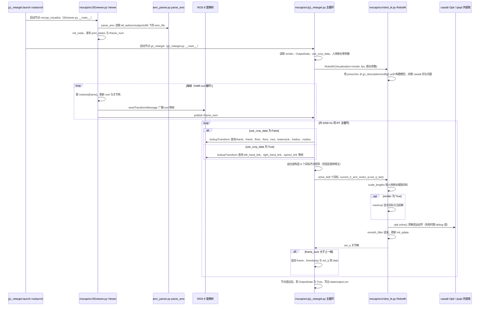

# mocap_retarget

**mocap_retarget**（<https://github.com/ccrpRepo/mocap_retarget>）是社区维护的 **动捕数据重定向到机器人** 的工程向示例仓库，侧重脚本化地把光学/文件格式 MoCap 映射到目标 URDF/MJCF 关节空间，而非提供完整 RL 训练栈。

## 英文缩写速查

| 缩写 | 英文全称 | 简要说明 |
|------|----------|----------|
| MoCap | Motion Capture | 光学或惯性动捕得到的参考动作 |
| IK | Inverse Kinematics | 满足末端/姿态约束的关节解算 |
| URDF | Unified Robot Description Format | 机器人连杆与关节描述格式 |
| Retargeting | Motion Retargeting | 跨骨架/跨体型动作映射 |

## 为什么重要

- **低门槛对照**：理解「源骨架关节角 → 目标机器人关节角」需要哪些标定与坐标对齐时，可作为比 GMR 更小的阅读样本。
- **导航锚点**：本知识库 [retarget-tools](../../references/repos/retarget-tools.md) 与历史资源地图均收录此外链，补齐详情页空链可避免读者遇到断链。
- **管线衔接**：动捕系统先得到人体或目标物体的运动状态，再进入重定向环节；例如 [Low Cost Mocap](./low-cost-mocap.md) 展示了低成本多相机跟踪与位置估计这一上游环节。

> **一手性说明：** 非论文官方实现，而是 `ccrpRepo` 个人维护的工程示例；与 [GMR](../methods/motion-retargeting-gmr.md) 等论文作者仓相比，更适合作脚本参考而非方法复现基线。

## 定位与局限

| 维度 | 说明 |
|------|------|
| 强项 | 工程脚本、README 级管线说明 |
| 弱项 | 多机型维护、实时性能、物理可行性筛选不如 GMR / PHC / holosoma |
| 典型下游 | 导出关节轨迹后接模仿学习或 WBC |

## 关联页面

- [Motion Retargeting](../concepts/motion-retargeting.md)
- [GMR](../methods/motion-retargeting-gmr.md)
- [Retarget Tools](../../references/repos/retarget-tools.md)
- [Low Cost Mocap](./low-cost-mocap.md)

## 源码运行时序图

入口：`roslaunch mocap g1_retarget.launch`（`src/mocap/launch/g1_retarget.launch` 同时启动 `3Dviewer.py` 与 `g1_retarget.py` 两个节点）

图依据：ccrpRepo/mocap_retarget@1093a3e，读过 `README.md`、`src/mocap/launch/g1_retarget.launch`、`src/mocap/src/g1_retarget.py`（主流程与数据输出）、`src/mocap/src/3Dviewer.py`（`__main__`、`draw` 与 `run` 中与发布相关的部分）、`src/mocap/src/robot_ik.py`（`__init__` 与 `solve_ik`）；`amc_parser.py` 与 `weighted_moving_filter.py` 仅据导入与调用关系推断，未逐行读取；未运行代码。

## 参考来源

- [mocap_retarget 仓库归档](../../sources/repos/mocap_retarget.md)
- 源码核对（2026-11-02）：ccrpRepo/mocap_retarget@1093a3e，读过 `README.md`、`src/mocap/launch/g1_retarget.launch`、`src/mocap/src/g1_retarget.py`、`src/mocap/src/3Dviewer.py`、`src/mocap/src/robot_ik.py`；时序图依据以上文件，未运行代码。

## 推荐继续阅读

- GitHub：<https://github.com/ccrpRepo/mocap_retarget>
