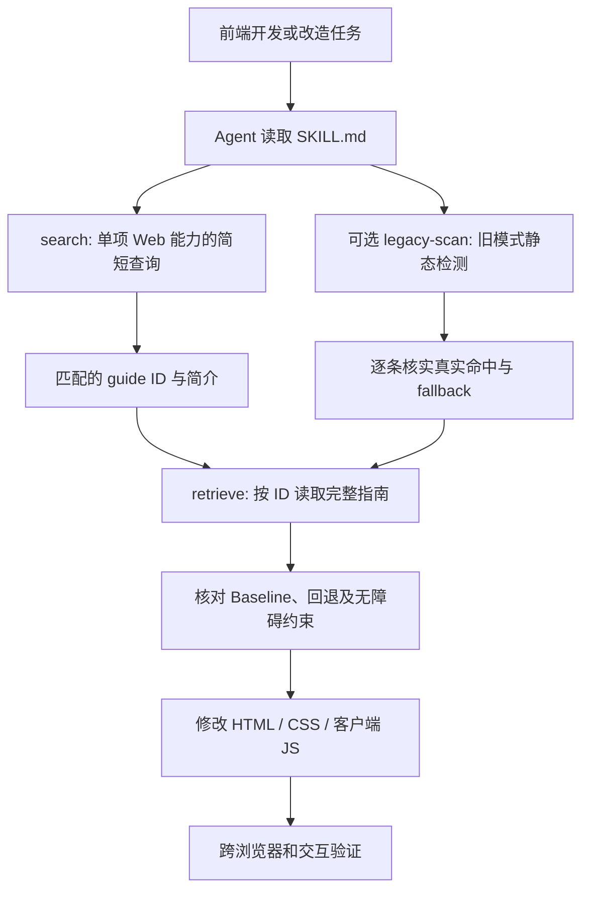
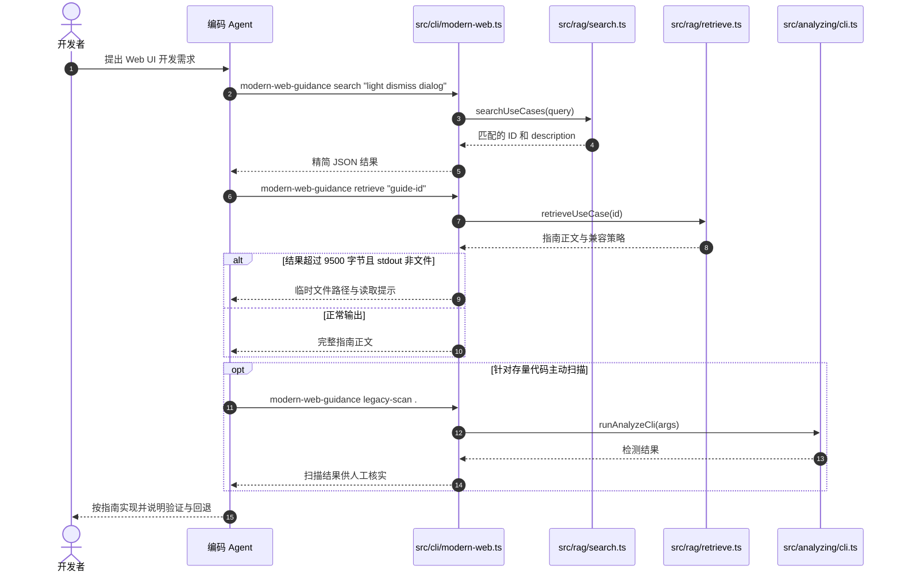

# Modern Web Guidance｜面向编码 Agent 的现代 Web 开发指南

## 一句话定义

[Modern Web Guidance](https://github.com/GoogleChrome/modern-web-guidance) 是一个**可供编码 Agent 调用的现代 Web 规范技能库**：通过按任务检索专家维护的 HTML、CSS、浏览器 API、可访问性与兼容性指南，让生成的前端代码优先考虑原生能力与合理降级。

## 英文缩写速查

| 缩写 | 英文全称 | 简要说明 |
|------|----------|----------|
| CLI | Command-Line Interface | `modern-web-guidance` 命令行：安装、搜索、读取、扫描 |
| API | Application Programming Interface | `<dialog>`、Popover、View Transitions 等浏览器原生编程接口 |
| CSS | Cascading Style Sheets | Container Queries、Anchor Positioning、滚动动画等样式机制 |
| DOM | Document Object Model | 现代原生交互组件与事件操作的页面对象结构 |
| INP | Interaction to Next Paint | 上游性能指南覆盖的页面交互响应指标 |

## 为什么重要

- **把训练语料的旧范式转为按需取证：** 在编码之前搜索具体需求，检索相应的新 API 与 fallback 规则，而不是直接拼接过时的 JS workaround。
- **强调现代 Web 平台而非盲目引入依赖：** 原生对话框、popover、CSS 布局与动画可利用浏览器已有语义和能力，但仍需根据实际浏览器支持决定回退方案。
- **对 Robotics_Notebooks 的适用边界明确：** 适合评审 `docs/` 目录的前端交互、图谱界面、移动端布局及无障碍体验；**不提供**机器人控制、仿真或学习算法的专用知识。
- **与 [Agent Skills](agent-skills-addyosmani.md) 互补：** 前者是 Web 平台专项建议，后者是通用软件交付工作流；不能相互取代。

## 核心原理

| 层 | 官方实现与作用 |
|----|---------------|
| 指南分发 | [GoogleChrome/modern-web-guidance](https://github.com/GoogleChrome/modern-web-guidance) 的 `SKILL.md` 与 `guides/`；上游 `package.json` 为 1.0.0 |
| 实际源码 | [GoogleChrome/modern-web-guidance-src](https://github.com/GoogleChrome/modern-web-guidance-src)：CLI、指南构建、静态扫描与评测 |
| 技能路由 | `SKILL.md` 要求先 `search` 简短英文用例；根据返回的指南 ID 再 `retrieve`，并核查建议与兼容性 |
| 兼容规则 | Baseline Widely available 功能可直接采用；新特性按对应指南给出的 feature detection / fallback 策略处理 |
| 存量扫描 | `legacy-scan` 查找有限范围内的旧写法，逐项确认是否真需迁移；不保证覆盖全部指南 |

### 流程总览



**示例：** 官方 `dialog.md` 推荐用原生 `<dialog>` 处理模态、焦点和 Escape；对尚有浏览器差异的 `closedby` 提供降级策略。不是每项新特性都可以在所有浏览器上直接采用。

### 源码运行时序图

以下据实际公开的 [`src/cli/modern-web.ts`](https://github.com/GoogleChrome/modern-web-guidance-src/blob/main/src/cli/modern-web.ts) 的命令分发及 `src/rag` 模块调用绘制；它描述 **CLI 搜索与检索执行路径**，不把 Agent 后续遵循指南的行为误写为 CLI 自动改代码。



## 工程实践

**安装与查阅（上游 README 的命令，本次未实际执行）：**

```bash
npx modern-web-guidance@latest install
npx modern-web-guidance@latest search "animate a dialog modal backdrop"
npx modern-web-guidance@latest retrieve "animate-to-from-top-layer"
npx modern-web-guidance@latest legacy-scan .
```

**在本仓库可落地的使用方式：** 修改 `docs/` 的移动端导航、悬停浮窗、模态框或滚动动画时，先把需求拆为单项能力分别查询；获取完整 guide，按浏览器兼容与无障碍要求实现；在 Chrome、Firefox、Safari 验证现代和回退分支。静态扫描结果要保留例外，不以扫描次数代替实际 UI 验收。

**开放状态：** 分发技能仓与源码仓均已公开（Apache-2.0），并提供安装与指南内容；CLI 源码位于 `modern-web-guidance-src` 而非把 `SKILL.md` 本身误当完整可执行程序。

## 局限与风险

- **不是通用代码质量门：** 不替代本仓库 `make ci-preflight`、Mermaid 检验、测试或 Web 前端真实浏览器回归。
- **兼容性有条件：** 对尚未 Baseline Widely available 的 API，须跟随该 guide 的 fallback 策略；不同用户目标浏览器会改变选型。
- **旧代码扫描覆盖有限：** `SKILL.md` 将 `legacy-scan` 定位为静态可判断的子集（约全部指南的 20%），误报及漏报须人工核查。
- **版本迭代快：** 上游持续增加和调整指南；本文对应 2026-11-16 核验的 1.0.0 及主要技术文档，不宣称已逐篇核对所有指南。
- **效果证据边界：** 官方发布公开评测入口，本页没有复现其通过率变化，也未在本仓运行相关 CLI。

## 关联页面

- [Agent Skills（Addy Osmani）](agent-skills-addyosmani.md) — 通用 SDLC 工程流程技能；与 Web 专项规则互补
- [Code Review Skill](code-review-skill.md) — PR 审查与风险分级；可在审前结合具体 Web 兼容性指南
- [Agentic Coding 时代的软件工程基础](../concepts/agentic-coding-software-fundamentals.md) — 人类对 Agent 编码的约束与验证职责

## 参考来源

- [上游 README、SKILL、指南和 CLI 源码核对归档](../../sources/repos/googlechrome-modern-web-guidance.md)
- [Chrome for Developers 官方文档核对归档](../../sources/sites/modern-web-guidance.md)
- [GoogleChrome/modern-web-guidance 官方分发仓](https://github.com/GoogleChrome/modern-web-guidance)
- [GoogleChrome/modern-web-guidance-src 官方源码仓](https://github.com/GoogleChrome/modern-web-guidance-src)

## 推荐继续阅读

- [Modern Web Guidance 指南目录](https://developer.chrome.com/docs/modern-web-guidance/guides) — 按组件和能力查找最新规则
- [官方 `SKILL.md`](https://github.com/GoogleChrome/modern-web-guidance/blob/main/skills/modern-web-guidance/SKILL.md) — Agent 搜索/检索流程与兼容策略
- [Dialog 实例指南](https://github.com/GoogleChrome/modern-web-guidance/blob/main/skills/modern-web-guidance/guides/ui-components/dialog.md) — 原生模态与 fallback 的具体取舍
