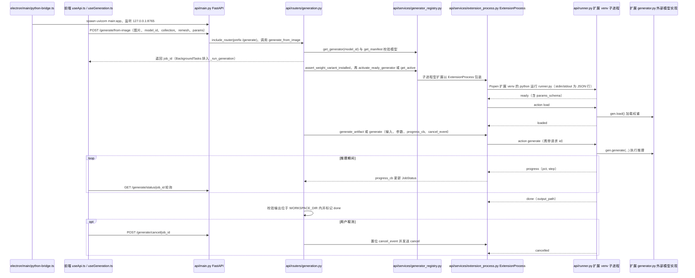

# Modly

[Modly](https://github.com/lightningpixel/modly) 是由 Lightning Pixel 开发的本地 AI 三维网格生成桌面应用。官方仓库以图片生成网格为主要流程；官网也介绍文本提示输入。它可用于生成仿真场景的视觉道具，生成结果仍需下游检查。

## 一句话定义

将本地模型扩展、图片输入、网格生成与导出组合到桌面工作流中的工具。

## 英文缩写速查

| 缩写 | 英文全称 | 简要说明 |
|------|----------|----------|
| GPU | Graphics Processing Unit | 本地模型推理使用的图形处理器 |
| GLB | GL Transmission Format Binary | 二进制三维资产交换格式 |
| CLI | Command Line Interface | 通过命令行调用运行中的 Modly |
| API | Application Programming Interface | 程序之间调用服务的接口 |

## 核心信息

| 项 | 内容 |
|------|------|
| 机构 | Lightning Pixel |

## 工作流程与选型

1. 安装桌面应用，在 Models 页面安装模型扩展并下载相应权重。
2. 创建并连接 Image → Generate Mesh → Add to Scene 工作流，选中工作流后生成。
3. 在应用中预览、处理并导出网格；官网列出 GLB、OBJ、STL 和 PLY。
4. 也可通过官方 CLI 向运行中的桌面应用提交图片生成请求。

官方扩展包括 Hunyuan3D 2 Mini、TripoSG 和 Trellis2 GGUF；不同模型的硬件需求、许可和输出质量各不相同。应用主仓以 MIT 许可发布，模型与扩展需分别核查。README 列出 Windows、Linux 和 Apple Silicon macOS 支持，具体硬件兼容性以所选扩展为准。

## 工程实践与局限

- **机器人场景：** 可以作为静态视觉道具的生成入口；单张图看不到的部分由模型推断，不能视作实测几何。
- **仿真准备：** 导入 Isaac 或 MuJoCo 前应检查尺度、坐标、碰撞网格、质量与惯量；导出网格本身不证明具有关节语义或可靠物理参数。
- **资源与许可：** 模型权重需下载并占用本地存储与显存；应用许可不替代单个模型和扩展的许可检查。
- **与其他工具对照：** [3D Gen Studio](./3dgenstudio.md) 面向更广的网格生产编排；[img2threejs](./img2threejs.md) 侧重生成可编辑 Three.js 代码。

## 关联页面

- [3D Gen Studio](./3dgenstudio.md)
- [img2threejs](./img2threejs.md)
- [Articraft](./articraft.md)
- [Sim2Real](../concepts/sim2real.md)

## 源码运行时序图

入口：桌面应用启动时由 `electron/main/python-bridge.ts` 执行 `python -m uvicorn main:app --host 127.0.0.1 --port 8765`（工作目录为 `api/`）；生成请求由界面或官方 CLI（`tools/modly-cli/agent.py`）发到 `POST /generate/from-image`

图依据：lightningpixel/modly@a471509，读过 `README.md`、`api/main.py`（路由注册与 lifespan 的导入）、`api/routers/generation.py`（`generate_from_image`、`_run_generation_impl`、status 与 cancel 相关代码）、`api/services/generator_registry.py`（`get_generator`、`activate_ready_generator` 等的引用处）、`api/services/extension_process.py`（`_start`、`load`、`generate_artifact`、`_read_loop` 等）、`api/runner.py`（`main` 的消息循环）、`electron/main/python-bridge.ts`（启动参数）、`src/shared/hooks/useApi.ts`、`tools/modly-cli/agent.py`（生成与轮询调用）；部分文件仅按函数名与关键行检索，未逐行通读；未运行代码。

## 参考来源

- [官方仓库归档](../../sources/repos/modly.md)
- [官网归档](../../sources/sites/modly.md)
- 源码核对（2026-11-02）：lightningpixel/modly@a471509，读过 `README.md`、`api/main.py`、`api/routers/generation.py`、`api/services/generator_registry.py`、`api/services/extension_process.py`、`api/runner.py`、`electron/main/python-bridge.ts`、`src/shared/hooks/useApi.ts`、`tools/modly-cli/agent.py`；时序图依据以上文件，未运行代码。

## 推荐继续阅读

- [Modly 官方 README](https://github.com/lightningpixel/modly)
- [Modly 官网](https://modly3d.app/)
