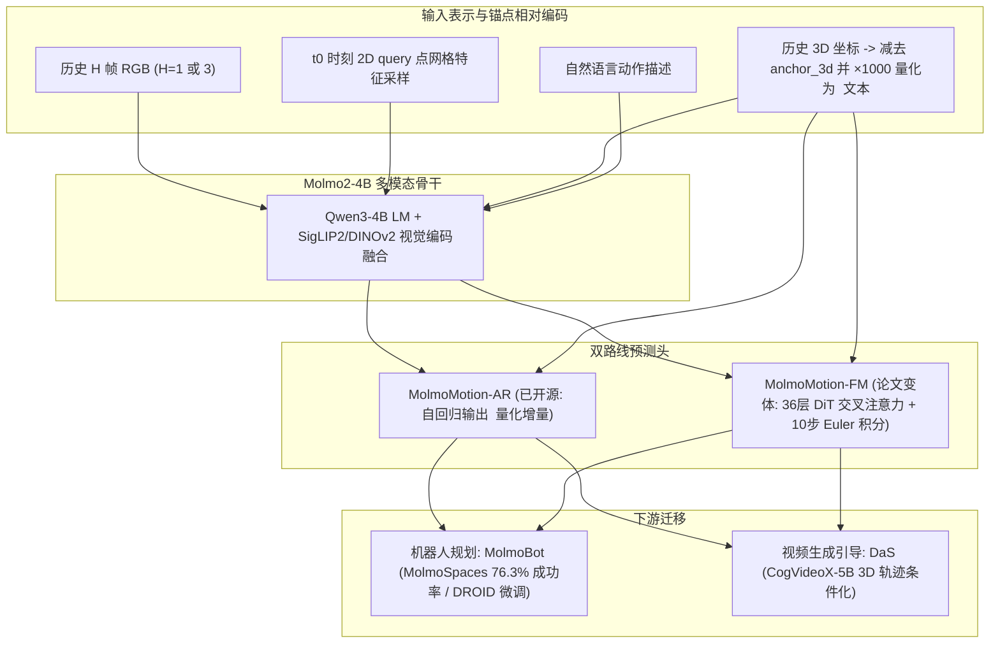
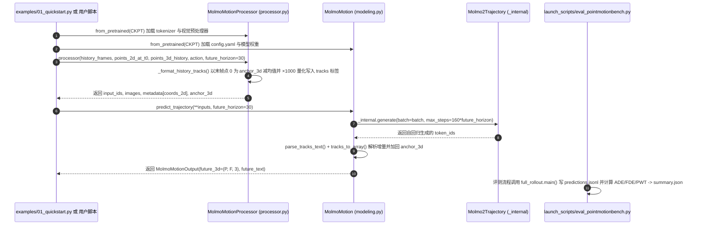

# MolmoMotion

## 一句话定义

**MolmoMotion**（[arXiv:2606.18558v2](https://arxiv.org/abs/2606.18558) | [GitHub](https://github.com/allenai/molmo-motion)）是 Ai2 面向通用物理交互预测提出的 **语言条件 metric 3D 点轨迹预测模型**：以 **Molmo2-4B** 为多模态骨干，给定 1–3 帧历史 RGB、物体 2D/3D query 点与自然语言动作指令，预测长达约 2 秒（30–32 帧，15 fps）的锚点相对世界系 3D 轨迹，并配套发布 **MolmoMotion-1M** 语料与 **PointMotionBench** 基准。

## 英文缩写速查

| 缩写 | 英文全称 | 简要说明 |
|------|----------|----------|
| VLM | Vision-Language Model | 视觉–语言多模态模型；MolmoMotion 基于 `Molmo2-4B`（Qwen3-4B + SigLIP2/DINOv2） |
| AR | Autoregressive | 坐标文本自回归变体 `MolmoMotion-AR`，开源权重均属此路线 |
| FM | Flow Matching | 论文提出的 36 层 DiT 连续轨迹速度头变体 `MolmoMotion-FM`（仓库未公开） |
| ADE | Average Displacement Error | PointMotionBench 核心指标：全部可见（点, 未来帧）平均 3D 欧氏距离误差（米） |
| FDE | Final Displacement Error | 末帧可见 query 点的 3D 欧氏距离误差（米） |
| PWT | Points Within Threshold | 误差落入 `{0.01, 0.02, 0.05, 0.10, 0.20} m` 阈值内的平均比例 |
| I2V | Image-to-Video | 图像到视频生成；MolmoMotion 预测的 3D 轨迹可直接作为运动条件输入 DaS |

## 为什么重要

- **类无关且跨视角稳定的 3D 物理表示**：相比仅在图像平面内漂移、易与相机自运动耦合的 2D 点追踪，以及受限于人体/刚体模板的参数化建模，metric 3D 点集能够统一表达刚体工具、碗具、可变形织物与动物等多种目标。
- **数据–基准–生成代码完整闭环**：开放近 100 万片段（1.16M 源视频）的 **MolmoMotion-1M**（含 EgoDex、HD-EPIC、Xperience、YT-VIS、Stereo4D 与机器人/仿真扩展 DROID/MolmoSpaces）、**742 条**人工校验的 **PointMotionBench** 以及基于 `Molmo2-8B` + `MolmoPoint` + `SAM 3` + `AllTracker` + `ViPE` 的 `data_generation/` 自动化管线。
- **验证两条下游可迁移价值**：作为预训练初始化，显著加快 `MolmoBot` 在 MolmoSpaces 与 DROID 上的策略/轨迹学习效率；输出的 3D 轨迹也能直接引导 `DaS`（CogVideoX-5B）生成物理更连贯的可控视频。

## 核心原理

关键设计与训练两阶段：

1. **锚点相对参数化与 2D 点特征条件化**：`MolmoMotionProcessor` 以最后一帧历史第 0 号点为共享 `anchor_3d`，将输入与输出轨迹转为局部 3D 位移并按 1 mm 粒度量化为整数文本 token，避免绝对相机坐标尺度方差过大。
2. **两阶段课程训练**：Stage 1 在 5 个开源人类/自然视频子集（按 `√N_i` 混合，排除 DROID 与 MolmoSpaces）上以 `N=8, H=3, F=8` 训练 40K 步；Stage 2 将未来视界扩至 `F=30/32` 并训练 10K 步，产出 `H=3` 与 `H=1` 两种实用检查点。
3. **MolmoMotion-1M 与 PointMotionBench 数据构造**：`data_generation/` 利用 Molmo2-8B 重写动作描述、MolmoPoint-8B + SAM 3 采样表面点、AllTracker + ViPE 联合提升为世界系 3D 轨迹并用 16 个低速锚点滤除深度漂移噪点。

## 实验与评测

### 1. PointMotionBench（742 片段，111 类物体，61 类动作，Table 1）

| 方法 | 输入帧 / 文本 | HOT3D (ADE↓ / FDE↓ / PWT↑) | WorldTrack (ADE↓ / FDE↓ / PWT↑) | DAVIS (ADE↓ / FDE↓ / PWT↑) |
|------|----------------|-----------------------------|----------------------------------|-----------------------------|
| Static | 1 / 无 | 0.180 / 0.316 / 0.293 | 0.167 / 0.317 / 0.390 | 2.281 / 4.360 / 0.085 |
| Extrapolate | 3 / 无 | 0.159 / 0.309 / 0.351 | 0.184 / 0.432 / 0.436 | 2.683 / 5.741 / 0.104 |
| Wan2.2-5B | 1 / 有 | 0.200 / 0.308 / 0.253 | 0.852 / 1.046 / 0.090 | 3.074 / 5.192 / 0.051 |
| Cosmos Predict | 5 / 有 | 0.225 / 0.294 / 0.199 | 0.831 / 0.988 / 0.072 | 4.191 / 6.368 / 0.033 |
| Track2Act | 1 / 无 | 0.294 / 0.413 / 0.202 | 1.230 / 1.567 / 0.053 | 4.853 / 8.110 / 0.018 |
| **MolmoMotion-FM** | 3 / 有 | 0.135 / 0.255 / 0.382 | 0.158 / 0.295 / 0.438 | 1.480 / 2.520 / 0.130 |
| **MolmoMotion-AR** | 1 / 有 | 0.157 / 0.290 / 0.303 | 0.148 / 0.269 / 0.424 | **1.146** / **1.843** / **0.199** |
| **MolmoMotion-AR** | 3 / 有 | **0.109** / **0.217** / **0.444** | **0.143** / **0.261** / **0.445** | 1.227 / 2.108 / 0.153 |

### 2. 消融、推理速度与下游迁移（Table 6 / Table 7 / Sec. 4.2–4.3）

- **消融发现（Table 6）**：移除锚点相对编码或移除语言动作指令均造成约 **50%** ADE/FDE 退化；去掉 2D 网格点特征损失 5–8%；将 query 点数 `N=8` 加倍至 `N=16` 仅提升 2–3%，却会导致 Stage 2 长序列超出 Qwen3-4B `4096` 上下文上限。
- **推理时延权衡（Table 7，单卡 A100，H=3, N=8）**：`MolmoMotion-AR` 在 `T=32` 时耗时 **`148.4 s/clip`**（`T=8` 时为 `37.2 s/clip`）；`MolmoMotion-FM`（`K=10` 步 Euler）仅 **`1.1 s/clip`**，提速约 **150 倍**。
- **机器人迁移与视频生成**：在 MolmoSpaces Franka Pick-and-Place 中，使用 MolmoMotion-AR 初始化 `MolmoBot` 骨干在 10K 步即达到 **51%** 成功率（对比 `Molmo2` 仅 **19%**），最终平均成功率 **76.3% vs 56.0%**；DROID 微调显著降低保留集 3D 轨迹 L2 误差；在视频生成上，`DaS + MolmoMotion` 在 PointMotionBench VBench 中（`Tem-Con 0.968`、`Subj-Cons 0.950`、`M-Smooth 0.990`、`Bg-Cons 0.948`）优于基座 `CogVideoX-5B` 及更大的 `Wan-14B`（除 `Dyn-Deg` 略低于 `Wan-14B`）。

## 源码运行时序图

以下时序基于 `allenai/molmo-motion` 开源源码（对应 **MolmoMotion-AR** 路线），涵盖快速推理与基准评测主流程。

## 工程实践

1. **零门槛快速体验与推理**
   - 克隆 `allenai/molmo-motion` 后执行 `pip install -e .[viz]`；无 GPU 时可先运行 `python examples/01_quickstart.py --from-prediction` 复用预计算结果验证 2D 重投影渲染链路，有 80 GB A100 时可加载 `allenai/MolmoMotion-4B-H3-F30` 运行在线预测（首轮加载权重约 110 s，单段 `predict_trajectory()` 约 40 s）。
2. **下载与重建训练语料 `MolmoMotion-1M`**
   - 除 `molmospaces/` 之外的子集均仅提供轨迹 NPZ、相机参数与动作描述 JSON，须先导出 `MOLMO_MOTION_1M_ROOT` 与 `POINTMOTIONBENCH_ROOT`，对照各子目录的 `README.md` 运行 `reconstruct_*.py` 重建原始视频与缺失追踪（**特别注意**：`stereo4d/` 仅下载 `track_index/`，必须先执行 `stereo4d/reconstruct_tracks.py`，否则随后必跑的 `python scripts/build_track_keys_cache.py` 会把全部 23,011 条样本判空）。
3. **两阶段训练与全点评测**
   - 下载 `Molmo2-4B-Pretrain.tar` 后使用 `torchrun --nproc-per-node=8 launch_scripts/sft.py` 依次执行 Stage 1（`trajectory_3d_human_p8_h3_f8`，40K 步）与 Stage 2（10K 步）；评测执行 `torchrun --nproc-per-node=8 launch_scripts/eval_pointmotionbench.py <ckpt> --benchmarks hot3d,worldtrack,davis --all_points --fixed_t0`。

## 常见误区与局限

- **开源代码与权重目前仅包含 AR 变体**：`allenai/molmo-motion` 仓库和 HuggingFace 已发布权重（`MolmoMotion-4B-H3-F30` / `H1-F32`）均是自回归文本版本 `MolmoMotion-AR`，不包含论文附录中 1.1 s/clip 的 Flow Matching DiT 变体 `MolmoMotion-FM`；如需 10 Hz 以上高频闭环机器人控制，不能直接照搬 AR token 解码延迟。
- **MolmoMotion 不是直接出关节角的端到端 VLA**：它预测的是物体附着点在世界系下的未来 3D 轨迹先验，机器人执行需在下游拼接策略头（论文采用基于 MolmoBot 的 36 层 Flow-Matching ActionExpert）；此外论文在 DROID 上仅完成了保留集轨迹预测微调验证，未开展真机闭环实验。
- **基准与训练规模细节差异**：论文 arXiv:2606.18558v2 正文明确 `PointMotionBench` 评测集最终由 **742 条**人工核验片段组成（HOT3D 497 + WorldTrack 155 + DAVIS 90），引用时勿与早期博客口径混淆；每样本默认仅监督 8 个稀疏 query 点，对复杂柔性形变几何刻画仍有限。

## 关联页面

- 视觉世界模型对比：[Generative World Models](../methods/generative-world-models.md)、[Video-as-Simulation](../concepts/video-as-simulation.md)
- 相关动作/世界模型：[mimic-video（Video-Action Model）](../methods/mimic-video.md)、[Qwen-RobotWorld](./qwen-robot-world.md)
- 下游任务：[Manipulation](../tasks/manipulation.md)

## 参考来源

- [molmo_motion_arxiv_2606_18558_reading.md](../../sources/papers/molmo_motion_arxiv_2606_18558_reading.md)（arXiv:2606.18558v2 论文全文精读归档）
- [allenai_molmo_motion.md](../../sources/repos/allenai_molmo_motion.md)（`allenai/molmo-motion` 源码与 `MolmoMotion-1M` HF 数据卡精读归档）
- [MolmoMotion 博客归档](../../sources/blogs/allenai_molmo_motion.md)

## 推荐继续阅读

- [MolmoMotion 论文 arXiv:2606.18558](https://arxiv.org/abs/2606.18558)
- [allenai/molmo-motion GitHub 仓库](https://github.com/allenai/molmo-motion)
- [MolmoMotion 项目主页](https://molmomotion.github.io/)
- [Generative World Models 方法页](../methods/generative-world-models.md)
- [Query：操作 VLA 与视频-动作架构选型](../queries/manipulation-vla-architecture-selection.md)
