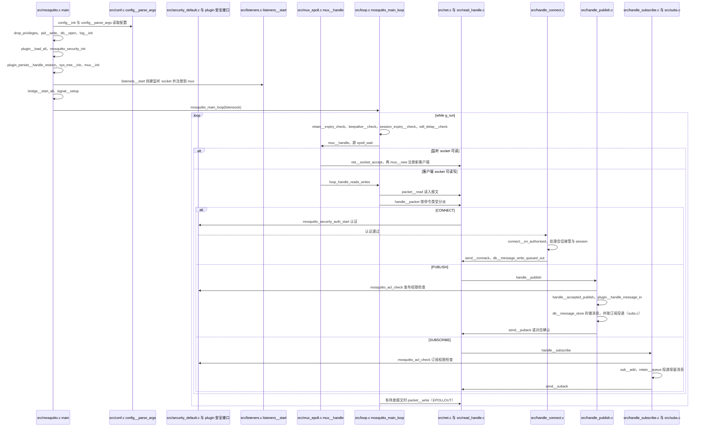

# Eclipse Mosquitto

**Eclipse Mosquitto** 是最广泛部署的 **开源 MQTT Broker** 之一，附带 **libmosquitto** C 库与 `mosquitto_pub` / `mosquitto_sub` CLI。读 OASIS MQTT 规范时的默认 **可运行对照实现**。

## 英文缩写速查

| 缩写 | 英文全称 | 简要说明 |
|------|----------|----------|
| MQTT | Message Queuing Telemetry Transport | OASIS IoT pub/sub 协议 |
| TLS | Transport Layer Security | 加密传输层 |
| CLI | Command-Line Interface | 命令行工具 |
| ACL | Access Control List | Broker 主题级访问控制 |
| EPL | Eclipse Public License | Mosquitto 主许可证 |

## 为什么重要

- **协议验证**：CONNECT、QoS 1/2 握手、Will、保留消息均可在本机复现。
- **机器人周边**：[PlotJuggler](./plotjuggler.md) MQTT 插件、[Wokwi](./wokwi.md) ESP32 仿真、边端 Agent 上报常对接 Mosquitto 或兼容 Broker。

## 核心信息

| 项 | 内容 |
|----|------|
| 机构 | 伊克利普斯基金会（Eclipse Foundation） |
| 仓库 | [github.com/eclipse/mosquitto](https://github.com/eclipse/mosquitto) |
| 许可证 | EPL-2.0 / EDL-1.0 |
| 协议版本 | MQTT 3.1.1、5.0（2.x 系） |
| 默认端口 | 1883（TCP）、8883（TLS） |

## 工程实践

```bash
sudo apt install mosquitto mosquitto-clients   # Debian/Ubuntu
mosquitto -v
mosquitto_sub -t 'robot/#' -v
```

配置见 `/etc/mosquitto/mosquitto.conf`：listener、password_file、aclfile、bridge 到云端 Broker。

## 局限与风险

- **单进程 Broker** 非集群 HA；生产应评估 EMQX/HiveMQ/云 IoT 或 Mosquitto 桥接拓扑。
- **非运控中间件**：勿用于 1 kHz 关节环，见 [MQTT 协议](../concepts/mqtt-protocol.md)。

## 关联页面

- [MQTT 通信协议](../concepts/mqtt-protocol.md)
- [PlotJuggler](./plotjuggler.md)
- [Wokwi](./wokwi.md)

## 源码运行时序图

入口：`mosquitto -c mosquitto.conf`（主函数在 `src/mosquitto.c` 的 `main`；`-c` 指定配置文件，可加 `-v` 等参数）



图依据：eclipse/mosquitto@83f2620，读过 `src/mosquitto.c`（`main` 的初始化顺序）、`src/loop.c`（`mosquitto_main_loop` 的循环体）、`src/mux_epoll.c`（`mux__handle` 的 accept 与读写分派）、`src/read_handle.c`（`handle__packet` 的 switch）、`src/handle_connect.c`（`connect__on_authorised` 与认证调用）、`src/handle_publish.c`（`handle__publish` 的 ACL 检查与 `handle__accepted_publish`）、`src/handle_subscribe.c`（`handle__subscribe` 的 ACL、`sub__add`、`retain__queue`）；`subs.c` 的投递细节与 `security_default.c` 仅按函数名检索，未逐行通读；未运行代码。

## 参考来源

- [Eclipse Mosquitto 仓库归档](../../sources/repos/mosquitto.md)
- 源码核对（2026-11-02）：eclipse/mosquitto@83f2620，读过 `src/mosquitto.c`、`src/loop.c`、`src/mux_epoll.c`、`src/read_handle.c`、`src/handle_connect.c`、`src/handle_publish.c`、`src/handle_subscribe.c`；时序图依据以上文件，未运行代码。

## 推荐继续阅读

- [Mosquitto 官方文档](https://mosquitto.org/documentation/)
