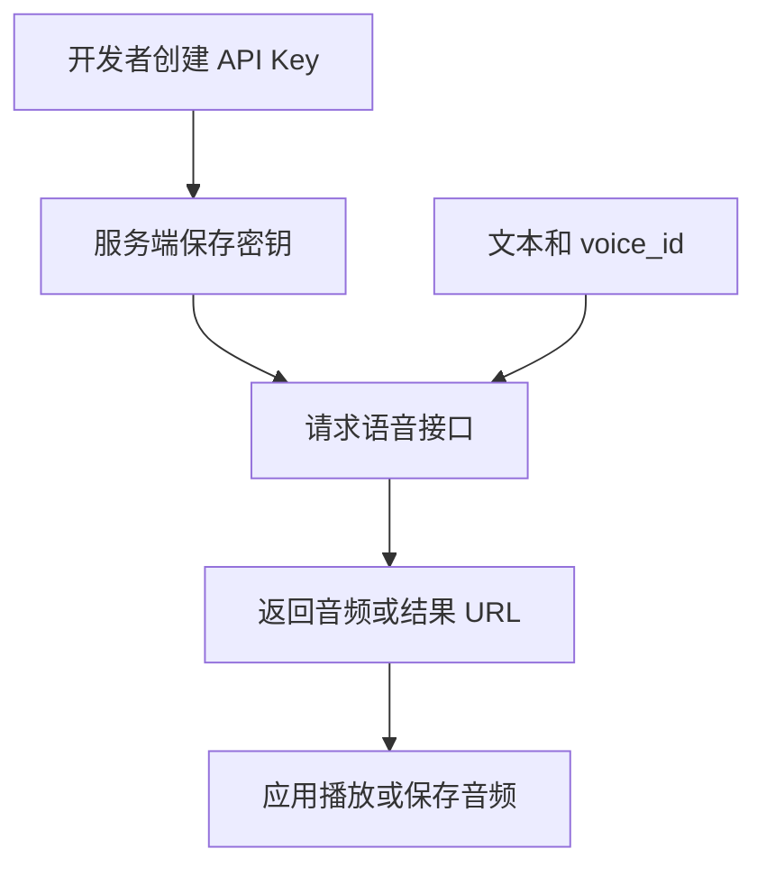

# MOSS API Open Platform / 模思开放平台

**MOSS API** 是模思智能的多模态模型云端接口与开发者平台，提供 Playground、模型目录和 API 文档。

## 英文缩写速查

| 缩写 | 英文全称 | 简要说明 |
|------|----------|----------|
| API | Application Programming Interface | 程序调用模型服务的接口 |
| TTS | Text-to-Speech | 文本转语音 |
| ASR | Automatic Speech Recognition | 语音识别与转写 |
| VL | Vision-Language | 视觉与语言理解 |
| SSE | Server-Sent Events | 服务端持续推送事件的机制 |

## 能力与接入

截至 2026-11-02，官方模型目录列出单人和多人语音生成、语音转写、图像与视频理解、实时视频理解、图像生成和实时交互。具体模型版本及价格以[模型目录](https://platform.moss.cn/en/docs/models/)为准。

| 场景 | 官方示例模型 | 接口 |
|------|--------------|------|
| 单人语音合成 | `moss-tts-1.5-flash` | `POST /v1/audio/speech` |
| 多人语音转写 | `moss-transcribe-diarize-pro` | `POST /v1/audio/transcriptions` |
| 图像及视频理解 | `moss-vl-1.0` | `POST /v1/responses` |
| 实时视频理解 | `moss-vl-realtime-1.0` | WebSocket `/v1/realtime` |
| 图像生成 | `moss-image-base-1.0` / `moss-image-sft-1.0` | `POST /v1/images/generations` |

## 接入流程

依据官方 Quickstart 和核心概念，下面是单人语音生成的接口流程，不代表服务内部模型架构。

基础地址为 `https://api.mosi.cn`，请求使用 Bearer Key。单人 TTS 示例需要文本与 `voice_id`；音色可通过音色列表或创建接口获取。按接口支持情况选择同步、异步或流式：异步音频任务通过 `task_id` 查询；流式输出与异步任务、双向实时会话并不等同。密钥应保存在服务端，勿放进客户端代码或公开仓库。

实时视频理解通过 WebSocket 连接并配置会话，按协议依次发送帧元数据、图像二进制和问题，再接收增量文本；该协议与音频实时交互协议不同。接口事件与细节应以[实时视频指南](https://platform.moss.cn/en/docs/scenarios/vl-realtime/)及对应参考文档为准。

## 工程实践与局限

- 平台提供云端服务；实时视觉可用于探索机器人场景描述或人机交互，但官网资料不足以证明闭环控制性能、实时控制延迟或安全性。
- 模型、价格、配额和可用区域可能变化；应用接入前查阅当前文档并实测端到端延迟与异常处理。
- 独立模型如 [MOSS-Image](moss-image.md) 和 [MOSS-Transcribe-Diarize](paper-moss-transcribe-diarize.md) 存在开源资料；不等于 API 平台服务端也已开源。所核查页面未提供平台服务端可运行源码，因此源码运行时序图不适用。
- 本页依据公开文档，未使用账户、密钥实际发起请求；模型服务质量及可用性未独立验证。

## 关联页面

- [MOSS-Image](moss-image.md) — 图像生成模型与开放权重。
- [MOSS-Transcribe-Diarize](paper-moss-transcribe-diarize.md) — 多说话人转写模型。

## 参考来源

- [官方平台与官网归档](../../sources/sites/moss-api-platform.md)
- [API 核心概念](https://platform.moss.cn/en/docs/getting-started/overview/)
- [Quickstart](https://platform.moss.cn/en/docs/getting-started/quickstart/)
- [API Overview](https://platform.moss.cn/en/docs/reference/)
