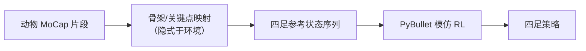
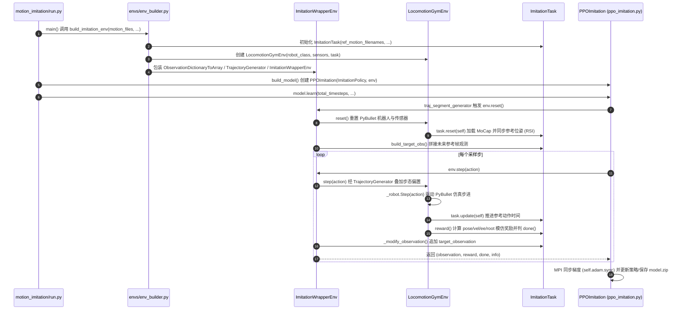

---

type: entity
tags: [repo, quadruped, motion-imitation, motion-retargeting, deepmimic, berkeley]
status: complete
updated: 2026-06-08
summary: "erwincoumans/motion_imitation 是 Peng 等「模仿动物」四足论文官方实现：动物 MoCap → 四足参考 → PyBullet RL 模仿，为 legged_gym/AMP 生态奠基。"
related:
  - ../tasks/locomotion.md
  - ./pybullet.md
  - ../methods/deepmimic.md
  - ../methods/amp-reward.md
  - ./legged-gym.md
  - ./xue-bin-peng.md
sources:
  - ../../sources/repos/motion_imitation_peng.md
original: ../../sources/repos/motion_imitation_peng.md
---

# motion_imitation（四足模仿动物）

## 一句话定义

**motion_imitation**（<https://github.com/erwincoumans/motion_imitation>）是 Xue Bin Peng 等论文 [*Learning Agile Robotic Locomotion Skills by Imitating Animals*](https://xbpeng.github.io/projects/Robotic_Imitation/index.html) 的 **官方开源实现**：在 **PyBullet** 中训练四足机器人跟踪 **动物 MoCap 参考**，是把「动物动作重定向到腿式机器人」带入主流 RL 社区的 **早期标杆仓库**。

## 英文缩写速查

| 缩写 | 英文全称 | 简要说明 |
|------|----------|----------|
| RL | Reinforcement Learning | 示例引导模仿学习 |
| MoCap | Motion Capture | 动物参考动作来源 |
| AMP | Adversarial Motion Prior | 后续四足风格先验扩展 |
| PD | Proportional–Derivative | 仿真中关节跟踪底层 |

## 为什么重要

- **四足重定向的历史锚点**：虽不叫 retargeting 模块，但核心问题就是 **异构骨架（动物→四足）参考映射 + 可跟踪性**。
- **后续生态母本**：[DeepMimic](../methods/deepmimic.md)、[AMP](../methods/amp-reward.md)、[legged_gym](./legged-gym.md)、[MimicKit](./mimickit.md) 均由此脉络演化。

## 核心机制

- **关键点重定向**：将动物（如狗）的 MoCap 关键点与姿态映射到四足机器人参考状态序列。
- **模仿学习奖励**：在 PyBullet 仿真环境中以参考状态初始化（RSI）和姿态/速度跟踪奖励驱动 RL 策略学习敏捷步态。

## 工程实践

- `paper` 分支保留论文原始代码；`motion_imitation/data/motions/` 含多种动物片段（pace、trot 等）。
- 训练示例：`python motion_imitation/run.py --mode train --motion_file motion_imitation/data/motions/dog_pace.txt --visualize`

## 局限

- 基于 PyBullet CPU 仿真，大规模并行训练吞吐量远低于 Isaac Gym / Isaac Lab 生态。
- 依赖预设关键点映射，跨形态泛化能力有限。

## 流程概念

## 源码运行时序图

以下时序基于官方仓库 `erwincoumans/motion_imitation`（`master` 分支）中 `motion_imitation/run.py`、`motion_imitation/envs/env_builder.py`、`motion_imitation/envs/env_wrappers/imitation_wrapper_env.py`、`motion_imitation/envs/env_wrappers/imitation_task.py`、`motion_imitation/envs/locomotion_gym_env.py` 与 `motion_imitation/learning/ppo_imitation.py` 核对整理：

关键复现入口：`python3 motion_imitation/run.py --mode train --motion_file motion_imitation/data/motions/dog_pace.txt`（测试回放使用 `--mode test --model_file ...`）。

## 关联页面

- [DeepMimic](../methods/deepmimic.md)
- [AMP 奖励设计](../methods/amp-reward.md)
- [legged_gym](./legged-gym.md)
- [Xue Bin Peng](./xue-bin-peng.md)

## 参考来源

- [motion_imitation 仓库归档](../../sources/repos/motion_imitation_peng.md)

## 推荐继续阅读

- 项目页：<https://xbpeng.github.io/projects/Robotic_Imitation/index.html>
- GitHub：<https://github.com/erwincoumans/motion_imitation>
