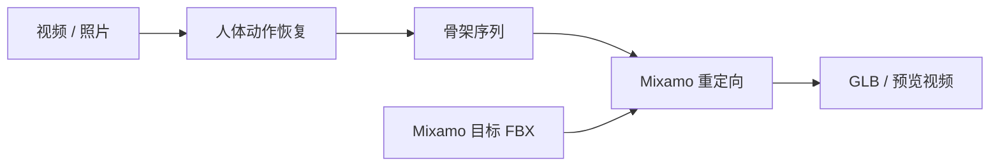

# Motion2MixamoRig

[Motion2MixamoRig](https://github.com/MaxLiu22/Motion2MixamoRig) 是一套开源“视频/照片→Mixamo动画”工具：给定单人全身视频或静态姿态图、Mixamo 角色文件及所需人体模型资产，运行人体动作恢复与重定向，导出蒙皮 .glb、骨架中间结果和预览视频。它把上游人体恢复和目标角色适配封装成可复用工程，不是一个新的动作估计模型。

## 一句话定义

> Motion2MixamoRig = 单人视频/照片 → 人体动作恢复 → Mixamo 骨架重定向 → 蒙皮 GLB 与预览导出。

## 英文缩写速查

| 缩写 | 英文全称 | 简要说明 |
|---|---|---|
| CLI | Command-Line Interface | 命令行接口；项目提供 `m2mr` 命令 |
| GLB | GL Transmission Format Binary | 二进制 glTF 文件，可携带网格、材质与骨骼动画 |
| FBX | Filmbox | 常用于交换三维模型、骨架和动画的文件格式 |
| SMPL-X | Skinned Multi-Person Linear eXpressive | 项目人体模型资产之一；需遵循其单独许可 |
| GVHMR | Gravity-View Human Mesh Recovery | 项目依赖的人体动作恢复模型之一 |

## 流程与接口

仓库提供 m2mr doctor、m2mr run 和 Blender 4.2+ 扩展。CLI 支持视频、静态图片、角色 rig 和 skeleton 复用参数；推理后可保留 skeleton，以便换角色时避免重复提取动作。项目 README 指出需要下载 GVHMR 等模型权重，故不应将整个流水线简化为“仅运行 GVHMR”。

## 复现与许可注意

首次运行需下载约 5 GB 权重；推理速度受硬件、视频长度和是否复用 skeleton 影响。用户需自行获取 Mixamo FBX 与 SMPL-X body model。仓库代码采用 Apache-2.0，但 SMPL-X 默认非商业许可及 Mixamo/上游权重各有独立条款；部署或分发前逐项确认。

## 参考来源

- [Motion2MixamoRig 官方仓库归档](../../sources/repos/motion2mixamorig.md)
- [Motion2MixamoRig 官方 GitHub 仓库](https://github.com/MaxLiu22/Motion2MixamoRig)
- [GVHMR 官方仓库](https://github.com/zju3dv/GVHMR)；[论文](https://arxiv.org/abs/2409.06662)

## 关联

- [GVHMR](./gvhmr.md)：人体运动恢复上游之一。
- [Motion Retargeting](../concepts/motion-retargeting.md) 与 [Motion Retargeting Pipeline](../concepts/motion-retargeting-pipeline.md)：所属任务链。
- 来源：[仓库归档](../../sources/repos/motion2mixamorig.md)。
