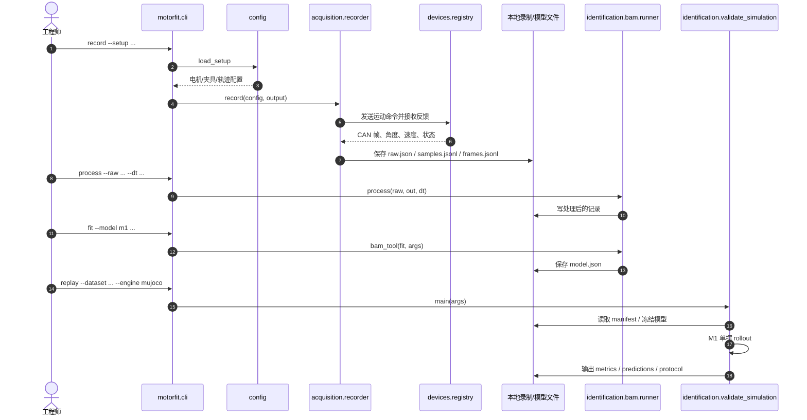

# MotorFit：电机动力学参数辨识与验证（Motor Identification and Validation）

## 一句话定义

**MotorFit** 将电机真实指令与运动记录、Rhoban BAM M1–M6 参数辨识、留出集评估和跨引擎单摆回放连成一条可复查的数据链，用于执行器建模和 Sim2Real 误差诊断，而非电磁设计或任意人形机器人的即插即用控制器。

## 英文缩写速查

| 缩写 | 英文全称 | 简要说明 |
|---|---|---|
| BAM | Better Actuator Models | 上游 M1–M6 执行器模型及拟合框架 |
| MIT | MIT-style impedance control | 目标位置、速度、Kp/Kd、力矩前馈接口 |
| CAN | Controller Area Network | 真机电机通信，通过 Linux SocketCAN 采集 |
| SysID | System Identification | 用实测数据拟合动力学参数 |
| MAE | Mean Absolute Error | 角度预测与实测的平均绝对误差 |

## 为什么重要

真实驱动器存在摩擦、反射惯量、位置指令延迟、坐标零偏和指令量化；仅用理想 PD 或力矩源可能让仿真与真机轨迹不一致。MotorFit 保存原始 CAN 帧、配置与独立评估记录，帮助研发者检查辨识模型是否能解释**没有参与拟合的动作**。它是 [关节执行器参数辨识](../methods/joint-actuator-parameter-identification.md) 的工程实现候选。

## 核心原理

| 阶段 | 关键数据与机制 |
|---|---|
| 真机采集 | RobStride RS00–RS06 / 达妙 16 个 MIT profile，经 SocketCAN 保存 raw.json、samples.jsonl、frames.jsonl |
| 训练与选择 | process 统一时间栅格，Rhoban BAM fit 对 M1–M6 进行位置误差拟合 |
| 验证 | fit --eval 在未参与拟合的完整记录上评价固定模型 |
| 引擎重放 | 将受支持的 **M1 torque-MIT 单摆**重放到 MuJoCo、Newton、mjlab，与实测/BAM 对照 |

M1 的六项主要参数是 torque_ratio（扭矩比例）、armature（附加关节惯量）、q_offset（坐标偏置）、command_delay（位置指令延迟）、friction_base（库仑型摩擦）、friction_viscous（黏性摩擦）。M2–M6 加入低速 Stribeck 或负载相关摩擦。**参数联合拟合好不等于单独测得了绕组力矩常数**；MuJoCo 中的 armature / frictionloss / damping 仅承载部分机械项，延迟与扭矩比例需额外控制逻辑。

### 流程总览


**物理后端限制：** 当前引擎 replay 只实现 M1 + torque-MIT + 单摆夹具，不是 M2–M6 或完整人形执行器的通用集成。

## 源码运行时序图

根据官方 [CLI](https://github.com/motorfit/motorfit/blob/main/src/motorfit/cli.py)、[采集实现](https://github.com/motorfit/motorfit/blob/main/src/motorfit/acquisition/recorder.py)、[BAM runner](https://github.com/motorfit/motorfit/blob/main/src/motorfit/identification/bam/runner.py) 和 [replay](https://github.com/motorfit/motorfit/blob/main/src/motorfit/identification/validate_simulation.py) 编制的**静态调用时序**，非运行 trace。record、process、fit、replay 是分别调用的 CLI 命令。



## 工程实践

官方 0.1.0 需要 Python 3.12、uv 及 third_party/bam 子模块；真机采集依赖 Linux SocketCAN。Damiao 型号应匹配 PMAX/VMAX/TMAX；record 会启用电机，须确保安装固定、行程、急停与供电切断措施。

官方提供的**离线**例子（这里未执行，亦非重新拟合）：

```bash
uv sync --frozen
uv run --no-sync motorfit demo \
  --dataset tests/fixtures/offline/manifest.json \
  --output outputs/rs05-demo

uv sync --frozen --extra simulation
uv run --no-sync motorfit replay \
  --dataset tests/fixtures/offline/manifest.json \
  --engine mujoco --dt 0.002 --output outputs/rs05-mujoco
```

自己录制的新 raw.json 应先完成训练和验证；replay 还需要包含模型、录制与固定参考预测的 dataset manifest，不能把单一 record 目录直接用于 replay。

**RS05 官方报告（非本次实测）**

| 样本 | 指标 | 官方结果 |
|---|---|---|
| 3 档负载，各 37 条 | 总记录 | 111 条，完整归档不随 Git 下载 |
| 36 条 final-test | 冻结 BAM M1 位置 MAE 均值 | 约 **2.035 mrad**，200 g release/停止仍有残差 |
| 随 Git 的 100 / 200 / 500 g 三条示例 | BAM 位置 MAE | 分别 **1.607 / 5.327 / 1.219 mrad**；PASS 表示冻结预测重放一致 |

## 局限与风险

- **有限的开源数据：** 111 条 RS05 全量实验/CAD/视频不随仓库分发；只有三条离线示例，未对全部数据实测。
- **不可误读外推能力：** BAM 支持 M1–M6 拟合，物理引擎适配当前只 M1 单摆，不代表完整整机/并联传动或所有摩擦模型已对齐。
- **辨识非唯一：** 夹具惯量误差可被 armature / torque_ratio 吸收，命令延迟不等于 CAN 单段传输时延；应变更负载、增益和激励测试。
- **执行安全：** 实机 record 会驱动摆臂，采样与控制循环不保证硬实时；异常时检查 CAN 帧与设备故障证据。
- **环境边界：** 仓库公开源码为 Apache-2.0；README 提示 SSH 克隆权限，Newton/mjlab 还需要另外的依赖运行环境。

## 关联页面

- [关节执行器参数辨识](../methods/joint-actuator-parameter-identification.md)
- [Sim2Real 关节辨识实验设计](../methods/sim2real-joint-sysid-experiment-design.md)
- [执行器驱动链选型闭环](../queries/actuator-drive-chain-selection-loop.md) — 本工具位于第③层：电机真机记录、辨识与仿真校准；不能代替固件电流环和总线实时性验证
- [Rhoban BAM 论文](./paper-bam-extended-friction-servo-actuators.md)
- [Armature 建模](../concepts/armature-modeling.md)与[关节摩擦](../concepts/joint-friction-models.md)
- [力矩电机设计路线 Stage 6](../../roadmap/depth-torque-motor-design.md)和[Sim2Real 路线 Stage 1](../../roadmap/depth-sim2real.md)

## 参考来源

- [官方源码归档](../../sources/repos/motorfit.md)
- [官方文档归档](../../sources/sites/motorfit-official-docs.md)
- [官方代码仓库](https://github.com/motorfit/motorfit)
- [RS05 案例](https://github.com/motorfit/motorfit/blob/main/docs/case-studies/rs05.md)

## 推荐继续阅读

- [官方 Quickstart](https://github.com/motorfit/motorfit/blob/main/docs/getting-started/quickstart.md)
- [官方模型参数](https://github.com/motorfit/motorfit/blob/main/docs/reference/parameters.md)
- [官方后端限制](https://github.com/motorfit/motorfit/blob/main/docs/reference/backends.md)
