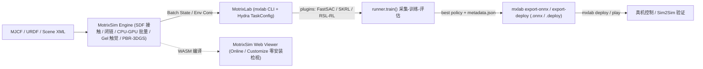
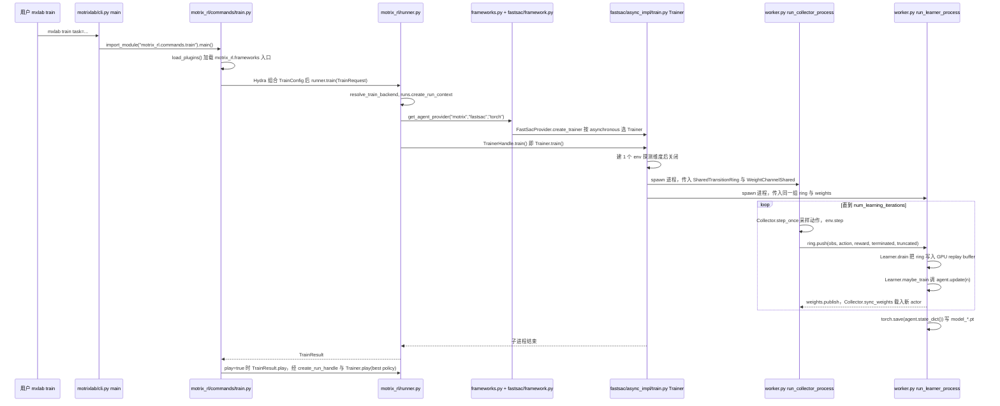

---

type: entity
status: complete
title: Motrix (MotrixSim / MotrixLab)
tags: [simulation, physics-engine, robot-learning, rust, mjcf, web-viewer, motphys]
summary: "Motrix 是高性能机器人物理仿真与训练平台，采用 Rust 开发，深度兼容 MJCF 格式，并提供浏览器 Web Viewer 零安装验模；MotrixLab 侧含 Microduck 球平衡等 FastSAC 任务。"
updated: 2026-11-21
related:
  - ./botworld.md
  - ./pollen-microduck.md
  - ../tasks/microduck-ball-balance.md
original:
  - ../../sources/repos/motphys-motrix.md
  - ../../sources/repos/motrixlab.md
  - ../../sources/sites/motrixsim-web-viewer.md
sources:
  - ../../sources/repos/motphys-motrix.md
  - ../../sources/repos/motrixlab.md
  - ../../sources/sites/motrixsim-web-viewer.md
  - ../../sources/sites/motphys.md
  - ../../sources/blogs/motphys-microduck-ball-balance-motrixsim.md
---

# Motrix (Motphys 机器人仿真与训练平台)

## 一句话定义

**Motrix** 是由 Motphys 开发的高性能机器人物理仿真与强化学习训练平台，由广义坐标多体动力学引擎 **MotrixSim**（支持 SDF 精细接触、闭链约束、MPM 软体与 CPU/GPU 大规模并行）、模块化 RL 训练与部署平台 **MotrixLab**（`mxlab` CLI + SKRL/RSL-RL/FastSAC）以及零安装浏览器端 **MotrixSim Web Viewer**（WASM）共同组成。

## 英文缩写速查

| 缩写 | 英文全称 | 简要说明 |
|------|----------|----------|
| MJCF | MuJoCo XML Format | MuJoCo 的模型与场景描述格式 |
| URDF | Unified Robot Description Format | 机器人连杆与关节的 XML 描述格式 |
| WASM | WebAssembly | 浏览器内运行原生级代码的虚拟机格式 |
| CPU | Central Processing Unit | 中央处理器 |
| RL | Reinforcement Learning | 通过与环境交互最大化长期回报来学习策略的范式 |
| GPU | Graphics Processing Unit | 图形处理器，大规模并行仿真训练的算力基础 |

## 为什么重要

- **高性能 CPU/GPU 并行底座**：MotrixSim 在 `4096` 并行环境下同时提供 CPU 批量仿真（Ryzen 9 9950X / EPYC 9J14）与 GPU 后端（RTX 5090），对稀疏接触、多点摩擦、闭链机构（如 12 腿 92 连杆 Strandbeest 的 36 闭环约束）与刚软耦合无需强绑定单一 CUDA 物理栈；已被 [UniLab](unilab.md)（arXiv:2605.30313）与 RSS 2026 工作 GS-Playground 用作核心物理后端。
- **训练到部署的统一控制面**：MotrixLab 将环境接口（`motrix-env-core` / `motrix-envs`）与算法插件（`motrix.fastsac`、`skrl.ppo`、`rslrl.ppo`）解耦，并通过 `mxlab train / play / view / export-onnx / export-deploy / deploy / bench` 贯通策略训练与部署产物打包。
- **零安装浏览器端验模**：MotrixSim Web Viewer 将核心引擎编译为 WebAssembly，研究者无需安装本地桌面依赖即可在浏览器中检视 MJCF/URDF 模型与关节极限。

## 核心原理

Motrix 平台由三层耦合架构构成：底层 **MotrixSim** 提供广义坐标多体动力学、基于符号距离场（SDF）的非凸精细接触求解、MPM 软体/凝胶触觉传感与 PBR/3DGS 渲染；中层 **MotrixLab** 借助 `motrix_rl` 注册中心按 `task=<env>/<rllib>.<algo>` 加载环境与算法插件（`motrix-rl-builtin`、`motrix-rl-skrl`、`motrix-rl-rslrl`），支持异步 FastSAC 进程池采集/学习；上层通过 **ONNX / `.deploy` 导出与 Web Viewer** 连接真机部署或在线展示。

### 流程总览



### 1. MotrixSim (仿真引擎)
- **定位**：工业级高性能多体动力学与渲染引擎（Python 二进制包 `motrixsim` 与示例文档库 `Motphys/motrixsim-docs`）。
- **技术底座**：Rust 核心，支持 Linux/Windows x86_64 与 macOS Apple Silicon（windowed 示例用 `mxpython`），提供 CPU/GPU 批量仿真接口与 SDF 精细接触、闭链约束（Strandbeest 示例）、MPM 刚软耦合及凝胶触觉位移场求解。
- **兼容性**：深度支持 **MJCF** 格式，并可加载 **URDF**、**JSON** 等场景描述；视觉侧支持 SSGI PBR 与 3DGS 混合渲染。

### 2. MotrixLab (训练平台)
- **统一 CLI（`motrixlab/src/motrixlab/cli.py`）**：`mxlab` 子命令涵盖 `train`、`play`、`view`、`export-onnx`、`export-deploy`、`deploy` 与 `bench`。
- **插件化控制面（`motrix_rl`）**：`motrix_rl` 不硬编码算法实现，而是通过 `motrix_rl.frameworks` 入口组在 Hydra 组合配置前加载 `motrix-rl-builtin`（FastSAC）、`motrix-rl-skrl`（JAX/PyTorch PPO）或 `motrix-rl-rslrl`（PyTorch PPO）；支持 `uv` 下的 `cuda` / `rocm` GPU profile 互斥路由。
- **Microduck 环境族**：50+ 注册环境与 7 款机器人模型，含 `microduck-walk-flat/rough`（多算法）与 `microduck-ball-balance`（`motrix.fastsac` 2048 并行异步训练，详见 [Microduck 球平衡](../tasks/microduck-ball-balance.md)）。

### 3. MotrixSim Web Viewer (浏览器端)
- **入口**：[Motrix Viewer](https://motrix.motphys.com/) — 现代浏览器 + **WebAssembly** 即可运行，无需本地安装；亦作为 [BotWorld](./botworld.md) 插件中心推荐入口，便于从资产广场跳转验模。
- **加载方式**：Web 端无法像桌面版直接读本地盘；应**将整个模型文件夹**（含 `scene.xml`、meshes、textures 等相对路径依赖）拖入页面，再在左侧 `Customize` 文件树中点击场景文件。
- **文件来源**：
  - **Online**：站点内置只读示例，加载 manifest 后自动列出。
  - **Customize**：当前会话中由用户拖入的本地资产，刷新后消失。
- **交互**：顶部栏 Play / Pause / Next、Reset、Reload；支持轨道相机、单步（F10）、重置（Ctrl+E）、重载（Ctrl+R）及可选的 **Ctrl+左键物理拖拽**。
- **定位**：快速验模、教学演示与对外分享；[UniLab](unilab.md) 等叙事中的浏览器 MotrixSim 策略试玩与此同属 Web 侧能力。大规模 RL 批量训练仍应使用 MotrixLab / 桌面 MotrixSim。

## 为什么选择 Motrix？

- **高性能 CPU 后端**：相比过度依赖 GPU 的 [isaac-gym-isaac-lab](isaac-gym-isaac-lab.md)，Motrix 的 Rust CPU 后端在 CPU 资源环境下提供了卓越的并行仿真能力，适合需要高确定性或 GPU 资源受限的工业场景。
- **零安装 Web 验模**：Web Viewer 降低协作与展示门槛，适合在分享 MJCF/URDF 资产前做快速动力学检视。
- **极致的 RL 吞吐量**：针对大规模并行采样进行了优化，缩短了从算法定义到策略收敛的迭代周期。
- **现代化的生态**：使用 `uv` 管理依赖，支持 TensorBoard 实时监控，提供 Pythonic 的 API 交互。

## 与其他系统的关系

- **对比 [mujoco](mujoco.md)**：MotrixSim 是 MuJoCo 的现代化、高性能替代方案，保持了 MJCF 兼容性，但在并行化和系统稳定性上做了更多工作。
- **对比 [isaac-gym-isaac-lab](isaac-gym-isaac-lab.md)**：Motrix 提供了更轻量、更灵活的 CPU 并行方案，而非强制绑定特定的 NVIDIA 驱动与硬件。
- **与 [UniLab](unilab.md)**：UniLab 将 **MotrixSim** 与 MuJoCoUni 作为可选 CPU 批量物理后端，经统一 runtime 对接 GPU learner（见论文 arXiv:2605.30313）；项目页亦链到浏览器 MotrixSim demo。
- **对比 [genesis-sim](genesis-sim.md)**：Genesis 更强调多物理场（流体、柔性体），而 Motrix 更专注于刚体关节型机器人的高频控制与 RL 训练。

## 快速体验：Microduck 蹬球平衡 与 统一 CLI

```bash
# 方式 A：MotrixLab 安装后使用统一 CLI mxlab（推荐入口）
mxlab view env=microduck-ball-balance
mxlab train task=microduck-ball-balance/motrix.fastsac play=true
mxlab play env=microduck-ball-balance
mxlab export-deploy env=go2-walk-flat output=artifacts/go2-walk-flat.deploy

# 方式 B：MotrixLab 仓库兼容脚本
python scripts/train.py task=microduck-ball-balance/motrix.fastsac play=true
```

## 工程实践

| 实践要点 | 说明 |
|---|---|
| 安装与依赖管理 | 官方推荐 `uv` + `git lfs pull` + `sh install.sh --gpu cuda`（或 `rocm`）；外部 `uv` 项目引用 Git 源码需显式声明 `cuda` / `rocm` 互斥，不要用存在 forwarding bug 的旧版 `uv export` 导出 GPU profile |
| 异步 FastSAC OpenMP 冲突规避 | `motrix_rl/commands/train.py` 在导入 Torch 前默认设置 `OMP_WAIT_POLICY=PASSIVE` 与 `GOMP_SPINCOUNT=0`，避免异步 Collector 与 Learner 进程争抢 CPU 自旋 |
| 部署包与自洽校验 | `mxlab export-onnx` 用 `parity.*` 校验导出等价性；`mxlab export-deploy` 打包 `.deploy` 自洽部署包并按 `validation.*` 校验，`motrix-deploy` 不反向依赖 `motrix-rl` |
| Web Viewer 文件夹拖拽约束 | 浏览器端无权读取本地分散路径，必须将包含 `scene.xml`、meshes、textures 的**整个目录**拖入 `Customize` 再点选加载 |

## 局限与风险

- **引擎二进制闭源边界**：`Motphys/motrixsim-docs`（即 `motrixsim` 示例仓库）明确声明仓库仅包含文档、示例、测试与资产，`motrixsim` 物理求解运行时以闭源二进制 Python 包分发，无法直接审计底层 Rust/CUDA 求解器源码。
- **GPU 与渲染额外前提**：官方标称的 Rust CPU 仿真覆盖 Linux/Windows x86_64 与 macOS Apple Silicon，但 GPU 批量仿真、SSGI PBR 与 3DGS 渲染均需额外图形/驱动栈，macOS 窗口示例须改用 `mxpython`。
- **任务与真机迁移约束**：如 `microduck-ball-balance` 当前仅配置了 `motrix.fastsac` 配方且默认无物理域随机化，直接迁移到真实硬件前仍需在任务配置中补齐系统辨识、延迟与观测噪声随机化。

## 源码运行时序图

入口：`mxlab train task=microduck-walk-flat/motrix.fastsac play=true`（`mxlab = motrixlab.cli:main`；默认 `asynchronous: true`，走异步 collector/learner 双进程；`asynchronous=false` 时改走 `sync/train.py` 单进程交替）



图依据：`Motphys/MotrixLab@8a1b6c3` 初始测绘，并经 `Motphys/MotrixLab@7701fca`（2026-11-21）复核 `motrixlab/src/motrixlab/cli.py` 与 `motrix_rl/src/motrix_rl/{commands/train.py,commands/play.py,runner.py}` 仍沿用 `mxlab` CLI → `motrix_rl.commands.train` → `runner.train` 主链路（说明文档核对，未独立运行 GPU 训练）。

## 关联页面

- [Microduck 球平衡](../tasks/microduck-ball-balance.md) — `microduck-ball-balance` 任务页
- [Pollen Microduck](./pollen-microduck.md) — 硬件与 Runtime
- [UniLab](unilab.md) — 异构 CPU-sim / GPU-learn 训练系统（MotrixSim 后端）
- [simulation](../../references/repos/simulation.md) (仿真平台导航)
- [rl-frameworks](../../references/repos/rl-frameworks.md) (RL 框架导航)
- [mujoco](mujoco.md) (底层物理引擎参考)
- [BotWorld](./botworld.md) — 机器人资产广场；插件中心挂载 Motrix Viewer

## 推荐继续阅读

- [MotrixSim Web Viewer 用户指南](https://motrixsim.readthedocs.io/en/latest/user_guide/getting_started/motrixsim_web.html) — 拖文件夹加载、快捷键与工具栏说明
- [MotrixSim 官方文档](https://motphys.github.io/motrixsim-docs/) — 安装与 API
- [MotrixLab GitHub](https://github.com/Motphys/MotrixLab) — RL 训练栈

## 参考来源
- [Motrix 原始资料](../../sources/repos/motphys-motrix.md)
- [MotrixLab 仓库归档](../../sources/repos/motrixlab.md)
- [MotrixSim Web Viewer 用户指南](../../sources/sites/motrixsim-web-viewer.md)
- [Motphys 官网归档](../../sources/sites/motphys.md)
- [小鸭子在 MotrixSim 里练起了蹬西瓜](../../sources/blogs/motphys-microduck-ball-balance-motrixsim.md)
- [MotrixSim 官方文档](https://motphys.github.io/motrixsim-docs/)
- [MotrixLab GitHub](https://github.com/Motphys/MotrixLab)（源码核对：`@8a1b6c3` / `@7701fca` 复核）
