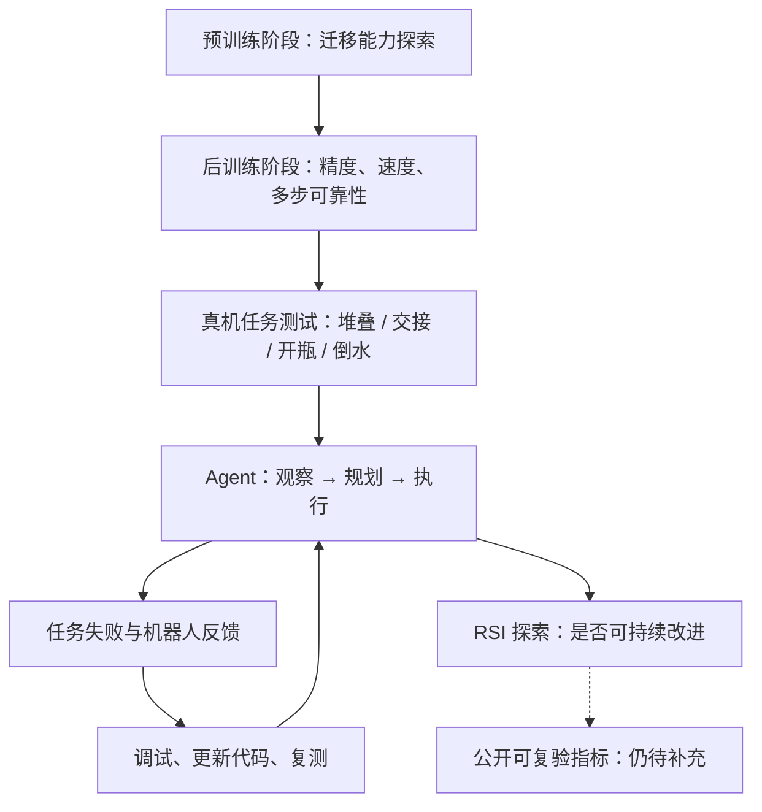

# Motubrain 2.0 公开训练直播 / Motubrain 2.0 Physical AI Live Lab

## 一句话定义

**Motubrain 2.0 公开训练直播**是生数科技围绕新一代机器人 Physical AI 模型展示训练、真机测试、Agent 任务执行与 RSI 探索的公开研究过程；它是**过程披露入口，不是可直接复现实验的论文或开源代码**。

## 英文缩写速查

| 缩写 | 英文全称 | 简要说明 |
|------|----------|----------|
| WAM | World Action Model | 联合世界状态预测与机器人动作生成的模型范式 |
| PT | Pre-Training | 预训练阶段，主要学习可迁移的能力 |
| Agent | Intelligent Agent | 带任务规划、执行与反馈的智能体环节 |
| RSI | Recursive Self-Improvement | 递归自我改进；需检验改进是否持久且能持续强化改进机制 |
| Physical AI | Physical Artificial Intelligence | 在真实物理世界进行感知、决策与行动的 AI |

## 为什么重要

- **把黑箱从 Demo 前移到训练现场：** 2026-10-21 官方宣布公开约半个月的训练全流程，讨论模型能力如何随阶段变化，而非只展示最终动作。
- **关注真机反馈：** 官方 11-13 的 Agent 片段明确描述“失败 → 机器人反馈 → 调试并更新代码 → 复测”，是可观察的工程修正循环。
- **区分 RSI 宣称与实证：** 11-14 官方发布最后训练日的 RSI 精选，但未提供足以验证递归能力增长的指标和可复现协议。
- **避免版本混淆：** [Motubrain 第一代](./paper-motubrain.md) 论文的 RoboTwin 2.0 95.8 / 96.1 等指标不能直接记为新版本直播成果。

## 核心信息

| 项 | 官方公开的状态 |
|----|----------------|
| 组织 | 生数科技（ShengShu Technology），Motubrain Team |
| 主要入口 | [Motubrain 2.0 Live](https://www.motubrain.com/motubrain2.0-live/) |
| 启动时间 | 官方 2026-10-21 宣布直播；最初计划约半个月 |
| 公开阶段 | 预训练 / 后训练、Agent 真机任务、RSI 探索 |
| 公开例子 | 堆叠、交接、开瓶、倒水；Agent 的观察/规划/抓取/导航/动作 |
| 2.0 独立论文 | **本次未核实到**可公开阅读全文的正式技术报告 |
| 代码 / 权重 | 官方曾预告后续开源；**截至 2026-11-17 未核实到 2.0 训练/推理代码或权重** |
| 版本边界 | 现有 [MotuBrain GitHub 仓](https://github.com/shengshu-ai/MotuBrain) 对应第一代论文/资料，不能据其宣告 2.0 可复现 |

## 核心原理与公开证据结构

公开资料呈现的是分阶段训练与真机反馈过程，而**非**可确认的 2.0 内部网络结构：预训练和后训练的真机示例用于观察动作能力；Agent 阶段把任务执行失败反馈给代码调试环节；RSI 阶段仍是探索展示。这里仅根据官方公开描述整理信息流，不推断未披露的模型梯度、参数更新或自我改进机制。

| 时间 | 阶段/事件 | 可观察内容 | 不应推断 |
|------|-----------|------------|----------|
| 10-21 | 宣布公开训练 | 训练、测试、泛化、Agent 反馈与 RSI 研究目标 | 完整训练数据已开放 |
| 11-10 | 后训练答疑 | 重启原因与精度、速度、多步可靠性等优化方向 | 已测得明确提升幅度 |
| 11-11 | 预训练与后训练 | 真机堆叠、交接、开瓶、倒水等定性示例 | 这些任务成功率已达到某个数 |
| 11-13 | Agent 阶段 | 遇失败后利用机器人反馈，**更新代码**再测试 | 更新的是策略权重或实现了在线 RL |
| 11-14 | RSI 探索 | 官方标注“最后训练日 RSI 精选” | 已达到开放式递归自我改进 |

### 阶段流程图（按官方宣布和公开帖子整理）

**读图边界：** 这是官方公开**阶段与 Agent 失败修复循环**的梳理，不是模型内部拓扑、权重训练数据流或已公开的源码调用图。RSI 的连接表示研究探索顺序，不代表已有自动更新权重的闭环。

## 源码运行时序图

**不适用（待发布 / 待核验）：** 2026-11-17 核查 [shengshu-ai/MotuBrain](https://github.com/shengshu-ai/MotuBrain) 仅有第一代 README、PDF、LICENSE、figures；没有可核验的 Motubrain 2.0 训练或推理入口。不能据通用训练常识虚构运行时序。

## 工程实践：如何判断直播是否提供可复现证据

1. **预训练与后训练：** 记录每阶段版本、数据规模、优化目标、硬件预算及固定任务集；只有前后采用一致协议才能评价阶段增益。
2. **真机泛化：** 区分 seen/unseen task；记录每任务试验次数、成功判据、人工干预、重置和失败恢复，而不以演示视频替代成功率。
3. **Agent 闭环：** 分清修改的是任务代码、工具链、提示或模型权重；公开帖子在 11-13 明确的是“更新代码”。
4. **RSI 审计：** 检验改进产物能否留存、是否经固定外部评估、下一轮是否更容易提出有效改进；单次任务做对不构成 RSI 证明。

## 局限与风险

- **直播正文未通读：** 用户指定页面在本次抓取中无可读正文；已核对官方账号原始帖文，仍缺完整视频、每日训练曲线与逐日实验日志。详见[来源归档](../../sources/sites/motubrain-2-live.md)。
- **无可核验的 2.0 专属成果包：** 官方“将开源”的表述不等于 2.0 实际发布权重、代码或数据。
- **2.0 与第一代论文不能混用：** 第一代已有技术报告及 RoboTwin / WorldArena 榜单；本次直播无同协议可引用的 2.0 结果。
- **RSI 有术语风险：** 代码修复循环和自我评价并不自动意味着模型自递归增强，需要独立评测和持续改进证据。

## 关联页面

- [Motubrain（第一代 Joint WAM 论文）](./paper-motubrain.md)
- [Motus2（含策略/世界/价值接口的自进化研究）](./paper-motus2.md)
- [World Action Models](../concepts/world-action-models.md)
- [递归自我改进](../concepts/recursive-self-improvement.md)
- [VLA（视觉语言动作模型）](../methods/vla.md) — 对照前馈策略与世界模型耦合
- [机器人操作任务](../tasks/manipulation.md) — 直播演示的任务类别
- [Model-Based RL](../methods/model-based-rl.md) — 理解“由真机反馈改进模型”仍需何种证明
- [WAM 纵深路线](../../roadmap/depth-wam.md)
- [RSI 纵深路线](../../roadmap/depth-rsi.md)

## 参考来源

- [Motubrain 2.0 官方直播入口归档](../../sources/sites/motubrain-2-live.md)
- [Motubrain 官方社交账号 10–11 月发布记录](../../sources/blogs/motubrain-2-official-live-updates.md)
- 官方直播：<https://www.motubrain.com/motubrain2.0-live/>
- 官方账号：<https://x.com/motubrain>
- [第一代 Motubrain 代码仓归档](../../sources/repos/motubrain.md)

## 推荐继续阅读

- [Motubrain 第一代技术报告（arXiv:2604.27792）](https://arxiv.org/abs/2604.27792)
- [Motubrain 官方技术页](https://www.motubrain.com/zh/technology/)
- [Motus2 自进化通用世界模型](https://www.motubrain.com/en/news/motus2/)
