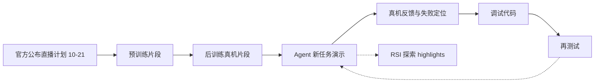

# Motubrain 2.0 公开训练动态 | Official Live-Training Updates

> **范围限定**：这是 **2026-10-21 至 11-14 官方账号公开帖子**的独立知识节点，而非直播全量研究报告。此页 `status: complete` 仅表示所列帖子文本及其证据边界已整理；**不表示直播录像、动态仪表盘、算法细节或 2.0 源码已通读/复现**。官方直播站点归档仍明确标注「通读：未完成」。

## 一句话定义

**Motubrain 2.0 公开训练动态**是生数科技以直播及官方帖子展示 Physical AI 训练阶段、真实机器人任务执行与 RSI 探索的过程性资料；它能说明团队公开了哪些**阶段和定性演示**，不能替代完整技术报告或可重复实验。

## 英文缩写速查

| 缩写 | 英文全称 | 简要说明 |
|---|---|---|
| WAM | World Action Model | 世界变化预测与机器人动作建模范式；本页不臆断 2.0 具体内部结构 |
| RSI | Recursive Self-Improvement | 递归自我改进；官方发布展示，但持续收益未被独立证实 |
| Agent | Autonomous Agent | 执行任务的规划与反馈循环；官方 11-13 展示了代码调试再测 |
| EEF | End-Effector | 末端执行器；本次 2.0 动态未公布可核对的动作空间定义 |

## 为什么重要

- **公开研发过程**：10-21 官方公布将预训练、后训练、Agent 执行及 RSI 探索作为直播观察主题，而非单独发布一个最终榜单。
- **真机反馈边界明确**：11-13 官方描述的失败恢复是根据机器人反馈调试、更新 **code** 再测试，**并未说明在线更新模型权重**。
- **为后续复核留证据锚点**：可将未来 2.0 论文/权重/真实评测与现阶段宣传片段进行逐项比较。

## 核心原理与公开证据结构

### 已核验官方帖子（均为团队自述）

| 日期 | 公开内容 | 证据性质 |
|---|---|---|
| 2026-10-21 | 宣布约半个月 Physical AI 全流程直播：训练阶段衔接、未见任务迁移、Agent 反馈和 RSI 可行性 | 目标和计划，非已达成指标 |
| 2026-11-10 | Q&A 提及重新启动训练、后训练侧重精度、速度和可靠多步执行 | 研究优先级，未列统一对照实验 |
| 2026-11-11 | 预/后训练真机片段涉及堆叠、物体交接、开瓶、倒水和少量演示 | 定性任务展示，非成功率统计 |
| 2026-11-13 | Agent 在新任务中观察、规划、抓取、导航、执行；失败后以机器人反馈调试**代码**再测 | 展示开发闭环，不证明策略权重在线自更新 |
| 2026-11-14 | 发布末日训练 RSI highlights 并预告正式发布 | 表明进行了 RSI 探索，不足以证明递归持续增益 |

### 公开阶段示意图

> **读图约束**：实线是公开阶段与 11-13 帖子描述的工作流程；虚线仅表示官方展示顺序/复测循环，**不是**已验证的模型更新算法、训练调用栈或权重级 RSI。

## 源码运行时序图

**不适用**：本次官方公开资料未提供可确认的 Motubrain 2.0 训练/推理入口；现有 [shengshu-ai/MotuBrain](https://github.com/shengshu-ai/MotuBrain) 的第一代报告仓不能充当 2.0 可运行代码。没有源码时不构造运行 `sequenceDiagram`。

## 工程实践

- 将 **计划 / 定性演示 / 可复现实证** 分开记录。11-11 真机片段不能反推成功率、推理频率或数据规模。
- 若后续公开 2.0 的训练日志、checkpoint 或代码，优先核对任务复测协议、权重是否改变、reset 条件、跨轮次收益、失败样例和真实部署延迟。
- 对标 [Model-Based RL](../methods/model-based-rl.md) 与 [Manipulation](../tasks/manipulation.md) 时只记录目前可确认的任务和反馈环路，不归因于尚未公开的网络模块。

## 局限与风险

- **完整直播未读**：直播页面动态正文、逐日训练曲线、视频原始记录尚无法完整核验，见 [站点来源](../../sources/sites/motubrain-2-live.md) 中保留的「通读：未完成」。
- **无 2.0 可复现实现**：独立论文、checkpoint、训练/推理入口及许可证尚无本次可核验的一手材料。
- **RSI 证据不足**：改动代码 ≠ 在线训练模型权重；展示 RSI highlights ≠ 通过可重复的持久改进评测。
- **勿继承第一代指标**：arXiv:2604.27792 的 RoboTwin / WorldArena 数字只属于 [Motubrain 第一代论文](./paper-motubrain.md)。

## 关联页面

- [Motubrain 第一代技术论文](./paper-motubrain.md) — 公开论文与 benchmark，不能移植到 2.0。
- [世界动作模型 WAM](../concepts/world-action-models.md) — 研究范式。
- [递归自我改进 RSI](../concepts/recursive-self-improvement.md) — 判别是否存在真正的持续增益。
- [Model-Based RL](../methods/model-based-rl.md) — 反馈、规划与模型更新的概念对照。
- [Manipulation](../tasks/manipulation.md) — 11-11 官方演示的任务类别。
- [WAM 纵深路线](../../roadmap/depth-wam.md) · [RSI 纵深路线](../../roadmap/depth-rsi.md)。

## 参考来源

- [Motubrain 官方公开帖逐条归档](../../sources/blogs/motubrain-2-official-live-updates.md)（`original`，已通读可见帖子文字；未核验视频）。
- [Motubrain 2.0 官方直播入口归档](../../sources/sites/motubrain-2-live.md)（仅作待核对的来源入口；未标为 `original`）。
- [官方原始社交账号](https://x.com/motubrain) · [可读的官方帖文镜像](https://teapawt.org/motubrain)。

## 推荐继续阅读

- [Motubrain 2.0 / Physical AI Live Lab](https://www.motubrain.com/motubrain2.0-live/) — 如恢复可读，补齐完整直播记录。
- [Motubrain 第一代](https://arxiv.org/abs/2604.27792) — 唯一可核验的前代论文，不代表 2.0 实测。
