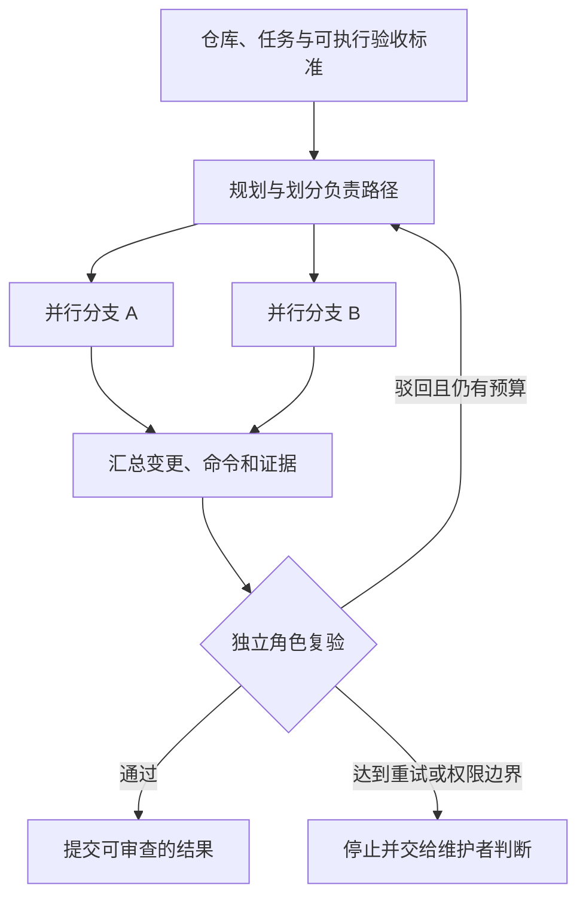
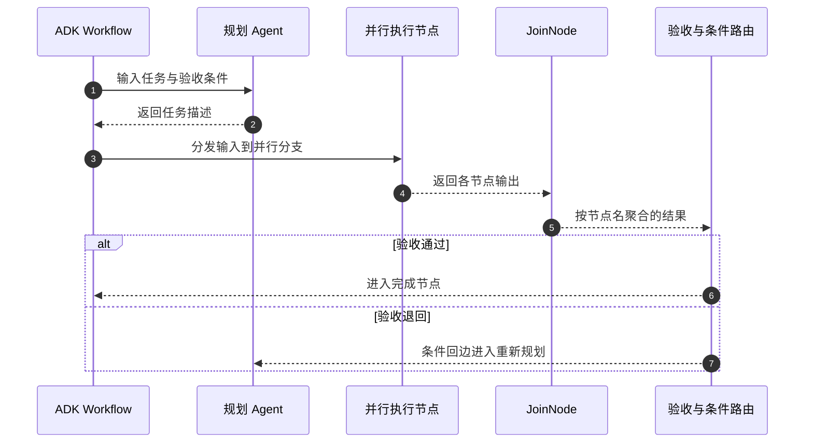

# Gemini 4 Neon 多 Agent 团队教程 / Build an AI Agent Team with Gemini 4 Neon

## 一句话定义

Movez 的八步实践用较强的模型规划、执行者分工、独立 Agent 复验来组织软件任务，并把同样的角色分工分别落到交互式 Antigravity 与可编程 ADK 工作流中。

## 英文缩写速查

| 缩写 | 英文全称 | 简要说明 |
| --- | --- | --- |
| ACP | Agent Client Protocol | T3 Code 调用 Antigravity 官方运行时的协议 |
| ADK | Agent Development Kit | 定义编排节点、并行汇合和条件路由的开发工具包 |
| CLI | Command-Line Interface | 从终端运行 Antigravity 或单独访问 Gemini API |
| API | Application Programming Interface | 为第三方软件提供模型、文件和交互调用的接口 |
| TTS | Text-to-Speech | 将文案合成为语音，供视频流水线单独混音 |

## 为什么重要

并行并不能自动提高正确率。这个教程把最容易漏掉的两件事写成明确接口：派单时写清负责路径和完成标准，交付时重新运行测试并引用可追溯证据。对机器人仓库，可将仿真脚本、日志分析和文档核验拆开；物理安全和真机动作仍由独立安全措施与人工授权负责。

## 核心原理与八步

| 步骤 | 做法 | 需要区分 |
| --- | --- | --- |
| 1. 选入口 | 从 Antigravity App、`agy`、T3 Code 或模型 API 进入 | 客户端和认证方式不是一回事；订阅额度与 API 用量分开看 |
| 2. 选规划与执行者 | Orchestrator 让 Neon 规划、Hydrogen 实现，遇到阻塞可交还规划器 | 这是双模型模式，不会自动生成独立的验收角色；按任务调推理档位 |
| 3. 写团队约定 | 在 `AGENTS.md` 写路径归属、禁止项和验收命令，用 `.agents/agents/` 定义角色 | 提示词不是权限控制；用沙箱、工具权限和工作区隔离实际约束写入 |
| 4. 先跑只读 Swarm | 协调者在共享看板分派审计，独立验收者查路径与行号、复跑命令；不合格退回 | 官方默认共享工作区，必要时才分工作副本；成员默认继承会话模型，换模型须明确指定且账号能选择 |
| 5. 用 T3 Code 并列接入 | 通过官方 ACP 运行时接入 Antigravity，与其他供应商会话并列使用 | 客户端并列不代表跨供应商自动组队；认证和可选模型由对应运行时与账号决定 |
| 6. 加上 Gemini 工具 | 从 shell 调用独立的 Gemini API CLI；由外层保留流程状态和返回的交互 ID 或文件 | 工具返回保留原始函数调用关联；文件切片及媒体支持以对应模型/API 为准 |
| 7. 把团队写成图 | 先规划，并行执行，`JoinNode` 汇总，验收决定通过或退回 | `previous_interaction_id` 是接续上下文；不能替代工作区、聚合、超时或部署配置 |
| 8. 做代码渲染短片 | 把文案、场景、音轨和渲染分工，通过可定位时间的浏览器接口逐帧输出，再合成 | 时长、切点、色板与峰值都能写成验收项；不是让语言模型直接生成成片 |

### 流程总览

### ADK 示例调用时序

图依据教程的 ADK 草图和官方图工作流示例绘制。实际实现仍须显式把规划结果映射到各分支、把可核验的 diff 或测试证据传给验收者，并规定最多返工次数；示意图不是对原文代码的实测调用轨迹。

## 工程实践

- 先在只读审计中验证分工：每条发现带路径、行号和依据；写入任务再按目录拆工，避免多份工作副本同时修改同一个共享接口。
- 验收者用独立上下文重新执行相同的测试命令；不同模型可作为额外对照，不能替代真实的测试结果。教程引用的案例里，核验者与其他成员实际同用 Hydrogen，仍指出了两条错误；这是单次经验，不是异模型配置的对照实验。
- 跟踪总成本而不只看单价：记录每个角色的输入、输出、重试、用量和总耗时。Google 公布的 SWE-sweep 结果是 **mini-SWE harness 12.8%，Antigravity CLI 1.5.9 39.0%**。这是 Google 自测的子任务加权得分，不是任务成功率；同模型在两种运行框架下的差异，不能推断 Neon/Hydrogen 搭配、某个提示词或验收者单独带来约三倍增益。
- 映射到机器人开发时，用固定仿真初态、回放日志和既有 CI 验收软件改动；不要把并行生成的结果直接下发给电机或把仿真过关当作真机放行。

## 与其他工作对比

| 方法或资源 | 适合什么 | 与本教程的关系 |
| --- | --- | --- |
| Antigravity Swarm | 人在环观察跨角色沟通与重新分派 | 看板利于交互；预览功能且并行消耗额度更快 |
| [Claude Code 动态工作流](../methods/claude-code-dynamic-workflows.md) | 将同一项目中的可分任务交给独立执行单元 | 对照如何控制委派、数据交换和收敛，不应假定不同客户端共享同一工作区语义 |
| [Coding Agent 验证闭环](../methods/coding-agent-verification-loops.md) | 用真实运行结果与独立审查判断交付是否完成 | 给教程里的「验收」补上确定性门禁，而不是只依赖另一个模型说通过 |
| [Agent 工程小书](./little-book-agent-engineering.md) | 从最小工具循环理解终态、权限与评测 | 本教程提供实际客户端入口；教材说明为什么终态验证不能省略 |

## 局限与风险

- 计费、模型及账号可用性会变化；不要把社区文章里的入口、计费或模型列表当作当前承诺。
- **源码运行时序图：不适用。** 未见教程独立的完整可运行仓库；上图仅说明公开 ADK 示例的调用边界。本次未运行 Antigravity、付费模型、T3 Code 或短片管线。

## 结论

可以先把只读任务拆小，验证执行者交的是证据而非结论；有写入需求时，再加入路径归属、独立测试和有上限的返工。周期性执行且需要可审计状态时，可把已经跑通的分工移入 ADK，而不是照搬一段提示词作为生产工作流。

## 关联页面

- [Coding Agent 验证闭环](../methods/coding-agent-verification-loops.md)：可复验行为与发布门禁。
- [Claude Code 动态工作流](../methods/claude-code-dynamic-workflows.md)：任务专用编排与分支汇总。
- [Agent 技能打包](../methods/agent-skill-packaging.md)：稳定的角色指令、技能分发与可移植边界。
- [多 Agent 编码管理与认知把关](../concepts/coding-agent-orchestration-and-cognitive-oversight.md)：分工和维护者的责任。

## 参考来源

- [Movez 原文归档及交叉核对材料](../../sources/blogs/movez_gemini_4_neon_agent_team_2026-11-25.md)

## 推荐继续阅读

- [Google Antigravity Swarm 文档](https://antigravity.google/docs/swarm/)
- [Google DeepMind：Gemini 4 Neon 模型卡](https://deepmind.google/models/model-cards/gemini-4-neon/)
- [Google ADK 图工作流教程](https://codelabs.developers.google.com/devsite/codelabs/build-agents-with-adk-graph-workflows)
