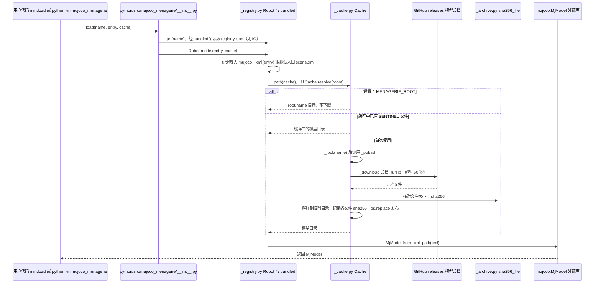

# MuJoCo Menagerie

[**google-deepmind/mujoco_menagerie**](https://github.com/google-deepmind/mujoco_menagerie) 是 DeepMind 维护的 **MuJoCo MJCF 模型集合**：提供机械臂、四足、人形等 **可直接运行** 的资产（网格、执行器、传感器、默认姿态与关键参数）。

## 一句话定义

**官方 MJCF 模型动物园** — 减少「同一机型各写一份 URDF/MJCF」的重复劳动，作为算法对照实验的统一资产底座。

## 英文缩写速查

| 缩写 | 英文全称 | 简要说明 |
|------|----------|----------|
| MJCF | MuJoCo XML Format | MuJoCo 场景与机器人描述 |
| MuJoCo | Multi-Joint dynamics with Contact | 底层物理引擎 |
| URDF | Unified Robot Description Format | 常与 Menagerie 交叉引用 |
| Sim2Real | Simulation to Real | 统一资产降低 sim gap 之一 |

## 为什么重要

- **算法对照：** 同一 MJCF 上比较 RL / MPC / 感知策略，减少模型差异干扰结论。
- **与 URDF 生态互补：** [Awesome Robot Descriptions](./awesome-robot-descriptions.md) 偏发现层；Menagerie 偏 **已调参可跑** 的 MJCF。
- **宇树等厂商模型：** 常与 [unitree_mujoco](./unitree-mujoco.md) 并行使用（后者强调 SDK2 DDS 同构）。

## 工程实践

1. Clone 后按子目录 README 加载对应 `*.xml`。
2. 各子模型 **LICENSE 可能不同**（Apache-2.0 仓 + 子目录例外）；商用前读子文件夹 LICENSE。
3. 引擎能力边界见 [MuJoCo](./mujoco.md) 实体页。
4. **双臂遥操作：** [`aloha/`](https://github.com/google-deepmind/mujoco_menagerie/tree/main/aloha) 为 [ALOHA 2](./aloha-2.md) 工位（11 轨迹 SysID + D405 相机内参）；详见 [子目录归档](../../sources/repos/mujoco-menagerie-aloha.md)。

## 局限与使用注意

- **不是训练框架：** 仅资产；训练需接 [legged_gym](./legged-gym.md)、[unitree_rl_gym](./unitree-rl-gym.md) 等。
- **ROBOTIS fork：** [robotis-mujoco-menagerie](./robotis-mujoco-menagerie.md) 为厂商扩展，勿与官方 Menagerie 混为同一节点。

## 关联页面

- [MuJoCo](./mujoco.md)
- [unitree_mujoco](./unitree-mujoco.md)
- [robot_descriptions.py](./robot-descriptions-py.md)

## 源码运行时序图

入口：Python 中 `import mujoco_menagerie as mm; model = mm.load("unitree_go2")`（`python/src/mujoco_menagerie/__init__.py` 的 `load`）；命令行 `python -m mujoco_menagerie path unitree_go2` 走 `__main__.py` 的同一套解析

图依据：google-deepmind/mujoco_menagerie@98a70c5，读过 `python/src/mujoco_menagerie/__init__.py`（`load`、`get`、`prefetch`）、`python/src/mujoco_menagerie/__main__.py`（`main` 的子命令分派）、`python/src/mujoco_menagerie/_registry.py`（`Robot.path`、`xml`、`model` 与 `bundled`）、`python/src/mujoco_menagerie/_cache.py`（`Cache.resolve`、`_publish`、`_download`、`_lock`）；`_archive.py` 与 `_closure.py` 仅按函数名与引用处检索，`files()` 路径中的 `closure` 未纳入本图；未运行代码。

## 参考来源

- [sources/repos/mujoco-menagerie-aloha.md](../../sources/repos/mujoco-menagerie-aloha.md)
- [sources/repos/mujoco-menagerie-google.md](../../sources/repos/mujoco-menagerie-google.md)
- [wechat_robot_yanfa_opensource_algorithms_compendium.md](../../sources/blogs/wechat_robot_yanfa_opensource_algorithms_compendium.md)
- 源码核对（2026-11-02）：google-deepmind/mujoco_menagerie@98a70c5，读过 `python/src/mujoco_menagerie/__init__.py`、`python/src/mujoco_menagerie/__main__.py`、`python/src/mujoco_menagerie/_registry.py`、`python/src/mujoco_menagerie/_cache.py`；时序图依据以上文件，未运行代码。

## 推荐继续阅读

- GitHub：<https://github.com/google-deepmind/mujoco_menagerie>
