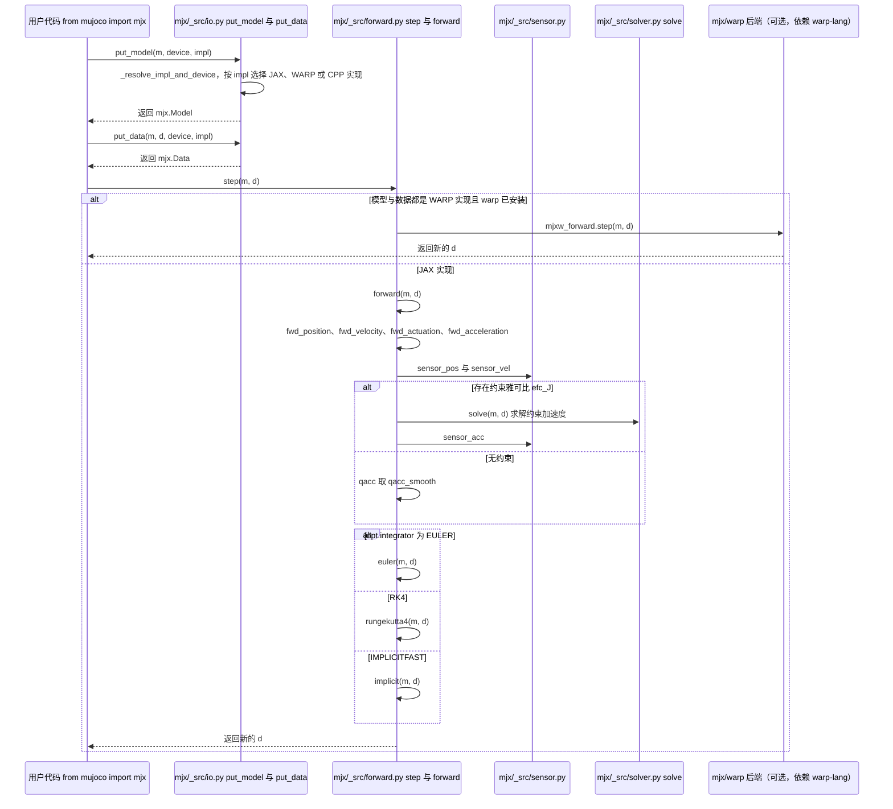

# MuJoCo MJX（MuJoCo XLA）

**MuJoCo MJX**（常写作 **MJX**）是 Google DeepMind 在 **JAX** 上对 [MuJoCo](./mujoco.md) 物理引擎的 **重实现**：通过 PyPI 包 **`mujoco-mjx`** 安装后，以 `from mujoco import mjx` 使用。其设计目标是让 **同一类 MJCF 模型** 能在 **加速器** 上高吞吐执行，并与 **JAX 生态**（`jax.vmap` / `pmap`、自动微分）自然组合。

## 一句话定义

**与 MuJoCo C 核心 API 对齐的 JAX 物理后端**，用于 **批量仿真、可微 rollout 与大规模 RL 采样**，但 **并非** 对 CPU 版 MuJoCo 的逐特性克隆，缺口以官方文档为准。

## 英文缩写速查

| 缩写 | 英文全称 | 简要说明 |
|------|----------|----------|
| MuJoCo | Multi-Joint dynamics with Contact | 接触丰富的刚体物理仿真引擎 |
| MJX | MuJoCo JAX | MuJoCo 的 JAX/XLA 后端，支持可微与批量仿真 |
| JAX | JAX | 支持自动微分与 XLA 编译的数值计算库 |
| MJCF | MuJoCo XML Format | MuJoCo 的模型与场景描述格式 |
| GPU | Graphics Processing Unit | 图形处理器，大规模并行仿真训练的算力基础 |
| API | Application Programming Interface | 应用程序编程接口 |
| RL | Reinforcement Learning | 通过与环境交互最大化长期回报来学习策略的范式 |
| CPU | Central Processing Unit | 中央处理器 |
| Isaac Lab | NVIDIA Isaac Lab | 基于 Omniverse 的机器人学习训练框架 |

## 为什么重要

- **并行 RL 与 Sim2Sim**：把机器人学习任务从「单进程 CPU 步进」扩展到 **成千上万并行环境**，墙钟吞吐接近 Isaac 类 GPU 仿真栈的量级讨论语境（具体上限依赖模型、接触密度与硬件）。
- **可微控制与优化**：与基于梯度的轨迹优化、系统辨识、可微渲染管线等研究方向的 **工具链位置** 一致。
- **版本耦合清晰**：`mujoco-mjx` 的 `major.minor.micro` **跟随 MuJoCo 发行版**；同主版本的补丁可用 `.postN` 区分，降低「仿真 DLL 与 Python 绑定版本漂移」的心智负担。

## 核心结构（读者心智模型）

| 概念 | 说明 |
|------|------|
| **安装入口** | `pip install mujoco-mjx`（仓库 README 推荐路径） |
| **导入方式** | `from mujoco import mjx`，与 `mujoco` Python 包协同演进 |
| **功能完备度** | 官方文档维护 **feature parity** 列表：部分传感器、求解路径或边缘特性可能与 C MuJoCo **不等价** |
| **教程** | 主仓 `mjx/tutorial.ipynb`（Colab 徽章链到训练示例） |

## 常见误区或局限

- **误区：「MJX = 把旧脚本原封不动加速」。** 需要按 JAX 习惯改写 **批量维度**、**纯函数** 与 **设备放置**；并核对 **不支持特性** 是否命中你的 MJCF。
- **误区：「有了 MJX 就不学 MuJoCo C API」。** 资产建模、调试与许多基准仍以 **MJCF / `mujoco` Python 绑定** 为中心；MJX 是 **执行后端之一**。
- **局限**：生态与第三方包对 MJX 的 **默认测试覆盖** 仍少于经典 CPU 路径；新特性落地节奏以 DeepMind 发布为准。
- **与 [MuJoCo Warp](./mujoco-warp.md) 不是同一后端**：MJX 是 JAX/XLA；MJWarp 是 [NVIDIA Warp](./nvidia-warp.md)/CUDA。要 GPU 吞吐且留在 PyTorch / Newton / [mjlab](./mjlab.md) 时选 MJWarp；要 `jax.grad` / Playground 时选本页。MJWarp 的 Warp AD **尚未接通**。

## 关联页面

- [MuJoCo（物理引擎）](./mujoco.md) — 设计哲学、接触模型与学术基准语境
- [MuJoCo Warp](./mujoco-warp.md) — Warp/CUDA 兄弟后端（Newton / mjlab）
- [Brax](./brax.md) — JAX 侧 RL 训练算法与 README 中的 **Playground + training** 推荐组合
- [dm_control](./dm-control.md) — 经典 MuJoCo Python 基准栈（CPU 路径为主）
- [仿真器选型指南（Query）](../queries/simulator-selection-guide.md) — 与 Isaac Lab、Genesis 并列讨论时的定位
- [Reinforcement Learning](../methods/reinforcement-learning.md) — 大规模采样算法侧上下文

## 推荐继续阅读

- 官方文档：[MJX — MuJoCo documentation](https://mujoco.readthedocs.io/en/stable/mjx.html)
- 源码与教程入口：[google-deepmind/mujoco `mjx/`](https://github.com/google-deepmind/mujoco/tree/main/mjx)

## 源码运行时序图

入口：`from mujoco import mjx`，随后 `mjx.put_model(m)`、`mjx.put_data(m, d)`，并用 `mjx.step(mx, dx)` 推进一步（公共 API 见 `mjx/mujoco/mjx/__init__.py`）

图依据：google-deepmind/mujoco@79ca367，读过 `mjx/README.md`、`mjx/mujoco/mjx/__init__.py`（公共导出）、`mjx/mujoco/mjx/_src/forward.py`（`forward`、`step` 的分支与积分器选择）、`mjx/mujoco/mjx/_src/io.py`（`put_model` 的后端分派与 `_resolve_impl_and_device` 的签名）；`put_data`、`solver.solve`、`sensor` 仅依据导出与调用关系，未逐行通读；未运行代码。

## 参考来源

- [mujoco-mjx（仓库归档）](../../sources/repos/mujoco-mjx.md)
- [MuJoCo 文档：MJX（readthedocs 归档）](../../sources/sites/mujoco-mjx-readthedocs.md)
- 源码核对（2026-11-02）：google-deepmind/mujoco@79ca367，读过 `mjx/README.md`、`mjx/mujoco/mjx/__init__.py`、`mjx/mujoco/mjx/_src/forward.py`、`mjx/mujoco/mjx/_src/io.py`；时序图依据以上文件，未运行代码。
