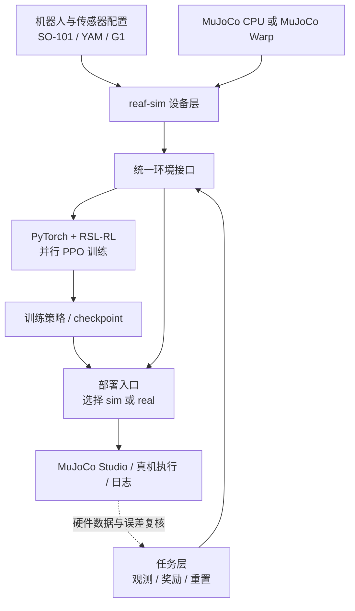
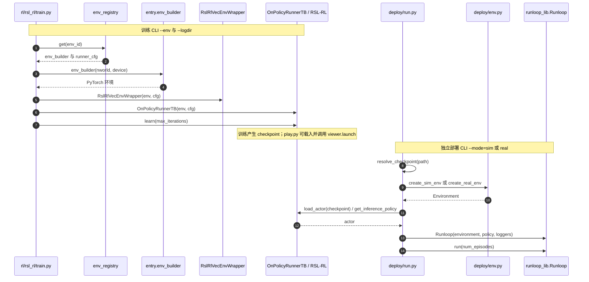

# MuJoCo Playground

> **1.0 更新（2026-11）：** 从 JAX/MJX 转向 PyTorch、MuJoCo Warp 与 Sim-to-Real 工作流。

## 一句话定义

**MuJoCo Playground 1.0** 是 Google DeepMind 维护的开源机器人学习与真机工作流集合：通过 [reaf-sim](https://github.com/google-deepmind/reaf-sim) 把机器人/传感器设备层和任务层解耦，以 **PyTorch + MuJoCo / MuJoCo Warp** 连接大批量 RL、仿真与真机部署。**这是对现有 MuJoCo Playground 项目的升级，不是独立的新项目。**

## 英文缩写速查

| 缩写 | 英文全称 | 简要说明 |
|---|---|---|
| RL | Reinforcement Learning | 策略与环境交互训练 |
| PPO | Proximal Policy Optimization | 官方 RSL-RL 示例使用的策略优化路线 |
| MJX | MuJoCo XLA / MuJoCo JAX | RSS 2025 研究版的 JAX 仿真路径，1.0 默认主线不再依赖它 |
| MJWarp | MuJoCo Warp | 基于 NVIDIA Warp 的 GPU MuJoCo 后端 |
| Sim2Real | Simulation to Real | 仿真策略迁移到真机 |
| VLM | Vision-Language Model | 官方 agentic 案例使用的视觉语言模型 |
| MCAP | MCAP (robotics log container) | 遥操作示例使用的分集日志格式 |
| SDK | Software Development Kit | 真机接口依赖，按可选 extras 安装 |

## 为什么重要

- **从 RL 环境库延展为完整工作流。** 1.0 不止提供 reward/observation 和批量 rollout，还把遥操作、系统辨识、策略部署、日志和 agentic 操作纳入同一项目。
- **从 JAX 迁向 PyTorch 主线。** 与 [RSL-RL](https://github.com/leggedrobotics/rsl_rl) 生态对接；旧版 JAX/MJX 仍可在官方 `rss2025/` 目录查阅，不应把“再见 JAX”理解成全生态删除。
- **同一任务层连接 sim 与 real。** 开发者可以复用任务与策略接口，在 `--mode=sim` / `--mode=real` 间选择环境实现；这不代表不用处理校准、时延和安全。
- **实用硬件案例。** SO-101、YAM Pro 涵盖仿真与真机；Unitree G1 的 29-DoF whole-body tracking 示例当前官方列表仅标注 sim。

## 核心原理

### 官方 0.2 / RSS2025 与 1.0 的差异

| 维度 | Playground 0.2 / RSS2025 | Playground 1.0 |
|---|---|---|
| 框架 | JAX / MJX | PyTorch / reaf-sim |
| 物理计算 | MJX：JAX 或 Warp backend | MuJoCo CPU 或 MuJoCo Warp |
| 训练 | MJX/JAX RL 示例 | RSL-RL 与批量状态/视觉 RL |
| 真机 | 仿真为主，部署依项目实现 | 示例仓提供真机接口、部署与代码 |
| 工作流 | RL 环境 | RL、sim/real 遥操作、系统辨识、agentic VLM |
| 查看器 | 经典 simulate | MuJoCo Studio |

*依据：[官方 1.0 What's New](https://playground.mujoco.org/)；旧版技术报告（2025）不能视为 1.0 的性能评测。*

### 项目流程总览（源于 1.0 官方文档）



其中 `task` 与 `device` 为拆分后的逻辑层；图示表达**工作流可组合性**，并非声称训练脚本自动直接启动真机。`mujoco.sysid` 是额外的系统辨识工具链，可使用硬件轨迹修正动力学参数。

### 源码运行时序图

已核对官方 `main` 入口、注册表、环境包装器和训练/部署分支（详见 [源码归档](../../sources/repos/mujoco_playground.md)）。下图按**两个独立 CLI 运行**绘制，而非臆造跨进程函数调用。



源码锚点：`train.py:main` 使用 `env_registry.get`、`RslRlVecEnvWrapper`、`OnPolicyRunnerTB.learn`；`play.py:main` 使用 `runner.load`、`get_inference_policy` 与 `reaf.simulation.torch.viewer.launch`；`deploy/run.py:main` 先 `resolve_checkpoint`，按 mode 建环境并使用 `runloop.run`。图内的 RSL-RL actor 重建是部署脚本自己的调用，**不表示复用训练进程中的 Runner 实例**。

## 工程实践

### 最小可复核入口

官方 PyPI 要求 Python **3.12–3.13**；新建实验宜以 `playground>=1.0` 为依赖。下面为官方 CPU Cartpole 例子，适合不依赖 GPU 的入口检查：

```bash
uvx --default-index https://pypi.org/simple --python 3.13 --from "playground[rl]>=1.0" \
  python -m mujoco_playground.rl.rsl_rl.train \
  --env=CartpoleBalance \
  --logdir=/tmp/rslrl_logs/cartpole_balance \
  --overrides='{"nworld": 64}'

uvx --default-index https://pypi.org/simple --python 3.13 --from "playground[rl]>=1.0" \
  python -m mujoco_playground.rl.rsl_rl.play \
  --env=CartpoleBalance --resume_path=/tmp/rslrl_logs/cartpole_balance
```

源码安装时按官方 README 选 `make sync-cpu`、`make sync-cu12`、`make sync`。**CUDA 12** 官方文档有独立的 PyTorch wheel 和 `warp-lang==1.18.0+cu12` 安装说明；不要直接照用旧版 `jax[cuda12]` 环境。官方 GPU 示例使用数千个并行世界，但这个数量只是**示例配置**，不是在任意 GPU 上复现的吞吐保证。

### 关键机器人工作流

| 任务 | 已公开路径与注意点 |
|---|---|
| SO-101 / YAM Pro | 官方标 `sim real`；真机设备 SDK 需可选 `so101` / `yam` extras |
| Unitree G1（29 DoF） | `tasks/whole_body/tracking` 中 BeyondMimic 风格参考运动跟踪；需将重定向参考轨迹转换成 `.npz`，当前展示是 `sim` |
| SO-101 Pick Cube | `--env=SO101PickCubeVision` 训练后以 `tasks/manipulation/pick_cube/so101/deploy/run.py --mode=real --checkpoint=...` 运行 |
| Leader-follower 遥操作 | `tasks/teleop/so101` 共享 runloop，脚踏 gating 与 episodic MCAP |
| 系统辨识 | `tasks/sysid` 使用 `mujoco.sysid` 拟合硬件关节动态 |
| Agentic 操作 | `tasks/agentic/tabletop_v0`：VLM 控制仿真/硬件；代码对生成的 Python 执行给出安全警告 |

## 局限与风险

1. **版本边界：** “告别 JAX”准确指 1.0 的**新主线技术栈**；RSS 2025 `rss2025` 保留旧 JAX/MJX 任务，不能把旧版论文和运行命令误用于 1.0。
2. **Sim2Real 不是自动消除误差：** 仿真/真机共用任务接口，只降低软件切换成本。动力学辨识、观测标定、安全限位、动作频率与延时仍要逐项检查。
3. **硬件支持不等于全面支持：** 官方 G1 标注 `sim`，SO-101/YAM 则有硬件路径；不要把所有演示泛化为任意机型的零样本成功率。
4. **不是性能排行榜：** 官方 1.0 主页没有发布与 [Isaac Lab](./isaac-lab.md)、[mjlab](./mjlab.md) 的同硬件同任务基准，不能据它断言快多少倍。
5. **Agentic 执行安全：** 公开 `tabletop_v0` README 警告执行 VLM 生成的 Python（`exec`）并直控机器人，真机运行须隔离、权限限制和人工监护。
6. **验收边界：** 本次确认官方文本和关键源码入口，但**未实际运行仿真、训练、GPU benchmark 或真机测试**。

## 关联页面

- [MuJoCo](./mujoco.md) — CPU 物理求解器和建模基准
- [MuJoCo Warp](./mujoco-warp.md) — 1.0 可选择的 GPU 物理后端
- [MuJoCo MJX](./mujoco-mjx.md) — JAX/XLA 旧研究路线（仍独立可用）
- [mjlab](./mjlab.md) — 另一条 PyTorch/MJWarp 上层管理式 RL 路线
- [mjlab_playground](./mjlab-playground.md) — 基于旧 Playground 任务的社区迁移案例
- [Brax](./brax.md) — 历史 JAX 训练算法生态
- [训练栈分层地图](../overview/robot-training-stack-layers-technology-map.md) — 任务层、物理层、训练层和真机部署层
- [仿真器选型指南](../queries/simulator-selection-guide.md) — 与 Isaac 生态的工程取舍

## 参考来源

- [官方 1.0 项目页归档](../../sources/sites/mujoco-playground.md)
- [官方源码 README / 训练与部署入口归档](../../sources/repos/mujoco_playground.md)
- [MuJoCo Playground 官方主页](https://playground.mujoco.org/)
- [官方文档：Overview](https://reaf-sim.readthedocs.io/en/latest/playground/index.html)
- [PyPI 发布历史（1.0.0 / 1.0.1）](https://pypi.org/project/playground/)
- [旧版训练栈讨论归档](../../sources/blogs/wechat_embodied_ai_lab_robot_training_stack_layers_2026.md)（**仅作历史背景**）

## 推荐继续阅读

- [官方 GitHub 项目及 `rss2025/` 历史代码](https://github.com/google-deepmind/mujoco_playground)
- [RSL-RL 训练入口](https://github.com/google-deepmind/mujoco_playground/blob/main/mujoco_playground/rl/rsl_rl/train.py)
- [SO-101 部署源码](https://github.com/google-deepmind/mujoco_playground/blob/main/mujoco_playground/tasks/manipulation/pick_cube/so101/deploy/run.py)
- [2025 年技术报告（历史版，勿当作 1.0 基准）](https://playground.mujoco.org/assets/playground_technical_report.pdf)