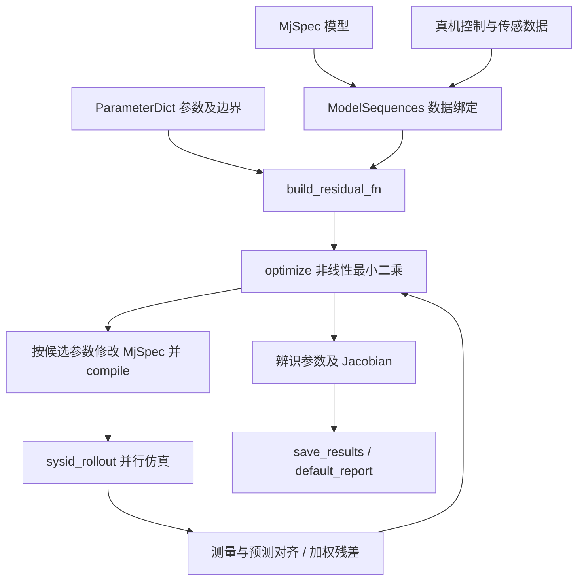

# MuJoCo SysID（官方系统辨识工具箱）

## 一句话定义

**MuJoCo SysID（System Identification Toolbox）** 是 Google DeepMind 在 MuJoCo 主仓内维护的 Python 工具箱：给定 `MjSpec` 和真机控制/传感器轨迹，自动寻找使仿真输出接近测量值的物理参数与测量参数。与 [MuJoCo 物理引擎](./mujoco.md) 是**主引擎与专用工具模块**关系。

## 英文缩写速查

| 缩写 | 英文全称 | 简要说明 |
|---|---|---|
| SysID | System Identification | 利用真机实验数据辨识模型参数 |
| MJCF | MuJoCo XML Format | MuJoCo 模型格式，可由 `MjSpec` 编译 |
| FD | Finite Difference | 对残差做有限差分 Jacobian 估计 |
| GN | Gauss–Newton | 非线性最小二乘优化思路 |
| P/D | Proportional / Derivative | 位置执行器比例/微分增益 |
| CPU | Central Processing Unit | 官方批量 rollout 的多线程执行位置 |

## 为什么重要

- **把调参变成可复现实验**：不用仅靠手工逐次调质量、关节阻尼、摩擦和增益，可用同一批真机数据拟合，并保存参数与对比报告。
- **复用 MuJoCo 模型**：参数修改回调直接作用于 `MjSpec`，无需另建一套动力学模型；支持一组模型对应多段轨迹、以及多个 `ModelSequences` 的联合辨识。
- **解释 Sim2Real 的中间环节**：在 [系统辨识](../concepts/system-identification.md) 和 [Sim2Real](../concepts/sim2real.md) 之间补齐可运行的官方工程实现。它负责模型对齐，不等同于策略的在线自适应。

## 核心原理

### 输入、优化目标与可辨识参数

输入是 `ModelSequences`（`MjSpec`、初态、控制 `TimeSeries`、实测 `TimeSeries`）及 `ParameterDict`（初值、下界、上界、修改模型的 `modifier` 回调）。令参数为 \(\theta\)，把模型预测与实测信号之差记为 \(r(\theta)\)，默认求解

\[
\theta^* = \arg\min_{\theta_{min}\leq\theta\leq\theta_{max}}\ \frac{1}{2}\|r(\theta)\|_2^2 .
\]

默认残差由信号对齐、加权差分和归一化构成；可以覆盖 `modify_residual` 处理自定义观测、增益、偏置或时延。官方 README 示例含接触摩擦、关节阻尼、质量/质心、完整惯量与位置执行器 P/D 增益。完整惯量采用 pseudo-inertia Cholesky 参数化以维持物理一致性。

**重要区别：** 这里的“可优化”不代表 MuJoCo rollout 具有自动微分。官方默认优化器通过有限差分 Jacobian 求解非线性最小二乘；各扰动需要 rollout，通过 `mujoco.rollout` 批量、多线程执行。后端可选 `mujoco`（默认）、`scipy`、`scipy_parallel_fd`。

### 流程总览（依据官方 README 与源码）



### 源码模块映射

| 模块 | 已核对职责 |
|---|---|
| `_src/parameter.py` | `Parameter` 管理 `nominal/min_value/max_value/frozen/modifier`；`ParameterDict` 打包优化变量 |
| `_src/residual.py` | `build_residual_fn` 绑定配置；`residual`、`model_residual` 构建模型、采样、差分与归一化 |
| `_src/trajectory.py` | `ModelSequences` 包装实测轨迹；`sysid_rollout` 调用 `mujoco.rollout.rollout` |
| `_src/optimize.py` | `optimize` 分派优化后端；可选初始 Jacobian 病态检查 |
| `_src/model_modifier.py` | 修改惯量与 PD 参数；`apply_param_modifiers` 重新编译模型 |
| `_src/io.py` / `report/defaults.py` | 保存优化结果、置信区间、模型 XML；构造 HTML 可视化报告 |

### 源码运行时序图（对应实际 Python 入口）

```mermaid
sequenceDiagram
    autonumber
    actor User as 调用方脚本
    participant Opt as optimize.py
    participant Solver as mujoco.minimize
    participant Res as residual.py
    participant Modifier as model_modifier.py
    participant Traj as trajectory.py
    participant Roll as mujoco.rollout
    User->>Res: build_residual_fn(models_sequences=[ms])
    Res-->>User: residual_fn
    User->>Opt: optimize(initial_params, residual_fn)
    Opt->>Solver: least_squares(x0, bounds, residual)
    loop 每次优化评估 / 有限差分扰动
        Solver->>Res: residual_fn(x, params)
        Res->>Modifier: apply_param_modifiers(params, spec)
        Modifier-->>Res: 编译后的 MjModel
        Res->>Traj: sysid_rollout(models, datas, controls, initial_states)
        Traj->>Roll: rollout(models, datas, initial_states, control)
        Roll-->>Traj: state, sensordata
        Traj-->>Res: SystemTrajectory
        Res-->>Solver: 对齐后的残差向量
    end
    Solver-->>Opt: 最优 x 与 Jacobian
    Opt-->>User: opt_params, opt_result
    User->>User: save_results(...) / default_report(...)
```

图示为 **README 示例所用的默认 `mujoco` 优化后端**；若选择 SciPy，`Solver` 对应 `scipy.optimize.least_squares`，`custom_rollout` 和 `modify_residual` 则替换相应默认调用。

## 工程实践

1. **安装并准备日志**：`pip install 'mujoco[sysid]'`；记录真机控制与状态/传感测量，并保存同步时间戳与可还原的初始状态。具体依赖应以安装时官方版本为准。
2. **定义模型参数**：用 `MjSpec.from_file("robot.xml")` 加载 MJCF，为连杆质量、阻尼等建带物理边界的 `Parameter`，在 `modifier(spec, param)` 内写入对应字段。
3. **包装数据并拟合**：通过 `TimeSeries.from_control_names`、`TimeSeries.from_names`、`create_initial_state`、`ModelSequences` 整理数据；随后调用 `build_residual_fn(models_sequences=[ms])` 与 `optimize`。
4. **验证**：保存 `save_results(...)`，查看最优参数、预测—测量轨迹及置信区间；另留独立真机轨迹检查泛化，遇到 `cond(JᵀJ)` 过大先调整激励及参数集。

官方 README 的入门案例是 **辨识 `link1` 质量**；[官方 Notebook](https://github.com/google-deepmind/mujoco/blob/main/python/mujoco/sysid/sysid.ipynb) 目录另列 5-DoF 机械臂 armature 辨识与参数可辨识性练习。本次核验了其目录和安装入口，**未运行** Notebook 全部实验。

## 局限与风险

- **辨识性受激励影响**：多组参数可能产生相似输出；初始 Jacobian 条件数检查提供病态信号，但不代替丰富工况与留出验证。
- **计算代价随参数与轨迹增加**：有限差分需要多次仿真；多线程批量是加速，不代表计算免费，也不是端到端可微物理。
- **默认目标依赖数据质量**：时间同步、信号名字/维度、初态、噪声与传感器延迟失配会污染残差；自定义传感器需要自己实现残差映射。
- **报告的置信区间有局部近似前提**：代码基于最优解处 Jacobian 与残差估计协方差；秩亏或严重模型失配时不宜直接解释为可靠物理不确定度。
- **开源边界**：已公开源码、测试和 Notebook，位于 MuJoCo 主仓 `python/mujoco/sysid/`；官方 API/依赖仍可能演进，未宣称已经在具体真机上验证性能。

## 关联页面

- [MuJoCo](./mujoco.md) — 引擎与 MJCF
- [System Identification](../concepts/system-identification.md) — 方法原理与辨识性
- [关节动力学辨识实验设计](../methods/sim2real-joint-sysid-experiment-design.md) — 先设计激励再估参
- [关节执行器参数辨识](../methods/joint-actuator-parameter-identification.md) — 参数分类及对比算法
- [Sim2Real 纵深路线：Stage 1](../../roadmap/depth-sim2real.md) — 资产与执行器对齐
- [mjbatch](./mjbatch.md) — 另一 CPU 批量仿真工具；与官方 SysID 的职责不同

## 参考来源

- [MuJoCo SysID 官方文档与源码核对归档](../../sources/repos/mujoco-sysid.md)
- [上游 README](https://github.com/google-deepmind/mujoco/blob/main/python/mujoco/sysid/README.md)
- [上游 optimize.py](https://github.com/google-deepmind/mujoco/blob/main/python/mujoco/sysid/_src/optimize.py) · [residual.py](https://github.com/google-deepmind/mujoco/blob/main/python/mujoco/sysid/_src/residual.py) · [trajectory.py](https://github.com/google-deepmind/mujoco/blob/main/python/mujoco/sysid/_src/trajectory.py)

## 推荐继续阅读

- [官方 System Identification Notebook](https://colab.research.google.com/github/google-deepmind/mujoco/blob/main/python/mujoco/sysid/sysid.ipynb)
- [MuJoCo Python 文档：sysid](https://mujoco.readthedocs.io/en/stable/python.html#sysid)
