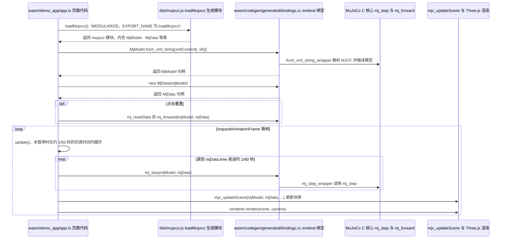

# MuJoCo WASM（浏览器物理仿真）

**MuJoCo WASM** 是把 [MuJoCo](./mujoco.md) C 核心编译为 **WebAssembly**、并通过 **JavaScript/TypeScript** 暴露 `MjModel` / `MjData` / `mj_step` 等 API 的部署形态。官方 canonical 实现位于主仓 [`google-deepmind/mujoco` 的 `wasm/` 子树](https://github.com/google-deepmind/mujoco/tree/main/wasm)，以 npm 包 **`@mujoco/mujoco`** 分发；社区项目 [zalo/mujoco_wasm](https://github.com/zalo/mujoco_wasm) 在官方绑定成熟后转为 **Three.js + 示例套件**，仍是许多 Web 集成方的参考起点。

## 英文缩写速查

| 缩写 | 英文全称 | 简要说明 |
|------|----------|----------|
| MuJoCo | Multi-Joint dynamics with Contact | 接触丰富的刚体物理仿真引擎 |
| WASM | WebAssembly | 浏览器内运行原生级字节码的虚拟机格式 |
| MJCF | MuJoCo XML Format | MuJoCo 模型与场景描述格式 |
| API | Application Programming Interface | 应用程序编程接口 |
| COOP | Cross-Origin-Opener-Policy | 跨源打开方策略，多线程 WASM 所需隔离头之一 |
| COEP | Cross-Origin-Embedder-Policy | 跨源嵌入方策略，与 COOP 配合启用 SharedArrayBuffer |
| ONNX | Open Neural Network Exchange | 跨框架神经网络交换格式，浏览器 demo 常与之联用 |

## 为什么重要

- **零安装传播**：研究者可把 MJCF 场景、策略回放、交互施力演示直接嵌入 **论文项目页** 或课程页面，降低复现门槛。
- **Sim2Sim / 部署前验**：与 [ONNX Runtime Web](./onnxruntime.md) 组合，可在浏览器跑 **obs → policy → ctrl → mj_step** 闭环（见 [BotLab MotionCanvas](./botlab-motioncanvas.md)、[RL Sim2Sim 在线演示](https://imchong.github.io/RL_Sim2Sim_Demo_Website/index.html)）。
- **与原生 MuJoCo 对齐**：npm 版本号 **跟随 MuJoCo 发行版**，便于与桌面 `pip install mujoco` 对照调试。

## 核心结构

| 组件 | 说明 |
|------|------|
| **官方 `@mujoco/mujoco`** | DeepMind 维护的 ESM 包；含预编译 `.wasm`、TS 声明；默认 **单线程** 构建兼容所有现代浏览器 |
| **多线程 `/mt`** | `import loadMujoco from '@mujoco/mujoco/mt'`；用 Web Worker + `SharedArrayBuffer` 并行物理；服务端须设 **COOP/COEP** 隔离头 |
| **虚拟文件系统** | Emscripten `FS`：在浏览器内存中挂载 MJCF、mesh、纹理后再 `loadFromXML` |
| **数据缓冲区** | `qpos`、`qvel`、`ctrl`、`xpos` 等为 **TypedArray**，便于与 Three.js 渲染或 JS 策略桥接 |
| **社区 demo 层** | [zalo/mujoco_wasm](https://github.com/zalo/mujoco_wasm)（MIT）、[mjswan](./mjswan.md)（Apache-2.0：实时 ONNX 策略 + WebXR 交互 demo）等 |

## 选型与局限

- **优先官方包**：新集成应使用 **`@mujoco/mujoco`**，而非维护自编译 WASM fork；zalo 仓 README 已声明角色转为 **examples 演示**。
- **成熟度 WIP**：官方 `wasm/README` 标明绑定 **尚未完备**（部分 `mjspec` 等 API、Windows 环境仍粗糙）；生产集成需预留回归测试。
- **性能与规模**：浏览器 WASM **单线程吞吐** 远低于原生 CPU MuJoCo 或 [MJX](./mujoco-mjx.md) GPU 批量；适合 **可视化、轻量 Sim2Sim、教学**，不适合大规模并行 RL 训练。
- **安全与部署**：多线程版对 HTTP 头有要求；静态站托管（GitHub Pages、Vercel）需单独配置 COOP/COEP。

## 典型集成栈

```
MJCF 资产 ──► Emscripten FS ──► MjModel / MjData
                                    │
                    ┌───────────────┼───────────────┐
                    ▼               ▼               ▼
              Three.js 渲染    JS 策略 / ONNX    用户交互（施力、reset）
```

下游消费方包括 [Robot Viewer](./robot-viewer.md)（URDF/MJCF/Xacro 多格式 + MuJoCo 仿真）、感知 loco 论文页的浏览器 demo 等。

## 关联页面

- [MuJoCo（主引擎）](./mujoco.md) — C/Python 核心与 MJCF 语义
- [MuJoCo MJX](./mujoco-mjx.md) — JAX/GPU 批量路径（训练侧，非浏览器）
- [mjswan](./mjswan.md) — 浏览器 RL 策略闭环与静态站 demo 生成
- [Robot Viewer](./robot-viewer.md) — 集成 `mujoco_wasm` 的 Web 查看与轻仿真
- [ONNX Runtime](./onnxruntime.md) — 浏览器 WASM/WebGPU 推理
- [BotLab MotionCanvas](./botlab-motioncanvas.md) — 浏览器编排与策略演示
- [仿真评估基础设施](../concepts/simulation-evaluation-infrastructure.md) — 在线 Sim2Sim 在评估链中的位置
- [Sim2Real](../concepts/sim2real.md) — 浏览器 demo 与真机部署的边界

## 源码运行时序图

入口：浏览器或 Node 中 `import loadMujoco from "@mujoco/mujoco"` 后调用 `loadMujoco()`，再用 `MjModel.from_xml_string` 等接口驱动仿真（示例见 `wasm/demo_app/app.ts`；npm 包名与导出见 `wasm/package.npm.json`）



图依据：google-deepmind/mujoco@79ca367，读过 `wasm/README.md`（安装与线程模式）、`wasm/package.npm.json`（exports）、`wasm/CMakeLists.txt`（`MODULARIZE`、`EXPORT_NAME`）、`wasm/demo_app/app.ts`（`loadModel`、`update`、动画循环）、`wasm/codegen/generated/bindings.cc`（`MjModel` 的 `from_xml_string` 注册、`mj_step` 与 `mj_forward` 的 `function` 注册、`mj_step_wrapper`）；`wasm/unpack.h` 为 JS 与 C++ 之间的缓冲工具，未纳入本图，MjVFS 资产读取路径未核对；未运行代码。

## 参考来源

- [MuJoCo 主仓归档（含官方 WASM）](../../sources/repos/mujoco.md)
- [mujoco_wasm 社区演示仓](../../sources/repos/mujoco_wasm.md)
- [MuJoCo JavaScript Bindings README](https://github.com/google-deepmind/mujoco/blob/main/wasm/README.md)
- [zalo/mujoco_wasm 在线 Demo](https://zalo.github.io/mujoco_wasm/)
- 源码核对（2026-11-02）：google-deepmind/mujoco@79ca367，读过 `wasm/README.md`、`wasm/package.npm.json`、`wasm/CMakeLists.txt`、`wasm/demo_app/app.ts`、`wasm/codegen/generated/bindings.cc`、`wasm/unpack.h`；时序图依据以上文件，未运行代码。

## 推荐继续阅读

- [MuJoCo 官方文档 — Python](https://mujoco.readthedocs.io/en/stable/python.html)
- [RoboPianist 高级浏览器示例](https://kzakka.com/robopianist/)（官方 README 引用）
