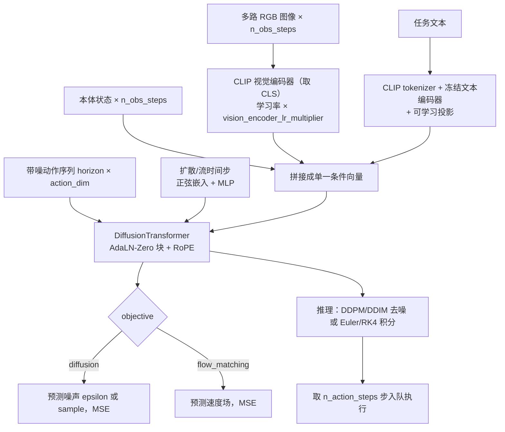
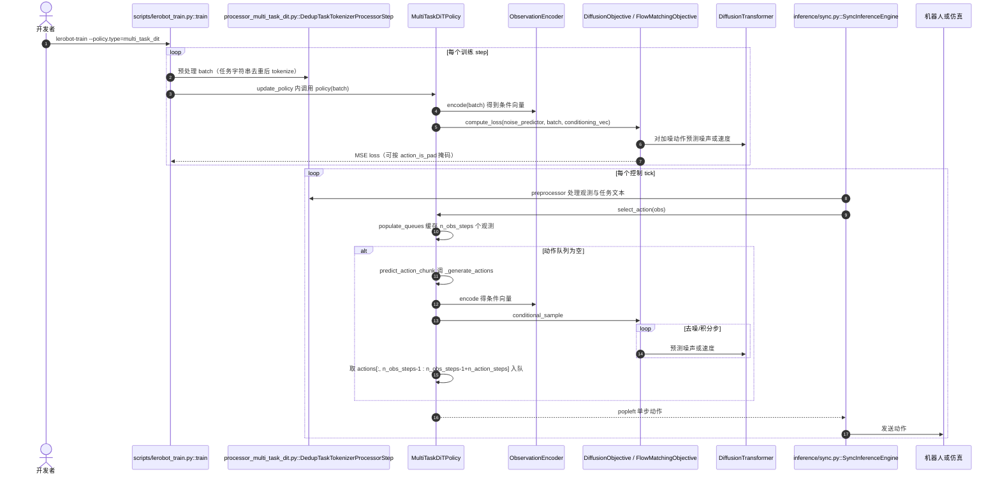

# Multitask DiT Policy：LeRobot 中的语言条件扩散 Transformer 策略

**Multitask DiT Policy** 是 LeRobot README「模仿学习」类里的一项。**它没有自己的论文**：LeRobot 文档 `docs/source/policy_multi_task_dit_README.md` 引用了三份材料——Bryson Jones 的博文 [Dissecting and Open-Sourcing Multitask Diffusion Transformer Policy](https://brysonkjones.substack.com/p/dissecting-and-open-sourcing-multitask-diffusion-transformer-policy)（实现作者）、TRI 的 [arXiv:2507.05331](https://arxiv.org/abs/2507.05331)（*A Careful Examination of Large Behavior Models for Multitask Dexterous Manipulation*）与 Boston Dynamics 博文。**身份区分：** arXiv:2507.05331 在库内的 canonical 节点是 [LBM 论文条目](./paper-rcl-2507-05331-a-careful-examination-of-large-behavior-models-f.md)；本页只描述 LeRobot 里的这份开源实现，不重复论文条目，也不在 frontmatter 声明 arXiv。

## 一句话定义

**以 CLIP 编码图像与任务文本、拼上本体状态作为条件，用 AdaLN-Zero 的 1D 扩散 Transformer 去噪（或流匹配积分）生成动作序列的多任务行为克隆策略。**

## 英文缩写速查

| 缩写 | 英文全称 | 简要说明 |
|------|----------|----------|
| DiT | Diffusion Transformer | 用 Transformer 做去噪网络 |
| LBM | Large Behavior Model | TRI 论文对多任务操作策略的称呼 |
| CLIP | Contrastive Language-Image Pre-training | 本策略的视觉与文本编码器 |
| AdaLN | Adaptive Layer Normalization | 用条件向量调制归一化层 |
| RoPE | Rotary Position Embedding | 默认的动作序列位置编码 |
| DDPM / DDIM | Denoising Diffusion Probabilistic / Implicit Models | 可选的噪声调度器 |

## 为什么重要

- LeRobot 里少数原生支持**语言条件多任务**的非 VLM 策略：文档称它以约 450M 参数达到与数十亿参数 VLA 相当的灵巧性（文档表述，未核实）。
- 同一套 DiT 骨干可切换**扩散**与**flow matching**两种目标，便于对照实验。
- 与 [Diffusion Policy](./paper-diffusion-policy.md) 的 U-Net 去噪器相比，是 Transformer + 语言条件的演进（文档开篇即称其为 Diffusion Policy 的演进）。

## 流程总览

图依据：LeRobot `modeling_multi_task_dit.py` 的 `ObservationEncoder.encode`、`DiffusionTransformer.forward`、`DiffusionObjective` / `FlowMatchingObjective`。

## 核心方法

- **条件编码（`ObservationEncoder`）：** 状态不经编码直接进条件向量；图像过 CLIP 视觉编码器；文本经 CLIP 文本编码器（冻结）加投影；全部按 `n_obs_steps` 展开后拼接并展平。博文称视觉编码器只取 CLS token、学习率为其余参数的 1/10，文本编码器仅训练投影层。
- **去噪网络（`DiffusionTransformer`）：** DiT 式 AdaLN-Zero 块，条件向量与时间步特征拼接后经 `adaLN_modulation` 产生 6 组调制参数；可选 RoPE（默认开）或绝对位置编码。
- **两种目标：** 扩散（`DiffusionObjective`，DDPM 或 DDIM，默认 epsilon 预测、100 个训练步）；flow matching（`FlowMatchingObjective`，`x_t = t·data + (1−(1−σmin)·t)·noise`，目标速度 `data − (1−σmin)·noise`，默认 Beta 时间步采样，推理 Euler 积分 100 步，可选 RK4）。
- **与 TRI 论文的关系：** 文档称扩散实现基于 LBM 论文，flow matching 目标则参考 Boston Dynamics 博文的高层描述。读过的 LBM 论文片段（§IV 架构部分）写到：Diffusion Transformer 条件于语言、视觉与本体，CLIP ViT 的 CLS 特征、CLIP 文本编码器加投影，8 个 DiT 块、嵌入 768，输出 16 步 20 维动作，部署时 10 Hz、执行前 8 步再重规划，用 DDIM 采样。**LeRobot 默认值与此不同**（见下），文档给出的 LIBERO 配方才用到 8 层 768 维。

## 评测

- LeRobot 文档给出 LIBERO 结果（作者训练命令与结果表，未复现核实）：Spatial 87.0、Object 98.2、Goal 93.8、LIBERO 10 为 83.2、平均 90.6（成功率 %）。配方为 `horizon=48`、`n_obs_steps=2`、`hidden_dim=768`、`num_layers=8`、`num_heads=12`、diffusion 目标、10 万步、batch 320。
- 论文级别的多任务真机/仿真评测请看 [LBM 论文条目](./paper-rcl-2507-05331-a-careful-examination-of-large-behavior-models-f.md) 及原文；本页不把论文结果归给这份开源实现。

## 结论

**Multitask DiT 是「LBM 式扩散 Transformer 策略」在 LeRobot 里的社区复现，适合作为语言条件多任务模仿学习的中等规模基线；它既不等于 TRI 论文本身，也不是 VLA。**

- 推理成本高于单次前向策略：默认 DDPM 要走 100 个去噪步，文档建议改 DDIM 加 10 步加速
- 文档称对 `horizon` 与 `n_action_steps` 很敏感（建议约 1 秒与 0.8 秒的控制步数），并列出"空转/不动""执行错任务"等失败模式
- 语言条件较浅（冻结 CLIP 文本加投影），相似任务多时可能忽略指令（文档与博文均有提示）
- 需额外安装 `lerobot[multi_task_dit]`（transformers、diffusers）

## 源码运行时序图

节点来自 LeRobot 固定提交 `9e5ee98`（路径相对 `src/lerobot/`），已对照 `policies/multi_task_dit/modeling_multi_task_dit.py`、`configuration_multi_task_dit.py`、`processor_multi_task_dit.py`、`scripts/lerobot_train.py`、`inference/sync.py`。

独立仓库 `brysonjones/multitask_dit_policy` 的入口本次未读，不另画。

## LeRobot 实现要点

- **默认配置（`configuration_multi_task_dit.py` 读到的值）：** `n_obs_steps=2`、`horizon=32`、`n_action_steps=24`；`objective="diffusion"`、DDPM、`num_train_timesteps=100`、`squaredcos_cap_v2`；`hidden_dim=512`、`num_layers=6`、`num_heads=8`、`dropout=0.1`、`use_rope=True`；视觉与文本编码器均为 `openai/clip-vit-base-patch16`；`vision_encoder_lr_multiplier=0.1`、`optimizer_lr=2e-5`、余弦学习率调度。
- **与 LBM 论文设置的差异（读自论文 §IV 与 LeRobot 默认）：** 论文 8 个 DiT 块、嵌入 768、输出 16 步、DDIM 采样、观测两步；LeRobot 默认 6 层、512 维、32 步、DDPM。文档的小/中/大数据集建议分别用 4/6/8 层。
- **文档推荐训练超参：** batch 192 至 320、30k 步以上（单任务）、`horizon=32`、`n_action_steps=24`（30Hz 控制）。
- **加速：** 文档称 `--policy.compile_model=true` 在 CUDA 上、A100 80GB bf16、有效 batch 320 时吞吐提升 22% 至 31%、显存约降 22%（见 `policy_multi_task_dit_README.md`，上游自测，未复现）。
- **硬件建议（文档）：** 推理至少 RTX 5070 Ti 级；训练 batch 不宜小于 64。
- **引用年份不一致：** 文档 BibTeX 把博文标为 2025 年，抓取到的博文页面日期为 2026-03-30，页面本身为准。

## 局限与风险

- 无独立论文与系统评测，性能数字主要来自实现者与 LeRobot 文档自述。
- 语言条件偏浅，多任务混训时可能"执行错任务"。
- 与 TRI 论文的预训练规模、数据混合并不等同，不能把论文里的大规模预训练收益套到这份开源实现上。

## 与其他工作对比

| 工作 | 去噪骨干 | 语言条件 | 备注 |
|------|----------|----------|------|
| Multitask DiT（本页） | AdaLN DiT（1D 序列） | CLIP 文本，冻结加投影 | 扩散或 flow matching |
| [Diffusion Policy](./paper-diffusion-policy.md) | 1D U-Net（LeRobot 版） | 无 | 单任务为主 |
| [LBM 论文条目](./paper-rcl-2507-05331-a-careful-examination-of-large-behavior-models-f.md) | DiT（论文 §IV） | CLIP 文本 | 论文本体，库内为清单索引页 |
| [ScaleDP](./paper-scaledp-scaling-diffusion-transformer-policy.md) | 可扩展 DiT | 见原文 | 另一条 DiT 策略线 |

## 关联页面

- [LBM 论文条目（arXiv:2507.05331）](./paper-rcl-2507-05331-a-careful-examination-of-large-behavior-models-f.md)
- [Diffusion Policy](./paper-diffusion-policy.md)
- [DiT](./paper-dit-scalable-diffusion-transformers.md)
- [ScaleDP](./paper-scaledp-scaling-diffusion-transformer-policy.md)
- [Robotic DiT 要素](./paper-robotic-dit-ingredients-dit-block-policy.md)
- [Flow Matching 具身策略](../concepts/flow-matching-embodied-policy.md)
- [LeRobot](./lerobot.md)

## 参考来源

- [bryson_jones_multitask_dit_policy_2026-03-30](../../sources/blogs/bryson_jones_multitask_dit_policy_2026-03-30.md)
- [rcl_awesome_wam_2507_05331 归档](../../sources/papers/rcl_awesome_wam_2507_05331_a-careful-examination-of-large-behavior.md)
- [lerobot](../../sources/repos/lerobot.md) — 固定提交 9e5ee98 的 `policies/multi_task_dit/` 与文档
- [arXiv:2507.05331](https://arxiv.org/abs/2507.05331)（TRI LBM 论文，已读 §IV 架构部分）
- [LeRobot Multitask DiT 文档](https://github.com/huggingface/lerobot/blob/9e5ee9859480e425a97a6836bb3fee479539beb5/docs/source/multi_task_dit.mdx)
- [Boston Dynamics 博文](https://bostondynamics.com/blog/large-behavior-models-atlas-find-new-footing/)（文档引用，本次未读）
