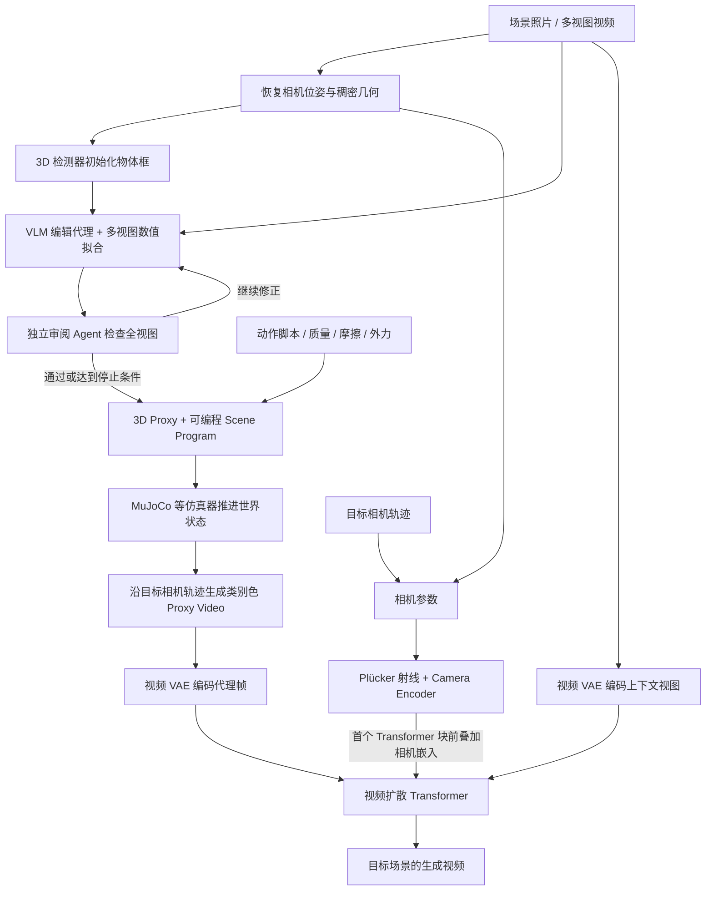

# Mundo：定制世界模型（Mundo: Customized World Model）

## 一句话定义

Mundo 将少量真实场景照片或视频编译为可编辑的 **3D Proxy + Scene Program**，用物理仿真推进物体状态，再由相机条件化视频扩散模型把结果渲染成目标场景的观测视频；其中 **Plücker 射线只提供相机几何条件，不代替物理仿真**。

## 英文缩写速查

| 缩写 | 英文全称 | 简要说明 |
|------|----------|----------|
| VLM | Vision-Language Model | 编辑与审阅代理场景的视觉语言智能体 |
| VAE | Variational Autoencoder | 将上下文视图和代理视频编码为视频 latent |
| DiT | Diffusion Transformer | 接受视频与相机条件的生成式 Transformer |
| RGB | Red, Green, Blue | 场景彩色视觉观测 |
| Real-to-Sim | Real to Simulation | 用现实场景资料重建可仿真环境 |
| 3D Proxy | Three-Dimensional Proxy | 用于场景几何、物体位置及仿真的显式代理 |
| FPS | Frames per Second | 视频生成吞吐帧率 |

## 为什么重要

纯视频世界模型可以生成像真实的画面，却不一定能显式查询物体姿态、接触事件或重放指定动作。Mundo 将**状态转移和视觉呈现解耦**：脚本 / MuJoCo 定义物体怎样动，代理视频传递时空约束，生成模型则依据原始照片恢复场景外观。这为特定场地的空间探索、机器人导航、操作演示和 Real-to-Sim 测试提供统一接口，但画面真实感不等于物理参数已验证。

**项目身份：** 官方标题为 *Mundo: Customized World Model*，署名 Luo 等 15 位贡献者（2026）。商汤科技 2026-11-04 的官方新闻将发布方表述为**大晓机器人与南洋理工大学 S-Lab**；项目页列有 Chen Change Loy 等作者。未发现独立正式论文 PDF，方法一手依据为作者 2026-10-23 官方技术博客与项目主页。

## 流程总览

依据项目页与官方技术博客全部技术章节整理。两条进入生成模型的条件具有不同职责：代理视频携带仿真后的运动/接触，Plücker 射线携带相机视角。

## 核心原理

### 1. 从影像到 3D Proxy

1. 3D 基础模型从多视角影像恢复相机位姿与稠密几何；3D 检测器（作者对比 Boxer、SpatialLM）初始化主要物体的包围盒。
2. 编辑 VLM 采用 *analysis-by-synthesis*：修改场景程序、从输入相机位姿重渲染、定位遗漏物体或错误边界，再在多个视角标记边缘并交给数值优化拟合**位置、尺寸、偏航角**。
3. 不参与拟合的视图用于验证结果，独立 reviewer agent 对所有输入视角复核；接受、几何改善停止或预算耗尽时结束。
4. 包围盒足以表达很多空间关系与简单刚体交互，但高精度接触可能需要更细网格、生成资产或库内现成的仿真模型。

### 2. Scene Program 管理可执行的世界状态

场景程序记录物体类别、位姿、尺度、质量、摩擦及更新规则。作者将运动表示为：

$$
S_{t+1}=f(S_t,a_t)
$$

其中 \(S_t\) 为可读写世界状态，\(a_t\) 是脚本/动作指令，\(f\) 可由 MuJoCo 等物理引擎或自定义程序执行。重力、碰撞、接触、机器人的操作轨迹在三维仿真中计算，**不是由 Plücker 射线或视频扩散模型求解**。项目页的 \(mundo.World\)、\(simulate\)、\(render\) 仅是经过简化的说明性代码，不应误当作可安装 SDK 的实测接口。

### 3. Proxy Video 与生成渲染

- 根据目标相机将仿真世界渲染成按物体类别平涂颜色的 **Proxy Frames**。它们提供运动、碰撞时间与位置、相机取景等几何 / 时间约束。
- 代理视频和上下文图像分别通过视频 VAE 取得 latent，按作者描述追加到目标视频的 latent 序列，供视频扩散模型使用。
- 输入视角及目标轨迹先对齐到**第一张上下文视图的相机坐标系**。作者观察到 **Proxy Video + 相机嵌入** 比仅用相机嵌入对视角与场景保真控制更好，但博客没有报告可复算的对应定量提升幅度。

### 4. Plücker 射线的定义、注入位置和边界

一条三维相机射线可用六维 Plücker 坐标表示：

$$
r_{u,v} = (\mathbf d_{u,v},\mathbf m_{u,v}),\qquad
\mathbf m_{u,v}=\mathbf o\times\mathbf d_{u,v}.
$$

对像素 \((u,v)\)，在 **\(R\) 表示 camera-to-world 旋转**、\(K\) 为内参、\(\mathbf o\) 为世界系相机光心时：

$$
\mathbf d_{u,v}=
\frac{R K^{-1}[u,v,1]^\top}{\|R K^{-1}[u,v,1]^\top\|}.
$$

这里 \(\mathbf d\) 表示射线方向，\(\mathbf m\) 是相对于世界坐标原点的矩向量；\(\mathbf d\cdot\mathbf m=0\)，且把射线上的取点沿方向平移不会改变矩向量。这是**通用相机射线几何定义**，可对照 ICLR 2024 *Cameras as Rays*，并非 Mundo 原创的 Plücker 公式；不同文献可能交换 \((\mathbf d,\mathbf m)\) 的排列顺序。

**在 Mundo 中的确切作用：**

1. Camera Encoder 把 **Proxy Frames 与带相机参数的 Context Views** 转换为 Plücker 射线特征。
2. 对应的 Camera Embedding **加到相应视频 latent 上，位置在第一个 Transformer block 之前**。
3. **仅提供外观但没有相机位姿**的参考图像（如添加进场景的新机器人）改用学习得到的 embedding。
4. 射线告诉模型「从哪里、朝哪里看」，**不携带沿射线的深度，不计算物体质量、摩擦或碰撞**；这些依赖显式代理、仿真状态以及 Proxy Video。官方博客未公开 ray-map 分辨率、encoder 具体层数或训练实现，不能声称已核验这些细节。

### 5. 训练与长时生成

- 训练作者报告约 **40,000 对目标视频与匹配代理视频**，含真实室内扫描、合成场景、驾驶、手物交互、游戏以及自渲染数据；微调 **MiniMax-H3 的 Ref2VA**，训练片段 **124 帧、640×480**。
- 视频流按块生成：示例每块 **124 帧**、将上一块末尾 **34 帧**作为下一块固定前缀；长路径按相机位置动态选择上下文图像。这里的数字是作者给出的方案配置，不是所有推理任务的固定常量。

## 工程实践

| 环节 | 可核对的接口 / 约束 | 工程含义 |
|------|--------------------|----------|
| 输入采集 | 官方新视角实验为 1–12 张图；大场景可用几十张 | 多视图覆盖不足的区域依然是生成推断 |
| 代理构建 | 包围盒、编辑/审阅智能体、跨视图优化 | 需要检查尺度、物体碰撞体、门/抽屉关节正确性 |
| 仿真执行 | 多数演示用 MuJoCo，Scene Program 设质量与摩擦 | 需校验接触参数，不把生成画面当真值 |
| 视频渲染 | Proxy Video + Context Views + Plücker 相机条件 | 相机坐标系、内外参和目标轨迹应一致 |
| 机器人应用 | 酒店楼层导航、洗衣房探索/开门、机械臂操作演示 | 展示了潜在训练/测试用途，未证明真机闭环策略收益 |
| 部署性能 | 重建通常 10–20 分钟；8×A800、20 步约 1.5 FPS | 不是实时机器人控制闭环的已验证吞吐 |

## 源码运行时序图

**不适用（截至 2026-11-13）。** 官方 [Luo-Yihang/Mundo](https://github.com/Luo-Yihang/Mundo) 仍只有 README 与素材目录；README TODO 将代码和权重列为**2026 年 11 月底待发布**，没有可核验的训练 / 推理 / 仿真源码入口。项目页的示例程序明确是简化说明，**不可据此绘制冒充源码的 sequenceDiagram**。代码发布后应重读真实入口再补图。

## 局限与风险

- **几何与接触：** 代理包围盒对细粒度接触不足，小物体可能漂浮；视觉模型也会把抓取 / 交互细节生成错误。
- **长期一致性：** 作者明确没有长时记忆机制；物体长期动态变化及再次看到遮挡区域时可能不一致。
- **速度：** 上述约 1.5 FPS 来自作者报告的 8×A800、20 步设置，不可直接视作单卡或在线部署性能。
- **可信性：** 代理世界具有物理状态并不意味着重建质量、材质参数、生成视频及仿真到真机迁移已完成定量标定；官方未提供独立机器人策略成功率基准或完整可运行代码。
- **论文状态：** 当前一手方法材料为官方项目页与 2026-10-23 技术博客；官方仓库未提供独立正式论文 PDF。Plücker 基础公式来自通用几何文献，区别于 Mundo 团队披露的具体注入方式。

## 关联页面

- [Atlas 世界模型](./atlas-world-model.md)
- [World-T3：相机条件世界模型](./paper-world-t3.md)
- [生成式世界模型](../methods/generative-world-models.md)
- [Video-as-Simulation](../concepts/video-as-simulation.md)

## 参考来源

- [Mundo 项目主页归档](../../sources/sites/mundo-world-model.md)
- [Mundo 作者官方技术博客全文归档](../../sources/blogs/mundo_world_model.md)
- [Mundo 官方 GitHub 状态归档](../../sources/repos/mundo.md)
- [Cameras as Rays: Pose Estimation via Ray Diffusion（ICLR 2024，Plücker 数学背景）](https://proceedings.iclr.cc/paper_files/paper/2024/hash/66175cc3d241c1702521dd836cd08585-Abstract-Conference.html)

## 推荐继续阅读

- [Mundo: From seeing a place to simulating what happens there（作者技术博客）](https://huggingface.co/blog/Luo-Yihang/mundo-world-model)
- [Mundo 官方交互演示](https://mundo-world-model.github.io/)
