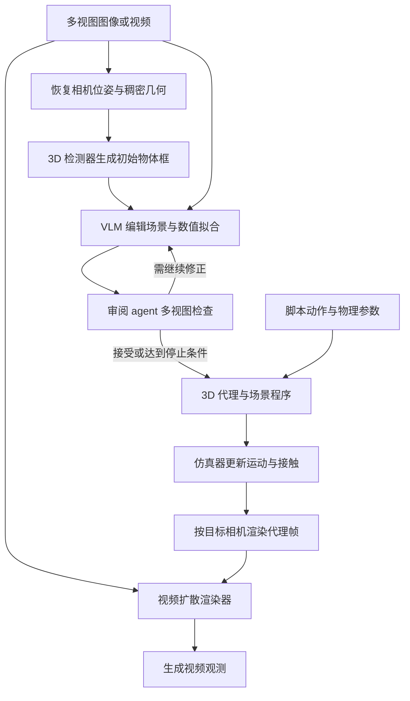

# Mundo：定制世界模型

## 一句话定义

Mundo 从场景图像或视频构建显式 3D 代理和可编程物理世界，再用上下文图像与代理视频引导视频模型生成场景观测。

## 英文缩写速查

| 缩写 | 英文全称 | 简要说明 |
|------|----------|----------|
| VLM | Vision-Language Model | 视觉语言模型，用于代理场景编辑与检查 |
| VAE | Variational Autoencoder | 编码上下文图像及代理视频 |
| Real-to-Sim | Real to Simulation | 从真实场景数据构建仿真环境 |
| RGB | Red Green Blue | 彩色图像观测 |

## 流程总览

基于 2026-10-23 官方技术博客全文与项目主页整理；图中物理演化由代码和仿真器计算，视频模型负责外观渲染。

## 核心机制

1. **构建代理：** 使用 3D 基础模型恢复相机与几何，3D 检测器初始化物体框。编辑 agent 在多视图标记边缘并调用数值优化，另用未参与拟合的视图验证；独立审阅 agent 检查所有输入视图。通过、停止改善或达到预算时结束。
2. **可编程世界：** 场景程序维护对象、位姿、质量、摩擦及更新规则；多数示例使用 MuJoCo 计算重力、碰撞与接触。普通空间探索可用包围盒；精细接触对象需要更详细几何。
3. **生成观测：** 将代理渲染为按类别着色的帧，与上下文图像编码为 VAE latent；相机参数通过 Plücker 射线编码注入模型。视频扩散模型据此生成场景外观。
4. **长视频：** 博客示例按 124 帧分块，将前一块末尾 34 帧作为下一块固定前缀，并按后续相机路径选择上下文视图。
5. **训练：** 约 4 万对目标视频与对应代理视频，覆盖真实和合成场景等；以 640×480、124 帧片段微调 MiniMax-H3 Ref2VA。

## 应用与局限

- 项目展示新视角探索、脚本化物理交互、机器人导航和操作；可输出轨迹与交互状态，供 Real-to-Sim 测试和训练研究使用。未见公开定量机器人策略性能评测。
- 不可见区域由模型推断，不能视为真实重建；更多上下文视图可减少推断范围。
- 博客报告场景重建约 10–20 分钟；8 张 A800、20 步推理时代理视频渲染约 1.5 帧/秒。小物体可能漂浮或产生交互幻觉，长期动态变化与遮挡重现缺乏长时记忆保障。
- 截至 2026-10-30，官方仓库仅有 README 与资源，代码和权重列为 11 月底待发布；未发现可运行实现或公开训练数据集。

## 源码运行时序图

不适用：官方仓库尚无可辨识的训练、推理或部署入口；上图为原文描述的方法流程，不代表已核验的源码调用。

## 关联页面

- [Atlas 世界模型](./atlas-world-model.md)
- [生成式世界模型](../methods/generative-world-models.md)
- [Video-as-Simulation](../concepts/video-as-simulation.md)

## 参考来源

- [项目主页归档](../../sources/sites/mundo-world-model.md)
- [官方技术博客归档](../../sources/blogs/mundo_world_model.md)
- [官方仓库归档](../../sources/repos/mundo.md)

## 推荐继续阅读

- [Mundo 官方技术博客](https://huggingface.co/blog/Luo-Yihang/mundo-world-model)
