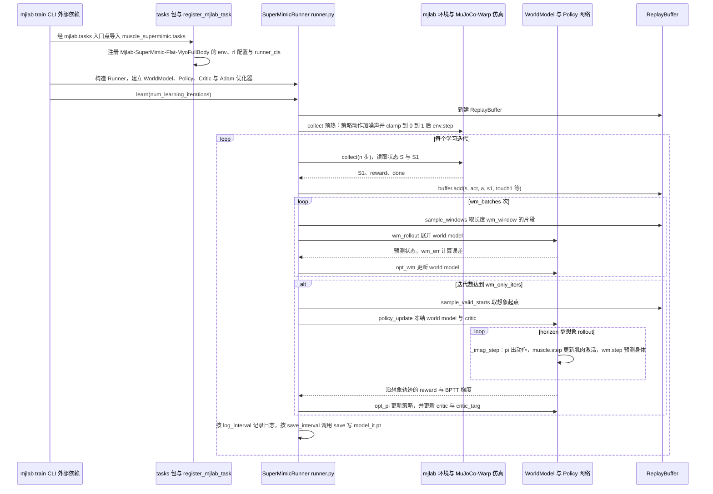

# muscle-supermimic：肌骨人体的世界模型动作跟踪

**muscle-supermimic** 将 SuperMimic 风格的可微世界模型训练应用于肌肉驱动的人体仿真，策略以 100 Hz 输出肌肉激励来跟踪动作捕捉轨迹。

## 英文缩写速查

| 缩写 | 英文全称 | 简要说明 |
|---|---|---|
| MDP | Markov Decision Process | 描述跟踪任务的状态、动作和奖励 |
| GPU | Graphics Processing Unit | 并行仿真与训练使用的硬件 |
| DoF | Degrees of Freedom | 模型关节自由度 |
| AMASS | Archive of Motion Capture as Surface Shapes | 动作数据来源 |

## 方法与模型

仿真器采集策略交互转移，世界模型拟合身体状态变化；策略在模型中展开 32 步想象轨迹并反向传播。观测、奖励和终止条件在仿真和想象轨迹中共用解析函数；肌肉长度、速度和力由 MuJoCo 肌肉与肌腱的 PyTorch 复现计算。原作者的 [SuperMimic](./paper-supermimic.md) 使用刚体人形；本项目移植社区实现并引入肌骨动力学。

| 模型 | 自由度 | 肌肉 | 项目报告配置 |
|---|---:|---:|---|
| [MS-Human-700](./ms-human-700.md) | 37 加自由根；锁手后 33 加自由根 | 700；锁手后 694 | 训练实验使用锁手配置 |
| MyoFullBody | 31 加自由根 | 354 | 来自 MuscleMimic 模型包，手指禁用 |

## 作者报告的结果

使用 972 条 KIT 训练片段、4096 个并行环境及一张 RTX 5090。在 108 条未见测试片段上，每条从首帧评估一次：MS-Human-700 训练 4 小时得到归一化回报 0.83，99 条跟踪到结束；10.1 小时得到 0.91，104 条跟踪到结束。MyoFullBody 训练 6 小时得到 0.83，101 条跟踪到结束。结果来自项目主页和 README，训练仍在进行，未独立复核；测试片段并非任意分布外动作。

## 工程实践与局限

[源码](../../sources/repos/muscle-supermimic.md) 提供训练、重定向、评测和渲染命令；默认并行规模下 README 报告分别需要 32 GB（MS-Human-700）与 24 GB（MyoFullBody）显存，可查看文档调整规模。数据集需先接受访问条款，动作数据限非商业研究且禁止再分发；MyoFullBody 的 MoBL-ARMS 组件也限非商业用途。项目页称尚无域随机化；仿真跟踪结果不等同于真实人体生理准确性或机器人真机表现。

## 源码运行时序图

训练入口：`uv run train Mjlab-SuperMimic-Flat-MyoFullBody --env.commands.motion.motion-file data/musclemimic/kit_kinesis_train.txt`（`train` 为 mjlab 外部 CLI，经 `mjlab.tasks` 入口点加载本仓库的任务注册，由 `runner_cls` 指定 `SuperMimicRunner`）。评估入口：`uv run ms-eval --checkpoint <model_*.pt>`（见 `pyproject.toml` 的 `[project.scripts]`）。下图为训练主循环。

图依据：kaibohex/muscle-supermimic@d73bbcb，`src/muscle_supermimic/rl/supermimic/runner.py`（learn、collect、wm_update、policy_update、_imag_step、save）、`src/muscle_supermimic/tasks/__init__.py`、`tasks/tracking/__init__.py`、`tasks/tracking/config/myofullbody/__init__.py` 与 `rl_cfg.py`、`tasks/tracking/scripts/evaluate.py`、`pyproject.toml`、`README.md`；未运行代码。

## 关联页面

- [MS-Human-700](./ms-human-700.md)：肌骨模型及原始研究。
- [SuperMimic](./paper-supermimic.md)：可微世界模型训练方法。
- [具身人体仿真](./embodied-human-simulation.md)：相关仿真背景。

## 参考来源

- [项目页归档](../../sources/sites/muscle-supermimic.md)
- [源码归档](../../sources/repos/muscle-supermimic.md)

- 源码核对（2026-11-02）：kaibohex/muscle-supermimic@d73bbcb，读过 `README.md`、`pyproject.toml`、`src/muscle_supermimic/rl/supermimic/runner.py`、`src/muscle_supermimic/tasks/__init__.py`、`src/muscle_supermimic/tasks/tracking/__init__.py`、`src/muscle_supermimic/tasks/tracking/config/myofullbody/__init__.py`、`rl_cfg.py`、`src/muscle_supermimic/tasks/tracking/scripts/evaluate.py`；时序图依据以上文件，未运行代码。

## 推荐继续阅读

- [项目主页](https://muscle-supermimic.beanpow.top/)
- [训练文档](https://github.com/kaibohex/muscle-supermimic/blob/master/docs/training.md)
