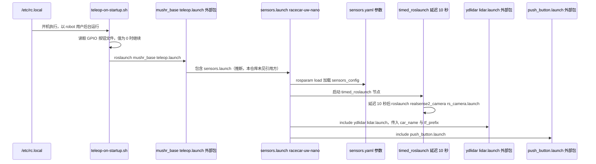

---

type: entity
tags: [repo, ros, education, ackermann, navigation, racing, mit]
status: complete
updated: 2026-07-27
related:
  - ../entities/navigation2.md
  - ../overview/navigation-slam-autonomy-stack.md
  - ./oomwoo.md
  - ./ukmarsbot.md
  - ../concepts/micromouse.md
  - ./mpc-python.md
sources:
  - ../../sources/repos/mushr.md
  - ../../sources/repos/ukmarsbot.md
summary: "MuSHR 是华盛顿大学 PRL 的多智能体非完整约束小车平台：低成本硬件 + ROS 导航/竞速教学。"
---

# MuSHR

**MuSHR**（Multi-agent System for non-Holonomic Racing）是面向 **教学与研究** 的 ROS 小车开源平台。

## 英文缩写速查

| 缩写 | 英文全称 | 简要说明 |
|------|----------|----------|
| BOM | Bill of Materials | 物料清单，硬件零部件列表 |
| SLAM | Simultaneous Localization and Mapping | 同步定位与建图 |

## 为什么重要

- **Nav2/slam 教学**：与 [Navigation2](./navigation2.md) 教程场景接近。
- **多车系统**：竞速与协同实验框架。

## 核心结构/机制

| 组成 | 说明 |
|------|------|
| **Hardware** | 阿克曼小车 BOM |
| **Software** | ROS 导航、定位、控制栈 |
| **Course** | 实验室作业与文档 |

## 常见误区或局限

- **规模小**：社区与 stars 小于 TurtleBot；硬件供应链需自行确认。
- **非工业 AMR**：偏教育而非量产底盘。

## 源码运行时序图

本仓库本身不含导航/控制节点（`mushr_base`、`mushr_sim` 等位于外部仓库，见 README 列表）；仓库内可运行的是开机脚本与传感器 launch 文件。下图据此画出：开机按钮触发的遥控启动，以及 `racecar-uw-nano` 传感器 launch 的展开顺序。

入口：开机后 `/etc/rc.local` 调用 `teleop-on-startup.sh`，GPIO 按钮读数为 0 时执行 `roslaunch mushr_base teleop.launch`（`mushr_base` 不在本仓库）。

图依据：prl-mushr/mushr@2030b90，`mushr_utils/startup/teleop-on-startup.sh`、`mushr_utils/startup/rc.local`、`mushr_hardware/mushr_hardware/launch/racecar-uw-nano/sensors.launch`、`mushr_hardware/mushr_hardware/config/racecar-uw-nano/sensors.yaml`、`README.md`；未运行代码。

## 参考来源

- [sources/repos/mushr.md](../../sources/repos/mushr.md)
- [prl-mushr/mushr](https://github.com/prl-mushr/mushr)

- 源码核对（2026-11-02）：prl-mushr/mushr@2030b90，读过 `README.md`、`mushr_utils/startup/teleop-on-startup.sh`、`mushr_utils/startup/rc.local`、`mushr_hardware/mushr_hardware/launch/racecar-uw-nano/sensors.launch`、`mushr_hardware/mushr_hardware/config/racecar-uw-nano/sensors.yaml`；时序图依据以上文件，未运行代码。

## 关联页面

- [Navigation2](../entities/navigation2.md)
- [导航·SLAM·自动驾驶栈总览](../overview/navigation-slam-autonomy-stack.md)
- [OOMWOO](./oomwoo.md) — 另一类低成本 ROS 2 整机（家用清扫形态）
- [UKMARSBOT](./ukmarsbot.md) — 无 ROS 的嵌入式竞赛/教学差速平台对照
- [Micromouse](../concepts/micromouse.md) — 迷宫竞速压缩栈
- [mpc_python](./mpc-python.md) — 非 ROS 的 CVXPY iMPC + MuJoCo MuSHR 路径跟踪 demo

## 推荐继续阅读

- https://mushr.io/
