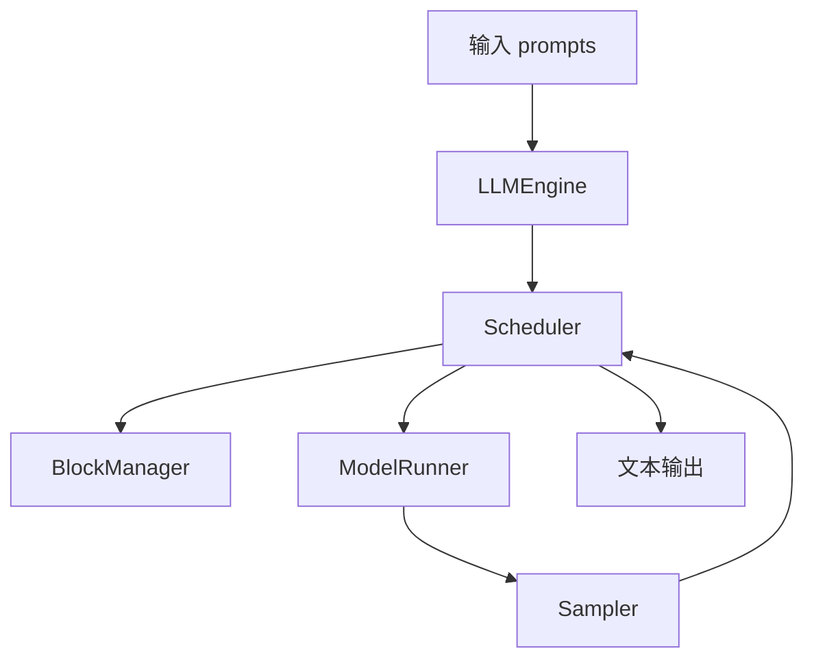
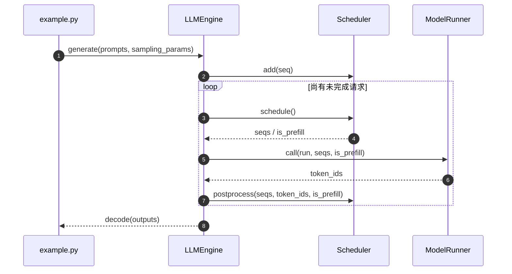

# Nano-vLLM｜面向学习的极简 LLM 推理引擎

## 一句话定义

Nano-vLLM 以可读的简化推理内核呈现 prefix caching、block KV cache、分批调度、Tensor Parallelism 与 CUDA Graph；适合先读懂一次离线生成如何完成，而非用它替代生产集群。

## 英文缩写速查

| 缩写 | 英文全称 | 简要说明 |
|---|---|---|
| LLM | Large Language Model | 本页服务的自回归语言模型类型 |
| KV | Key-Value Cache | 用于增量推理的历史注意力键值缓存 |
| GPU | Graphics Processing Unit | 计算和 kernel 执行的硬件 |
| CI | Continuous Integration | 贡献审核时运行的自动验证 |
| PR | Pull Request | 提交测试、代码变更、性能证据的上游审查单 |

## 为什么重要

Nano-vLLM 以可读的简化推理内核呈现 prefix caching、block KV cache、分批调度、Tensor Parallelism 与 CUDA Graph；适合先读懂一次离线生成如何完成，而非用它替代生产集群。

## 核心原理

`LLM.generate` 先把 prompt 编码为 `Sequence`，`Scheduler` 在 waiting/running 队列间组织 prefill 和 decode 并调用 `BlockManager` 管理 cache；`ModelRunner.run` 负责前向与采样，`postprocess` 判断 EOS 或输出长度后释放块。

### 流程总览

## 源码运行时序图

**已核对执行入口：** `example.py` 中 `from nanovllm import LLM, SamplingParams` → `LLM(...).generate(...)`；`bench.py` 用输出 token 数 / 运行时间计算离线吞吐。 此图仅覆盖所列实际入口的主干路径，不代表全部异步/多卡细节。

## 工程实践

- **可执行入口：** `example.py` 中 `from nanovllm import LLM, SamplingParams` → `LLM(...).generate(...)`；`bench.py` 用输出 token 数 / 运行时间计算离线吞吐。
- **贡献切口：** 先复现 Qwen3-0.6B `example.py`，再选 `Scheduler` / prefix caching 的边界条件编写正确性用例；固定同一 GPU、prompt 集、种子与生成长度，报告 tokens/s 和 P95 延迟（如有在线封装）。
- **回归要求：** 说明 GPU/驱动/依赖、模型版本、输入与输出 token 长度分布、预热次数与 batch/并发；保留正确性对拍，再报告 tokens/s、TTFT 或 TPOT（按服务模式选择）。
- **开源状态：** 官方 [GitHub 仓库](https://github.com/GeeeekExplorer/nano-vllm) 与 README/源码可访问；对特殊 GPU kernel、训练与数据等子组件是否完全开放，不能从主页自动推断。

## 局限与风险

README 标称约 1200 行 Python；官方在 RTX 4070 Laptop 8GB、Qwen3-0.6B、256 请求的离线测例报告 1434.13 tokens/s，对照 vLLM 1361.84 tokens/s。这不是本站实测，也不代表生产线上更快。

- **视频事实界限：** “学生 / 1–2 年 / 资深”是用户提供的视频观点，不是上游官方招聘标准；未验证作者或 Discord 时间。别把开源贡献与 PR 合并结果视为确定承诺。

## 关联页面

- [LLM 推理显存估算](../concepts/llm-inference-vram-estimation.md)
- [Mini-SGLang｜精简但完整的在线 LLM Serving 系统](./mini-sglang.md)
- [vLLM｜生产级大模型推理与持续批处理](./painode-103-vllm.md)

## 参考来源

- [Nano-vLLM｜面向学习的极简 LLM 推理引擎：一手文档和代码核验归档](../../sources/repos/nano-vllm-official.md)
- [六项目对照与原视频证据边界](../../sources/repos/llm-inference-open-source-contribution-primary-docs-2026-11.md)
- [官方 README](https://github.com/GeeeekExplorer/nano-vllm/blob/main/README.md)

## 推荐继续阅读

- [官方仓库与最新文档](https://github.com/GeeeekExplorer/nano-vllm)
