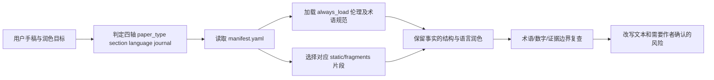

# nature-polishing（学术润色 Skill）

## 一句话定义

**nature-polishing** 是原仓库 `Yuan1z0825/nature-skills` 下的可复用 Agent Skill，不是独立仓库；它根据论文类型、章节、语言与目标期刊，路由到合适的润色规则，优化表达同时保留原文中的事实、证据强度和引文意图。

## 英文缩写速查

| 缩写 | 英文全称 | 简要说明 |
|---|---|---|
| NMI | Nature Machine Intelligence | Skill 单独选择的目标期刊规则 |
| SI | Supplementary Information | 附录材料，涉及主文与补充材料的证据分配 |
| AI | Artificial Intelligence | 执行润色的宿主 Agent |
| LaTeX | LaTeX Typesetting System | 需要排版修复时的输出与检查对象 |

## 为什么重要

学术英文可以改善表达却不可悄悄增强结论。该 Skill 的规则明确“不新增作者没有给出的结果、机制、统计意义或引用”，并要求语言修改在不同文章类型、章节和期刊之间保持有区别的判断。

## 核心原理

- **四轴路由：** `skills/nature-polishing/manifest.yaml` 定义 `paper_type`（research/methods/hypothesis/algorithmic/review）、`section`、`language`（en/zh-to-en）与 `journal`（nature/nat-comms/nat-mach-intell/generic）。
- **先加载共同底线：** `always_load` 指向 `nature-shared/core/` 的学术伦理、术语台账等通用规则，再按四轴读取需要的 `static/fragments/`；不把全部参考材料无差别塞进上下文。
- **内容与边界：** 先关注论文类型和段落职责，再约束 claim/evidence，最后做语句润色；无法在不虚构内容的情况下修复逻辑问题时标记而非编造。
- **任务切分：** 新章节起草应交由 `nature-writing`；目标是 Nature 家族期刊也须核对具体期刊规则，而非仅凭“Nature 风格”一概处理。

## 流程总览

图由模块 `SKILL.md` 与 `manifest.yaml` 的路由顺序直接提炼，非独立训练推理架构。

## 源码运行时序图

**不适用（独立运行时）**：`nature-polishing` 的公开入口是由宿主 Agent 消费的 `SKILL.md` 和声明式 `manifest.yaml`；本次核验未发现该子模块自带可独立启动的润色服务器或模型推理 CLI，故不虚构 Python/服务间调用序列。

## 工程实践

- 安装官方原仓库的 `skills/nature-polishing`，并保留 `nature-shared` 的依赖；只复制单个 SKILL.md 可能丢失路由与通用约束。
- 输入原文、目标章节和期刊；明确不可改变的数据、术语与引用。
- 若只是改稿，使用 `nature-polishing`；要重建核心论证或从头写 Introduction，则应评估 `nature-writing` 或 [PaperSpine](paperspine.md)。
- 核查 `a1a8220366e8` 的 Skill 文档和 manifest，技能版本 `6.6.0`。

## 局限与风险

学术风格示例不是出版社认可或投稿成功保证；结果必须由作者核对。对 Nature Portfolio 的文稿保密、AI 披露与作者责任须遵循期刊最新政策。未做本文之外的实际润色质量 benchmark。

## 关联页面

- [Supervisor-Skills](supervisor-skills.md)：把论文结构与写作质量拆成多种互补技能。
- [PaperSpine](paperspine.md)：贡献、动机、证据与论文交付的端到端约束。
- [ARIS](aris-auto-research-in-sleep.md)：更侧重实验和审稿循环。
- [AI Auto-Research](../concepts/ai-auto-research.md)：应用情境。

## 参考来源

- [官方 nature-polishing 源码归档](../../sources/repos/nature-polishing.md)
- [nature-skills 上游原仓库](https://github.com/Yuan1z0825/nature-skills)

## 推荐继续阅读

- [nature-polishing SKILL（固定版本）](https://github.com/Yuan1z0825/nature-skills/blob/a1a8220366e8/skills/nature-polishing/SKILL.md)
- [manifest.yaml](https://github.com/Yuan1z0825/nature-skills/blob/a1a8220366e8/skills/nature-polishing/manifest.yaml)
