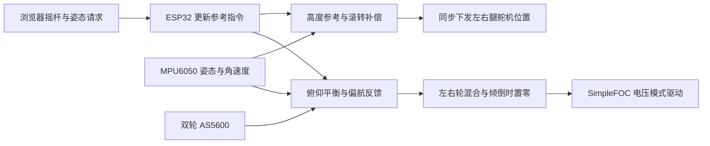
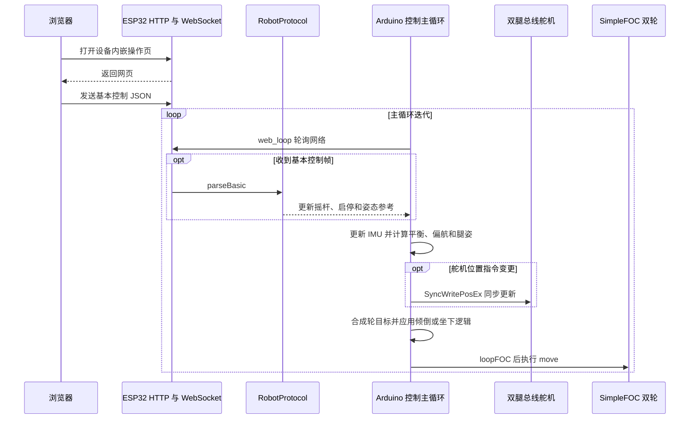

# NavBot-EN01｜桌面双轮足自平衡机器人（Tabletop Self-Balancing Wheel-Legged Robot）

## 一句话定义

**NavBot-EN01 用两只主动轮维持俯仰平衡并转向，用两只总线舵机改变腿长对应的机身高度和侧倾，人在浏览器里给指令，平衡闭环在 ESP32 上运行。**

## 英文缩写速查

| 缩写 | 英文 | 本页含义 |
| --- | --- | --- |
| FOC | Field-Oriented Control | 按电机转子角度调节定子电压的矢量驱动 |
| IMU | Inertial Measurement Unit | MPU6050 提供机身姿态与角速度反馈 |
| BLDC | Brushless Direct Current | 无刷轮电机 |
| AP / STA | Access Point / Station | ESP32 自建热点或接入已有的 Wi-Fi |
| BOM | Bill of Materials | 物料清单，不等同于核验过的采购与接线组合 |

## 为什么重要

它把三个不同层次的控制放在桌面样机上：轮电机驱动、倒立摆平衡和浏览器遥操作。可以练习区分参考指令、状态反馈和实际执行量；不需要把网页连通或舵机可动误认成平衡调通，也不把这套轮足样机当成人形步态、导航或 AI 平台的实证。

## 核心机制与流程

| 模块 | 固定版本能核对的实现 |
| --- | --- |
| 主控与传感 | ESP32、两侧 AS5600 磁编码器，MPU6050 与右侧编码器共享同一组 I²C；README 指出无刷驱动芯片为 L6234PD013TR |
| 俯仰与转向 | `lqr_balance_loop()` 将俯仰角、角速度、轮位置和轮速度的反馈合成，含零点和增益修正。源码称 LQR，但实现为可调反馈项和补偿，未据此声称已有可复核的最优增益推导。偏航项对左右轮按相反符号叠加 |
| 执行与腿姿 | 左右轮使用 SimpleFOC 的 voltage torque 模式；不是测电流的转矩闭环。高度参考与 IMU 滚转修正映射为两个舵机位置，经限位后同步写入 |
| 浏览器 | ESP32 提供内嵌控制页，浏览器通过 WebSocket JSON 传入启停、方向、摇杆与姿态参考；不把网页放进实时稳定内环 |

## 官方固件运行时序

依据固定版本的 `wl_pro_robot.ino`、`basic_web.h`、`robot.cpp` 和 `wifi.cpp`。`web_loop()` 和 IMU 更新、控制计算在 Arduino 主循环中顺序执行；另一个核心上的 SPIFFS / OLED 表情任务不是平衡回路。

## 工程实践

1. 把 [STEP / STL、面板和 CNC 图、BOM](https://github.com/fuwei007/Navbot-EN01/tree/3139f2fb32b38d10611feb905e16f8aa012f2f2e/Hardware/RebotModel) 与 [EasyEDA 工程](https://github.com/fuwei007/Navbot-EN01/tree/3139f2fb32b38d10611feb905e16f8aa012f2f2e/Hardware/PCB) 固定在同一提交。先核对实际控制板修订、配电和接插件，不用购物链接反推电气兼容性。
2. 把轮编码器方向与电机驱动、舵机机械零位和行程、IMU 静止零偏分开验收，再验证手扶条件下的站立。网页遥控只作为最后一层；在隔离本地网络使用，不把默认遥控接口暴露到公网。
3. 验收另记录站立、高度切换、转向、倾倒后行为和失联停止；源码有倾角越界时将轮目标清零的分支，但这不能替代独立急停，也不是已验证的失联保护。

## 局限与证据边界

- 目前核实的是公开的设计和源码，不是有明确整机许可的开源硬件认证。固定版本未见顶层许可证；第三方库有各自许可，本页不转载源码、CAD、PCB 或照片。
- BOM 的 3.7 V 电池条目、固件的 8 V 驱动参数及 7.2 V 电量提示，与作者装配文和仓库说明的供电/接口写法并不统一。在核清板卡、保护、极性及接口前，不据此建议接电。
- 本次没有编译、刷机、组装、检查 EDA 规则或测试性能；不把套件宣传的坡度、续航或不同版本的自动起身演示当成本提交实测。

## 关联页面

- [轮腿双足机器人](../concepts/wheel-legged-biped.md)
- [SimpleFOC](./simplefoc.md) · [磁场定向控制](../concepts/field-oriented-control.md)
- [执行器驱动链选型](../queries/actuator-drive-chain-selection-loop.md)：分清电压模式下发、轮端实际力矩与板级验收。
- [PID 控制](../methods/pid-control.md) · [混合运动](../tasks/hybrid-locomotion.md)
- [Micro-Wheeled Leg Robot](./paper-notebook-micro-wheeled-leg-robot.md)：EN01 README 致谢的上游，不是同一个项目节点。
- [人形硬件设计纵深：Stage 6](../../roadmap/depth-humanoid-hardware-design.md)：仅作为小型轮足的上电与验收对照。

## 参考来源

- [官方仓库与源码核查](../../sources/repos/fuwei007-navbot-en01.md)
- [产品页、作者装配与版本差异](../../sources/sites/navbot-en01-official.md)

## 推荐继续阅读

先把 `wl_pro_robot.ino` 的传感反馈和 `motor.target` 对起来，再读 SimpleFOC 的电压与电流控制差异。用相同的站立工况区分控制器误差、传感器符号和执行器限幅，不先用遥控手感调平衡参数。
