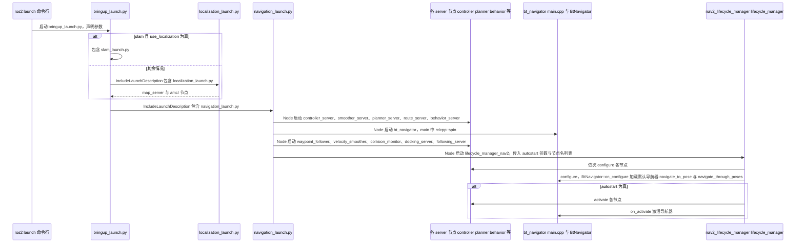

# Navigation2（Nav2）

**Navigation2**（[ros-navigation/navigation2](https://github.com/ros-navigation/navigation2)）是 ROS 2 生态的 **移动机器人导航参考实现**，将定位结果、静态/动态代价地图与路径跟踪解耦为可替换插件。

## 英文缩写速查

| 缩写 | 英文全称 | 简要说明 |
|------|----------|----------|
| ROS 2 | Robot Operating System 2 | 机器人系统集成与通信的常用中间件 |
| SLAM | Simultaneous Localization and Mapping | 同步定位与建图 |
| LiDAR | Light Detection and Ranging | 激光雷达，地形感知与建图主传感器 |
| LIO | LiDAR-Inertial Odometry | 激光-惯性里程计 |
| VIO | Visual-Inertial Odometry | 视觉-惯性里程计，融合相机与 IMU 估计位姿 |

## 为什么重要

- **事实标准**：AMR、服务机器人、科研平台普遍以 Nav2 为 **规划—控制中枢**。
- **插件化**：全局规划（NavFn、Smac Planner 等）、局部规划（DWB、RPP、MPPI 等）、控制器与 **行为树（BT）** 可独立升级。
- 与 [ROS 2 基础](../concepts/ros2-basics.md)、[slam_toolbox](https://github.com/SteveMacenski/slam_toolbox) 形成常见 **「建图 + 导航」** 闭环。
- 算法预习可先用 [PythonRobotics](./python-robotics.md) 跑通 A*、DWA、Stanley/MPC 等示例，再读 Nav2 插件与 ROS 2 集成。
- 开源家用清扫整机入口见 [OOMWOO](./oomwoo.md)（Gazebo + slam_toolbox + Nav2，仿真优先）。

## 核心结构/机制

| 组件 | 说明 |
|------|------|
| **bt_navigator** | 行为树编排：导航、充电、恢复（spin、backup、wait） |
| **planner_server** | 全局路径；支持 2D grid、Hybrid-A* 等 |
| **controller_server** | 局部跟踪；输出 `geometry_msgs/Twist` |
| **smoother_server** | 路径平滑 |
| **costmap_2d** | 静态层 + 膨胀层 + 可选 3D 源（如 nvblox） |
| **lifecycle** | 节点生命周期管理，便于量产启动顺序 |

典型数据流：**SLAM/AMCL** 提供 `map`↔`odom`↔`base_link` → **global costmap** → **planner** → **local costmap** → **controller** → 底盘驱动。

## 常见误区或局限

- **误区：装好 Nav2 即可自动驾驶** — 仍需可靠定位、地图质量、传感器标定与安全监控。
- **误区：默认 DWB 适用所有底盘** — 全向、阿克曼、差速动力学差异大，需换 **controller / footprint**。
- **局限**：Nav2 面向 **平面移动底盘**；人形/腿式 **步态规划** 不在其范围（见 [OpenLoong](./openloong.md)）。

## 源码运行时序图

入口：`ros2 launch nav2_bringup bringup_launch.py`（launch 文件 `nav2_bringup/launch/bringup_launch.py`）。下图为 launch 层的启动顺序，以及生命周期管理器对各节点的 configure 与 activate；`bringup_launch.py` 中的 `use_composition` 为真时，各服务改为同一容器内的 ComposableNode，图中未展开。

图依据：ros-navigation/navigation2@20b9fa3，`nav2_bringup/launch/bringup_launch.py`、`navigation_launch.py`、`localization_launch.py`、`nav2_bt_navigator/src/main.cpp`、`nav2_bt_navigator/src/bt_navigator.cpp`（on_configure、on_activate 段）；未运行代码。

## 参考来源

- [sources/repos/navigation2.md](../../sources/repos/navigation2.md)
- [sources/repos/navigation_slam_autonomy_stack_catalog.md](../../sources/repos/navigation_slam_autonomy_stack_catalog.md)
- [ros-navigation/navigation2](https://github.com/ros-navigation/navigation2)

- 源码核对（2026-11-02）：ros-navigation/navigation2@20b9fa3，读过 `README.md`、`nav2_bringup/launch/bringup_launch.py`、`navigation_launch.py`、`localization_launch.py`、`nav2_bt_navigator/src/main.cpp`、`nav2_bt_navigator/src/bt_navigator.cpp`（部分）；时序图依据以上文件，未运行代码。

## 关联页面

- [PythonRobotics](./python-robotics.md) — 规划/跟踪算法入门代码
- [导航·SLAM·自动驾驶栈总览](../overview/navigation-slam-autonomy-stack.md)
- [LiDAR / LIO / VIO 选型](../comparisons/lidar-slam-lio-vio-selection.md)
- [OOMWOO](./oomwoo.md) — 开源家用扫地机（Nav2 应用整机）
- [Language-to-Navigation-Goals（VLM+RGB-D→Nav2）](./paper-language-to-navigation-goals-rgbd.md)
- [Autoware](./autoware.md)

## 推荐继续阅读

- [PythonRobotics 在线教材](https://atsushisakai.github.io/PythonRobotics/)（算法预习）
- [Nav2 官方文档](https://docs.nav2.org/)
