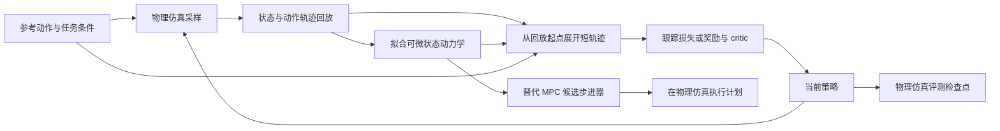
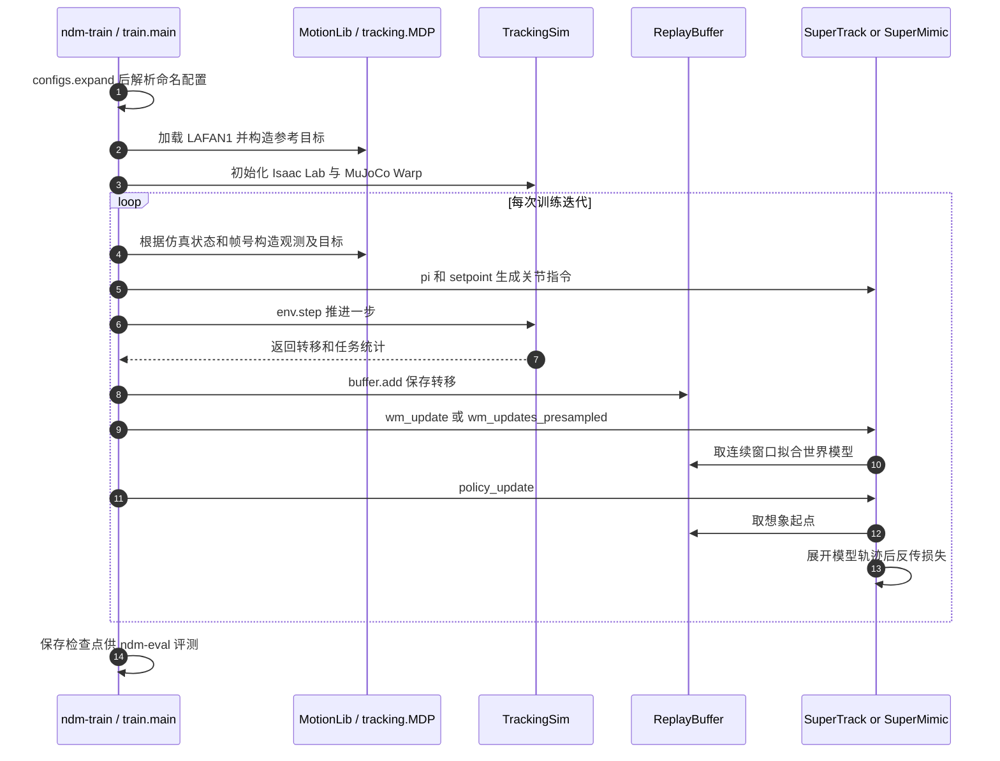

# 神经动力学建模训练与评测框架｜NDM Gym (Neural Dynamics Modeling Gym)

## 一句话定义

NDM Gym 是 NDM Gym Contributors 开源的控制实验框架：用物理仿真转移训练可微状态世界模型，在短想象轨迹中优化策略，或用模型替换规划器里的步进器，再回到指定物理仿真器评估。

## 英文缩写速查

| 缩写 | 英文全称 | 简要说明 |
|---|---|---|
| NDM | Neural Dynamics Model | 用网络预测动作条件下的状态转移 |
| MLP | Multilayer Perceptron | 吞吐比较中常用的状态动力学骨干 |
| BPTT | Backpropagation Through Time | 沿展开状态反传到策略 |
| MPJPE | Mean Per Joint Position Error | 位置跟踪误差；区分世界系与根相对坐标系 |
| MPC | Model Predictive Control | 搜索候选动作序列后只执行计划的一部分 |

## 为什么重要

做 [全身运动跟踪](../methods/whole-body-motion-tracking.md) 时，单位时间内能跑多少模型步、策略多久达到目标回报、以及最终姿态误差，是三个不同问题。NDM Gym 把 [基于模型的强化学习](../methods/model-based-rl.md) 中的物理采样、模型拟合、策略更新与评测拆开，使这些口径能够独立比较；它预测物理状态，不是生成视频的世界动作模型。

## 核心机制

1. **采集与拟合。** 用当前策略在物理引擎收集状态、动作、下一状态及上下文，保存连续窗口；世界模型以预测的多步轨迹拟合仿真状态。SuperTrack 的加速度模型预测根部与关节加速度，再用半隐式 Euler 积分；SuperMimic 的增量形式直接预测局部状态增量，也有 BlinkMimic 的半隐式选项。MLP 与 RigidFormer 是可选骨干，不是两种策略目标。
2. **短想象更新。** 从回放取起点，冻结模型参数，沿预测轨迹回传到策略。SuperTrack 直接最小化跟踪损失，无 critic；SuperMimic 使用折扣奖励、软存活权重和视界末端 critic。训练条件下的回报和根相对姿态误差并不等价。
3. **拆开系统耗时。** 单 GPU 依次采集、拟合、更新；多卡 AWL 将采样器、世界模型拟合、策略更新放在不同 GPU，四卡 LAFAN1 再分离评测探针。CUDA Graph、固定形状、融合内核可减少调度开销；这是实现配方，不代表模型预测变得更准。
4. **把模型接到规划器。** RoboKit 和 mbrl-lib 的实验用模型评估候选动作，再用指定物理仿真执行；规划器自身开销不会随模型步进等比例缩短。

## 源码运行时序图

对齐固定版本 `ndm_gym.train:main` 的 G1 单卡主循环（以下展示非捕图分支；快速配置可将对应阶段捕获为 CUDA Graph，不改变数据依赖）。

## 实验与评测

### 策略首次达标

以下为作者公开结果，列内为 SuperTrack / SuperMimic；训练 GPU 为 A100 40GB SXM4。达标时间不包括从环境安装到最终模型的完整成本，也不是跨任务可比较的统一成功率。

| 任务与阈值 | 单卡（分钟） | 多卡（分钟） | 如何读 |
|---|---:|---:|---|
| G1，LAFAN1 40 段，归一化回报 0.82 | 4.13 ± 0.18 / 3.52 ± 0.30 | 四卡 1.47 ± 0.05 / 1.42 ± 0.09 | 从第 50 迭代、编译与图捕获后计时；训练后每 100 迭代的检查点做四轮全片段评测。单卡达标时根相对 MPJPE 22.4 / 27.0 mm |
| 两个有接触的 G1 复现一段 InterHuman 双人动作，回报 0.88 | 3.48 ± 0.49 / 2.70 ± 0.27 | 三卡 1.63 ± 0.15 / 1.48 ± 0.16 | 同一策略控制两台，仅一段双人参考；从第 50 迭代计时，每个检查点评测两次取均值 |
| 竞速四旋翼，三条自动驾驶参考轨迹 | 0.38 / 0.32 / 0.36 对 0.71 / 0.69 / 0.67 | — | 20 mm 内成功比例达到 0.99，并维持 500 迭代；不是飞行用时 |

### 模型步进、梯度与规划

单 GPU，除注明外为 A100；倍率依赖对照版本、批量、精度、子步数及输出状态。这里的「控制步」可以跨多个物理积分子步。

| 指标与场景 | 报告倍率 | 关键口径 |
|---|---:|---|
| G1 控制步，4,096 个世界 | 40.2–42.4× 对 Isaac Lab 的 MuJoCo Warp；16.1–16.9× 对 Steel | Steel 取通过该项目精度条件的最快配置；同窗 32 步相对参考的身体位置误差为 19.6 / 22.8 mm，Steel 30.2 mm，不表示在其他状态更准确 |
| 双 G1 控制步 | 27.0× | 4,096 对机器人，A100 80GB；融合 bf16 MLP 对同场景物理步 |
| HDMI 人物-物体场景 | 45.3× | H100 80GB，三个实测场景的中位倍率；并非 13 个任务都达此速度，计时 MLP 的该推理副本没有单列精度评分 |
| Adroit Door / 竞速四旋翼 | 64.3–69.7× / 22.6–22.8× | 前者 16,384 个世界且 GPU 对照未开 no-slip；后者 4,096 个世界、融合步 |
| robomimic | Transport 757–765×；Square 725–736×；Lift 256× | 每个对照控制步含 25 个物理子步；属于示范跟踪场景 |
| 双 Wuji 钢琴 | 最高 1,530× | 模型仅推进策略观察的 192 个数，物理基线推进全场景 10 个子步，二者输出范围不同 |
| G1 前向一步 / 32 步梯度 | 前向：对 MuJoCo Warp 23.2×、对 MJX 98×；梯度：32.0×、183× | 4,096 个世界，A100 40GB；后者比较对 32 步目标向量的损失梯度，Warp 使用 PR 1535 的伴随，不等于训练加速 |
| mbrl-lib 规划耗时 | cart-pole 20.8–20.9×、pusher 9.9–10.5× | A100 80GB，PETS 设置，对 MuJoCo Warp；是每个执行步的规划开销 |
| RoboKit G1 搬箱 | 3.0× | 完整规划约 9→3 秒，同场景的模拟步为 8.7–10.0×，两者不可互换 |

## 工程实践

- **快速入口：** 有 NVIDIA GPU 的 Linux 主机按[官方安装说明](https://frank-zy-dou.github.io/ndm-gym/installation/)配置 Isaac Lab 3、Newton、MuJoCo Warp 与动作数据，再用 `ndm-train --config lafan1-supertrack-fast` 或 `ndm-train --config lafan1-supermimic-fast`，`ndm-eval` 验证检查点。仅安装 Python 库并不会安装完整仿真训练栈。
- **测试矩阵：** G1/双 G1、HDMI 13 项交互、MuscleVAE 284 块肌肉角色、XHand/Allegro/Inspire 8 个手物跟踪任务（含双臂示范）、四旋翼、Adroit 门/笔/锤/重定位、Go2、双 Wuji《欢乐颂》、Panda 的 Lift/Square/Transport，以及 RoboKit/mbrl-lib。覆盖不等于有同硬件结果：Go2 未给出跟踪结果，Adroit 后三项贡献结果来自 L40S。
- **公开边界：** 官方仓库公开实现、配置、各任务结果、部分检查点链接与数据准备入口。代码 MIT 不覆盖第三方动作或权重；LAFAN1 重定向仍按非商业授权，InterHuman 双人片段不随库分发，需要用户自行合法获取、转换。

## 与相关工作对比

| 角色 | 在 NDM Gym 中的关系 |
|---|---|
| SuperTrack / SuperMimic | 同管线重实现、可直接对照；不是独立论文作者的原代码 |
| BlinkMimic / InstantTrack / XMimic / ∇Mimic | BlinkMimic 配方和源于 InstantTrack 的选项移植进来；XMimic 并行布局与 learner 优化可选、外部原版另有计时；∇Mimic（NablaMimic）是外部代码计时 |
| RigidFormer / DiffMimic / RWM | RigidFormer 提供骨干设计；DiffMimic 的示范回放作为选项；[RWM](robotic-world-model-eth-rsl.md) 的 `--algo rwm` 接入标进行中 |
| HDMI / MuscleVAE / SPIDER / Eden | 分别提供任务或角色依据、手物片段与场景、钢琴曲目与评分设计；不等于移植完整训练栈 |
| RoboKit / PETS / mbrl-lib | 调用各自的规划设置和控制器；mbrl-lib 的 PETS、MBPO 训练算法接入仍标进行中 |

## 结论

最有参考价值的不是最大倍率，而是用同一评测口径把原因拆开。

- 想比较训练效率，固定目标回报、评测频率与起始计时点；另报最终姿态误差、扰动失败数及 GPU 数。
- 想替代物理步进，先核对预测状态、控制周期、子步、批量、开放环误差和长视界闭环表现，再谈吞吐。
- 想做在线 MPC，报端到端规划耗时与闭环成功次数；不能拿单步倍率估算延时。

## 局限

公开倍率是项目作者的测量，不是本页独立 GPU 复现。LAFAN1 达标覆盖的是这 40 段参考，不据此宣称未见动作、未见接触或真机优势。RigidFormer 在项目的部分离线误差测试更好，但在线同时间迭代更少；骨干规模更小不代表实际训练更快。学自仿真的状态转移也不能替代数据范围外的安全校验。

## 关联页面

- [基于模型的强化学习](../methods/model-based-rl.md) · [全身运动跟踪](../methods/whole-body-motion-tracking.md)
- [SuperMimic](paper-supermimic.md) · [BlinkMimic](blinkmimic.md) · [XMimic（JAX）](paper-xmimic-jax.md)
- [足式强化学习纵深路线](../../roadmap/depth-rl-locomotion.md)

## 参考来源

- [NDM Gym 官方仓库及固定版本实验记录](../../sources/repos/ndm-gym.md)

## 推荐继续阅读

- [官方覆盖表：实现、移植、外部对照与进行中](https://frank-zy-dou.github.io/ndm-gym/coverage/)
- [官方世界模型文档：状态参数化及骨干](https://frank-zy-dou.github.io/ndm-gym/world_models/)
