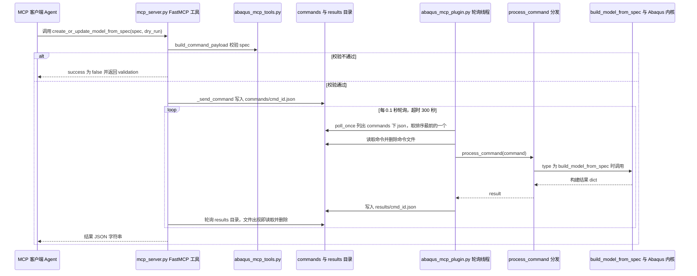

# Abaqus Agent（nellikassa566-ops/abaqus-agent）

## 一句话定义

Abaqus Agent（nellikassa566-ops/abaqus-agent）是以自然语言描述驱动 Abaqus 建模、网格、边界、提交作业和结果提取。

## 英文缩写速查

| 缩写 | 英文全称 | 简要说明 |
|------|----------|----------|
| FEA | Finite Element Analysis | 有限元分析工作流 |
| FEM | Finite Element Method | 有限元离散求解方法 |
| V&V | Verification and Validation | 数值验证与模型确认 |

## 为什么重要

对 CAE 自动化而言，代理能否稳定完成任务，取决于工程步骤是否清楚、工具边界是否明确、结果是否保留可审查证据。以自然语言描述驱动 Abaqus 建模、网格、边界、提交作业和结果提取；文章将它列为零散项目，仓库自述也覆盖脚本生成、执行与报错修复。

## 核心原理

**项目自身范围：** AI agent workflow for Abaqus finite-element modeling and job execution.

**工作流：** 用户提出仿真任务后生成 Abaqus 脚本、运行求解、提取结果并根据错误迭代修复。

## 工程实践

1. 从目标问题识别所需的 Skill、MCP、CLI 或软件接口，不把指导文件当成求解器。
2. 依照仓库 README 检查安装前提、软件/许可证、输入文件和输出证据。
3. 小规模运行并逐项核对几何、网格、边界、求解状态和物理量，再决定是否扩大任务。

文章所述的项目特征：以自然语言描述驱动 Abaqus 建模、网格、边界、提交作业和结果提取；文章将它列为零散项目，仓库自述也覆盖脚本生成、执行与报错修复。

## 局限与风险

运行需要本地 Abaqus 与许可证；自动修复不能证明载荷、材料、约束和结果解释正确。

源码状态核验：该 GitHub 仓库于 2026-10-07 可公开访问。仓库 API 报告许可证为 MIT。 

## 源码运行时序图

入口分两端：Python 3 侧 `python mcp_server.py`（FastMCP 的 `mcp.run()`）；Abaqus/CAE 侧在 Abaqus 中 `execfile("abaqus_mcp_plugin.py")` 后调用 `mcp_start()`（或菜单 Plug-ins -> MCP -> Start MCP）。下图以 `create_or_update_model_from_spec(dry_run=false)` 为例，展示一次工具调用经文件 IPC 到 Abaqus 内核的路径。

图依据：nellikassa566-ops/abaqus-agent@9ea7e10，`mcp_server.py`（_resolve_mcp_home、_send_command、create_or_update_model_from_spec）、`abaqus_mcp_tools.py`（build_command_payload 签名）、`abaqus_mcp_plugin.py`（poll_once、process_command 分发段、_mcp_thread_loop、_start_worker）、`abaqus_plugins/mcp_control/mcp_control_plugin.py`、`README.md`（启动步骤）；未运行代码。

## 关联页面

- [CAE / CFD 代理工具项目总览](../overview/cae-cfd-agent-skills-landscape.md)
- [Abaqus Agent Skills](./1348109517-abaqus-agent-skills.md)

## 参考来源

- [公众号文章原始资料归档](../../sources/blogs/wechat_cae_cfd_agent_skills_2026-10-07.md)
- [GitHub 仓库资料归档](../../sources/repos/nellikassa566-ops-abaqus-agent.md)
- [nellikassa566-ops/abaqus-agent 官方仓库](<https://github.com/nellikassa566-ops/abaqus-agent>)

- 源码核对（2026-11-02）：nellikassa566-ops/abaqus-agent@9ea7e10，读过 `README.md`、`mcp_server.py`、`abaqus_mcp_tools.py`（函数签名）、`abaqus_mcp_plugin.py`（轮询、分发与启动相关段）、`abaqus_plugins/mcp_control/mcp_control_plugin.py`；时序图依据以上文件，未运行代码。

## 推荐继续阅读

- [项目 README](<https://github.com/nellikassa566-ops/abaqus-agent/blob/main/README.md>)