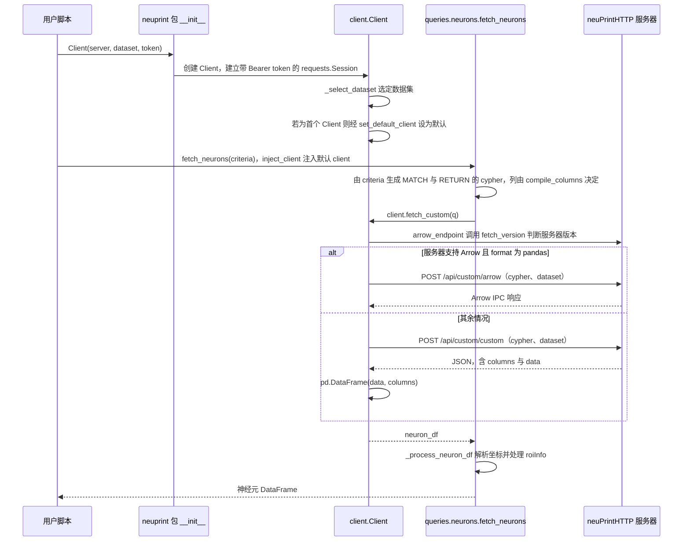

# neuPrint

**neuPrint** 是 HHMI Janelia 提供的 **连接组图数据库与交互查询服务**（https://neuprint.janelia.org/），支持按细胞类型、连接模式与 ROI 检索神经元及突触邻接，并嵌入 [Neuroglancer](./neuroglancer.md) 做 3D 可视化。程序化访问通过开源客户端 **[neuprint-python](https://github.com/connectome-neuprint/neuprint-python)** 完成。

## 英文缩写速查

| 缩写 | 英文全称 | 简要说明 |
|------|----------|----------|
| API | Application Programming Interface | REST 查询接口 |
| ROI | Region of Interest | 神经纤维网室等解剖分区 |
| CNS | Central Nervous System | 中枢神经系统 |
| JSON | JavaScript Object Notation | API 响应格式 |
| GPU | Graphics Processing Unit | 浏览器端 Neuroglancer 渲染 |

## 为什么重要

- **图查询而非体素遍历：** 直接查询「A 类型 → B 类型」邻接，避免自建 TB 级图索引。
- **多数据集统一入口：** 托管 [Male CNS](./male-cns-connectome.md)（`male-cns:v1.0`）、FlyWire 导出等。
- **Python 生态：** `fetch_neurons` / `fetch_adjacencies` 与 [navis](https://github.com/navis-org/navis) 衔接形态分析。

## 核心信息

| 字段 | 内容 |
|------|------|
| 服务 | https://neuprint.janelia.org/ |
| Python 客户端 | https://github.com/connectome-neuprint/neuprint-python |
| 文档 | https://connectome-neuprint.github.io/neuprint-python/docs/ |
| 安装 | `pip install neuprint-python` 或 `conda install -c flyem-forge neuprint-python` |
| 授权 | 需注册账号获取 API token |

## 工程实践

```python
from neuprint import Client, fetch_neurons, fetch_adjacencies

client = Client(
    "https://neuprint.janelia.org",
    dataset="male-cns:v1.0",
    token="<your-token>",
)
neurons, roi_dist = fetch_neurons("DNge104")
out_edges, meta = fetch_adjacencies("DNge104")
```

- **Token 获取：** 登录 neuPrint → 按 [quickstart 文档](https://connectome-neuprint.github.io/neuprint-python/docs/quickstart.html#client-and-authorization-token) 复制 token。
- **批量导出：** 大规模离线分析优先 [Male CNS download 页](https://male-cns.janelia.org/download/) Feather 表，避免 API 限流。
- **R 用户：** `neuprintr`（natverse）或 Male CNS 推荐的 `malecns` 包。

## 局限与风险

- **托管服务依赖：** 无自托管 neuPrint 服务端开源替代时，需依赖 Janelia 在线可用性。
- **Token 管理：** 脚本中勿提交 token；CI 用环境变量注入。
- **数据集版本：** `dataset=` 字符串须与发布版本一致（如 `male-cns:v1.0`）。

## 源码运行时序图

本仓库是 Python 客户端库，没有命令行入口。典型入口为用户脚本中 `from neuprint import Client, fetch_neurons`，先创建 `Client(server, dataset, token)`，再调用查询函数；下图以 `fetch_neurons(criteria)` 为例。



图依据：connectome-neuprint/neuprint-python@c0fa554，`neuprint/__init__.py`（导出）、`neuprint/client.py`（inject_client、Client.__init__ 与 _select_dataset、_fetch、fetch_custom、arrow_endpoint 段）、`neuprint/queries/neurons.py`（fetch_neurons、_process_neuron_df 签名）、`README.md`；未运行代码。

## 关联页面

- [Male CNS Connectome](./male-cns-connectome.md)
- [Neuroglancer](./neuroglancer.md)
- [果蝇连接组工具栈](../concepts/fly-connectomics-stack.md)

## 参考来源

- [neuPrint 服务归档](../../sources/sites/neuprint.md)
- [neuprint-python 仓库](../../sources/repos/neuprint-python.md)

- 源码核对（2026-11-02）：connectome-neuprint/neuprint-python@c0fa554，读过 `README.md`、`neuprint/__init__.py`、`neuprint/client.py`（部分）、`neuprint/queries/neurons.py`（fetch_neurons 段）；时序图依据以上文件，未运行代码。

## 推荐继续阅读

- [neuprint-python Quickstart](https://connectome-neuprint.github.io/neuprint-python/docs/quickstart.html)
- [navis neuPrint 教程](https://navis-org.github.io/navis/generated/gallery/4_remote/tutorial_remote_00_neuprint/)
