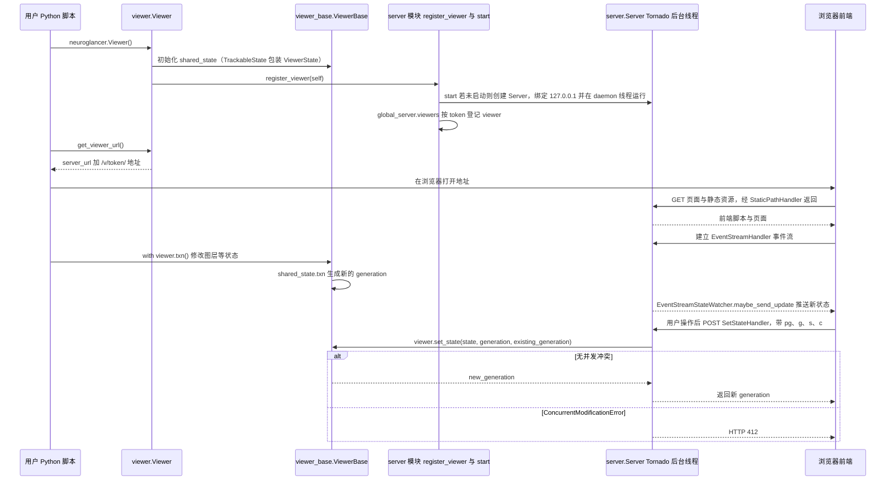

# Neuroglancer

**Neuroglancer** 是 Google 开源的 **WebGL 体数据可视化客户端**（Apache-2.0），可显示任意朝向的截面、3D mesh 与 skeleton。它 **纯前端运行**，通过 HTTP 读取远程数据，被 [Male CNS](./male-cns-connectome.md)、[FlyWire](./flywire.md)、[neuPrint](./neuprint.md) 等 **嵌入为默认 3D 视图**。

## 英文缩写速查

| 缩写 | 英文全称 | 简要说明 |
|------|----------|----------|
| WebGL | Web Graphics Library | 浏览器 3D 图形 API |
| EM | Electron Microscopy | 电子显微镜体数据 |
| ROI | Region of Interest | 可叠加的分割或注释层 |
| HTTP | Hypertext Transfer Protocol | 远程数据访问协议 |
| GPU | Graphics Processing Unit | 浏览器端加速渲染 |

## 为什么重要

- **连接组事实标准查看器：** FlyEM 公开数据几乎均以 **precomputed** 格式 + Neuroglancer 链接分发。
- **多源统一：** 同一 UI 可读 precomputed、N5、Zarr、[DVID](./dvid.md)、BOSS、NIfTI 等。
- **零后端部署：** 研究者只需托管数据 URL，无需自建 VTK 桌面应用。

## 核心信息

| 字段 | 内容 |
|------|------|
| 仓库 | https://github.com/google/neuroglancer |
| 文档 | https://neuroglancer-docs.web.app |
| Demo | https://neuroglancer-demo.appspot.com |
| 许可 | Apache-2.0 |
| Male CNS 示例 | [预加载场景](https://neuroglancer-demo.appspot.com/#!gs://flyem-male-cns/v1.0/male-cns-v1.0.json) |

## 工程实践

```bash
pip install neuroglancer
python -m neuroglancer  # 本地启动查看器
```

- **四窗格交互：** 3 个正交截面 + 1 个 3D 视图；`Shift+拖拽` 平移截面，`h` 查看快捷键。
- **Python 内嵌：** `neuroglancer.Viewer()` 可在 Jupyter 中挂本地 numpy 体数据并自动生成 mesh。
- **读 GCS 公开桶：** URL 形如 `precomputed://gs://flyem-male-cns/...`；亦可用 `cloud-volume` 在 Python 侧切块。

## 局限与风险

- **非官方 Google 产品：** 维护节奏依赖社区与 Google 贡献者。
- **WebGL 要求：** 需 WebGL 2.0 + `EXT_color_buffer_float`；远程桌面或无 GPU 环境可能失败。
- **大体积延迟：** TB 级数据仍受网络与 tile 缓存限制；离线分析应配合 DVID / 本地 precomputed。

## 源码运行时序图

入口：Python 脚本中 `import neuroglancer` 后执行 `viewer = neuroglancer.Viewer()`，再用 `viewer.get_viewer_url()` 或打印 viewer 取得浏览器地址（`python/neuroglancer/viewer.py`）。前端页面由内置 Tornado 服务器提供静态资源，状态同步走事件流与 POST 接口；下图据此展开，未展开 `src/` 下 TypeScript 前端的内部实现。



图依据：google/neuroglancer@b792051，`python/neuroglancer/__init__.py`（导出）、`python/neuroglancer/viewer.py`（_ViewerHelper、Viewer、get_viewer_url）、`python/neuroglancer/viewer_base.py`（ViewerBase 的 shared_state、set_state、txn）、`python/neuroglancer/server.py`（Server、start、register_viewer、StaticPathHandler、EventStreamHandler、SetStateHandler）；未运行代码。

## 关联页面

- [DVID](./dvid.md) — 原生数据源之一
- [Male CNS Connectome](./male-cns-connectome.md) — 典型预置场景
- [果蝇连接组工具栈](../concepts/fly-connectomics-stack.md)

## 参考来源

- [Neuroglancer 仓库归档](../../sources/repos/neuroglancer.md)

- 源码核对（2026-11-02）：google/neuroglancer@b792051，读过 `python/neuroglancer/__init__.py`、`viewer.py`、`viewer_base.py`（部分）、`server.py`（部分）；时序图依据以上文件，未运行代码。

## 推荐继续阅读

- [Neuroglancer Gallery](https://neuroglancer-docs.web.app/gallery/index.html)
- [precomputed 格式说明](https://github.com/google/neuroglancer/tree/master/src/datasource/precomputed)
