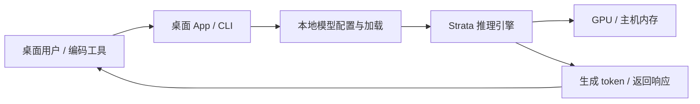
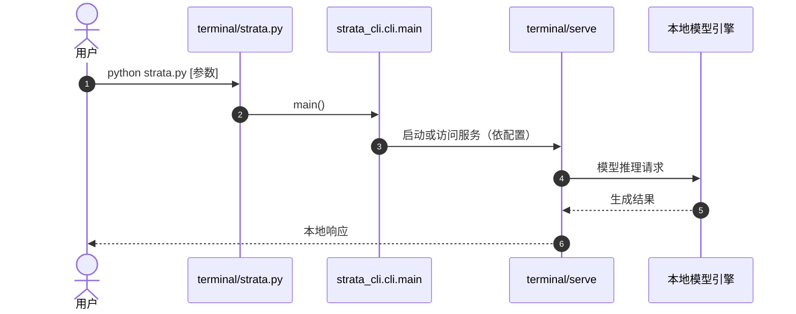

# Strata（Niko1221）：个人电脑本地模型推理

官方项目：[Niko1221/Strata](https://github.com/Niko1221/Strata) · [官网中文页](https://www.stratat.com/zh)。本页专指**本地推理引擎**，不指 STRATA 论文或同名记忆服务器。

## 一句话定义

在个人 Windows/Linux/macOS 电脑部署本地模型，向桌面聊天和编码工具提供推理能力，而非提供 Agent 的自动化调度或持久经验库。
## 英文缩写速查

| 缩写 | 英文全称 | 简要说明 |
|---|---|---|
| LLM | Large Language Model | 由推理引擎执行的语言模型 |
| GPU | Graphics Processing Unit | 运行模型计算的显卡处理器 |
| CLI | Command-Line Interface | 终端运行入口 |
| API | Application Programming Interface | 向本地编码工具公开模型服务 |

## 为什么重要

个人 Agent 若希望减少对远程 API 的依赖，需要可在本机启动、供聊天和编码工具调用的模型推理服务。Strata 专注模型加载与推理，和长期记忆库、浏览器自动化或任务调度属于不同软件层，选型时应分别验证。

## 技术结构

- 官方 README 支持本地桌面应用、终端安装、模型选择与编码工具接入。
- `terminal/strata.py` 的 Python 入口委托给 `strata_cli.cli.main`；`terminal/serve/` 是服务目录。项目按平台和硬件提供具体引导。
- 官方网站截至 2026-11-20 标示 v0.2.16；宣传速度或显存需求只对相应型号与量化设置有效。

## 流程总览

## 源码运行时序图

已阅读官方 `terminal/strata.py` 入口，未运行推理：

其中 CLI 对服务的具体调度依参数而变化；入口委托是源码可直接确认的，后续链路按官方项目结构表达，不能作为逐函数调用追踪。

## 工程实践与局限

模型支持列表、显存/内存与吞吐随发行版变化；必须在目标硬件实测。Strata 自身不会凭空获得浏览器控制、主动任务或长期记忆能力，需外接 Agent 运行时。注意模型量化、许可证及本地 API 暴露范围。

## 关联页面

- [Coding Agent 验证闭环](../methods/coding-agent-verification-loops.md) — 本地推理模型可作为编码 Agent 的模型端，最终代码正确性仍由测试验证。
- [Claude Code 动态工作流](../methods/claude-code-dynamic-workflows.md) — 任务级多 Agent 编排与 Strata 模型推理是不同层，可组合但不能混为一谈。
- [PolyStrata 本地多引擎推理](polystrata-local-inference.md) — 对部分模型复用该引擎。
- [Linger（SimplexAI）](linger-simplexai.md) — 推理后端上层的代理应用。
- [Agent 记忆与 dreaming](../concepts/agent-memory-and-dreaming.md) — 明确推理系统与记忆子系统的区别。

## 参考来源

- [官方 GitHub 源码归档](../../sources/repos/niko1221-strata.md)
- [Strata 官方站点归档](../../sources/sites/stratat-local-inference.md)

## 推荐继续阅读

- [官方安装指南入口](https://github.com/Niko1221/Strata) · [官网](https://www.stratat.com/zh)。
