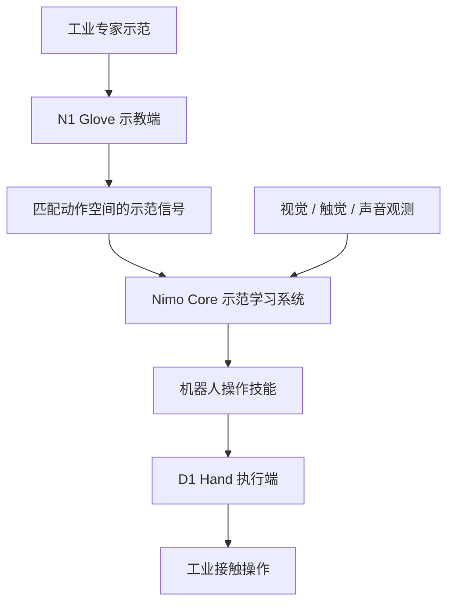

# Nimo Robotics｜N1 Glove × D1 Hand 接触感知灵巧操作（Contact-Aware Dexterity）

## 一句话定义

**Nimo Robotics** 的官方首发系统将 **N1 Glove** 人类示教接口、**D1 Hand** 机器人执行端与 **Nimo Core** 学习系统组合，试图利用**匹配的运动学/外观及视觉、触觉、声音**来缩短人类专家示范至工业机器人接触操作技能的距离。以下是**厂商发布方案**，不是已独立复现的训练算法或性能报告。

## 英文缩写速查

| 缩写 | 英文全称 | 简要说明 |
|---|---|---|
| DoF | Degrees of Freedom | 官方称手指动作空间含 9 个独立驱动自由度 |
| UMI | Universal Manipulation Interface | 厂商用来描述人–机示教界面的技术类别 |
| IL | Imitation Learning | 根据专家示范学习机器人动作策略的技术范畴 |
| SFP | Small Form-factor Pluggable | 二次转述提及的连接器装配示例，尚未获官方演示逐项核实 |

## 为什么重要

- **遮挡下的末端接触可观测性：** 连接器、齿轮或紧配合件进入最后装配阶段时，相机可能看不到接触点；触觉和声音能提供潜在互补信号，但必须验证传感器与策略是否真正使用这些信号。
- **降低跨本体示范映射成本：** 官方强调 N1 与 D1 外观、运动学匹配及 9 个手指主动 DoF，以紧凑动作空间减少示教到执行的映射差异；未披露映射误差或训练样本效率的量化结果。
- **从展示动作到工业验收：** 厂商目标是示教、训练、验证、部署一天完成；工程上必须分别核对时间口径、任务复杂度、成功率、重复性和安全接触力。

## 核心信息

| 维度 | 当前证据与边界 |
|---|---|
| 发布方 | Nimo Robotics（官方首发于 2026-11-18） |
| 示教端 / 执行端 | **N1 glove / D1 hand**（官方命名） |
| 机器人手指自由度 | 官方自述 **9 个独立驱动 finger DoF**；详细机械布局待核对 |
| 运动映射 | 厂商强调相近运动学与外观，以降低人–机 embodiment gap |
| 学习系统 | **Nimo Core**；从示范中结合视觉、触觉和声音学习技能 |
| 感知例子 | 官方举例：连接器卡入时的声音可辅助识别接触事件 |
| 任务到上线 | **一天**是官方提出的目标，未提供实测分布与验收报告 |
| 测试计划 | 官方首发开放 20 名研究者/开发者 beta 名额 |
| 可复现资源 | 暂无已核实的官方可运行代码、公开模型权重或训练数据入口 |

## 核心原理

### 已公开的系统思路

- **示教与执行硬件对齐：** 专家使用 N1 Glove 示范，D1 Hand 对应执行；厂商宣称保持外观与运动学一致，从而缩小动作表征的跨本体差异。
- **多模态接触证据：** Nimo Core 使用视觉、触觉和声音。声音对连接器「卡入」事件的价值是官方举例，而非已公开的音频消融实验。
- **学习与落地：** 官方表述是示范生成技能、再训练验证部署的整体目标；尚无公开模块接口、网络结构、损失函数和评测协议。

### 项目流程总览（官方首发所支持的方案级关系）

> 图仅表达官方声明的系统级输入、学习和执行关系，**不代表可复现的软件实现、时间同步协议或已验证在线控制数据流**。

## 工程实践

以连接器插入 / 卡扣装配为验收对象，建议做如下**工程评估**（并非官方公布的测试）：

1. **定义闭环动作接口：** 实测 N1 到 D1 的关节映射、标定偏差、动作限位与碰撞安全，明确「9 个主动 DoF」和机器人整手关节数的差异。
2. **验证接触信号：** 将视觉、接触力/触觉、音频分别记录；在遮挡、背景噪声、空插和未完全卡入等条件下，检查接触事件误报和漏报。
3. **定量评价：** 固定工件公差与初始姿态，记录每个任务的训练数据量、示范采集时长、训练耗时、部署耗时、连续成功率、峰值接触力及失败恢复。
4. **交叉消融：** 对比 vision-only、vision+touch、vision+audio、完整三模态；若没有统一测试协议，不能将系统愿景换算成性能提升百分比。

## 源码运行时序图

**暂不适用：** 未取得 Nimo 官方可运行训练/部署源码、脚本入口和模块实现；现阶段不绘制虚构的源码时序图。

## 局限与风险

- **首发帖通读、技术资料未公开：** 已通过两份完整转发交叉核对 Nimo 官方 2026-11-18 首发帖全文，故本页作为**首发方案资料梳理**标为 complete；但官方 X 直链返回 403、官网抓取失败，尚未观看完整发布视频或取得技术规格、实验原始记录。**内容健康度只衡量本页首发帖证据与阅读骨架，不代表官方技术已完整披露或评测已复现。**
- **型号混淆：** 网络二次转述用「CAP Glove / DEX Hand」，官方首发使用 **N1 glove / D1 hand**；目前没有证据证明是正式更名或同款型号。
- **未证实的技术参数：** 「Interaction Episode」、力 2 kHz、音频 48 kHz、20+ 项工业操作及三手指细节，当前仅来自二次叙述，未从官方技术原文确认。
- **没有可审计的评测指标：** 一天部署属于官方目标；未见独立实验的成功率、操作次数、训练预算和长期可靠性报告。
- **开源边界：** 本轮未找到确认属于 Nimo Robotics 的代码、论文和权重；并不推断其永远不会公开。

## 关联页面

- [机器人操作 Manipulation](../tasks/manipulation.md) — 工业精细装配任务归属
- [遥操作 Teleoperation](../tasks/teleoperation.md) — 人类示教接口与动作数据来源
- [模仿学习 Imitation Learning](../methods/imitation-learning.md) — 从专家示范学习策略
- [Contact-Rich Manipulation](../concepts/contact-rich-manipulation.md) — 接触任务与视觉盲区
- [Tactile Sensing](../concepts/tactile-sensing.md) — 接触事件的局部物理观测
- [视触融合](../concepts/visuo-tactile-fusion.md) — 跨模态融合方法
- [接触丰富操作纵深路线](../../roadmap/depth-contact-manipulation.md)
- [具身数据纵深路线](../../roadmap/depth-embodied-data.md)

## 参考来源

- [Nimo 官方首发完整转发记录 A（保留官方原帖作者）](https://zamantika.com/profile/TheHumanoidHub)
- [Nimo 官方首发完整转发记录 B（保留官方原帖作者）](https://teapawt.net/wangzhangup)
- [Nimo Robotics 2026-11-18 官方首发证据与核对边界](../../sources/sites/nimo-robotics-launch-2026.md)
- [Nimo Robotics 官方首发声明（X）](https://x.com/Nimo_Robotics/status/2123144261344592269)
- [Nimo Robotics 官网](https://nimobot.ai/)

## 推荐继续阅读

- [Nimo 官方 90 秒发布视频索引（指向原帖）](https://whatships.com/videos/nimo-robotics/)
- [数据手套 vs 视觉遥操作](../comparisons/data-gloves-vs-vision-teleop.md) — 将此厂商方案放入采集接口选型维度
